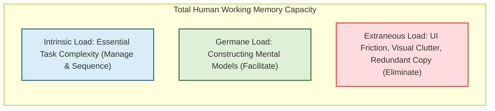

# Cognitive Load Theory & Visual Perception in Interface Design

Interfaces serve as a translation bridge between human mental models and machine execution. When an autonomous agent builds a user interface, it must optimize for human cognitive bandwidth.

---

## 1. Cognitive Load Theory (CLT)

Coined by cognitive psychologist John Sweller, Cognitive Load Theory establishes that human working memory is severely limited in both capacity and duration. In interface design, cognitive load divides into three distinct categories:

### 1.1. Intrinsic Load (Inherent Difficulty)
- **Definition**: The irreducible complexity of the objective itself (e.g. configuring cryptographic access policies, diagnosing crawler cluster anomalies, or comparing genetic variant effects).
- **Agent Rule**: You cannot eliminate intrinsic load without removing functional capability. Instead, **manage and sequence it**. Break multi-parameter tasks into staged vertical steps (wizards, contextual disclosures) so the operator processes only one sub-problem at a time.

### 1.2. Extraneous Load (Interface Waste)
- **Definition**: The mental effort wasted decoding a poorly organized interface: scanning across misaligned controls, reading verbose instruction text, deciphering low-contrast labels, or hunting for buried actions.
- **Agent Rule**: **Drive extraneous load to zero**. Every unneeded border, every redundant helper paragraph, and every unaligned control taxes working memory without contributing to task completion.

### 1.3. Germane Load (Mental Model Construction)
- **Definition**: The mental processing dedicated to integrating new information into long-term memory schemas (e.g. learning how a status badge color maps across the entire platform).
- **Agent Rule**: **Reinforce germane schemas through strict consistency**. When a green badge indicates "Healthy" in one view, never use green for "Informational" or "Staged" in another.

---

## 2. Working Memory Limits: The 4-Chunk Boundary

While George Miller originally proposed the $7 \pm 2$ rule for one-dimensional items, modern cognitive science (notably Nelson Cowan) demonstrates that active visual working memory holds only **$4 \pm 1$ distinct informational chunks** at any single moment.

### The Agent View Overpopulation Failure
When an agent renders a view containing 12 standalone filter dropdowns, 8 stat cards, 6 action buttons, and a dense table simultaneously, it demands that the user juggle over 20 discrete cognitive targets. This produces:
1. **Saccadic Exhaustion**: The user's eyes dart across the viewport searching for relevance.
2. **Decision Paralysis (Hick's Law inflection)**: The time required to select an action increases dramatically.
3. **Loss of Task Context**: The user forgets the original intent while navigating the interface chrome.

### Mitigation: Visual Chunking
Chunking groups individual data points into unified cognitive units. A card containing an avatar, name, role, and status pill is parsed by the brain as **one chunk**, not four:

| Raw Unchunked Items ($N = 12$) | Chunked Cognitive Presentation ($N = 3$) |
| :--- | :--- |
| Node ID, IP address, Port, Status, CPU %, RAM %, Disk %, Current Lease, Job ID, Started At, Finished At, Actions | 1. **Identity & State**: Node badge + Status pill 2. **Telemetry Gauge**: Combined resource utilization bar 3. **Active Work**: Job lease card with contextual action |

---

## 3. Gestalt Principles of Perceptual Organization

The human visual cortex organizes visual stimuli before higher-order cognitive processing begins (pre-attentive processing, $<200\text{ ms}$). Interfaces that align with Gestalt principles are comprehended instantly without reading.

### 3.1. Law of Proximity (Spatial Closeness)
Objects placed near each other are perceived as a functional group. Space is the primary structural mechanism:
$$\text{Gap}_{\text{intra-group}} \le \frac{1}{2} \cdot \text{Gap}_{\text{inter-group}}$$
- **Rule**: If inputs within a fieldset have an `8px` gap, the separation between fieldsets must be at least `16px` to `24px`. Violating this ratio turns the layout into visual noise.

### 3.2. Law of Common Region (Enclosure)
Elements enclosed within a shared boundary or background surface are perceived as belonging together, overriding proximity alone.
- **Rule**: Use subtle surface elevation or a muted background fill (`bg-surface-elevated` or `bg-zinc-900/50`) to group related controls instead of drawing heavy borders or writing a container header.

### 3.3. Law of Similarity
Elements that share visual attributes (color, shape, typography, sizing) are assumed to have identical behavior.
- **Rule**: All primary submit buttons must share the exact same background token and typography. Never style a secondary navigation link to look like an action button.

### 3.4. Law of Continuity & Alignment
The eye follows continuous lines and paths. Stray alignment edges create visual friction.
- **Rule**: Align controls to shared leading and trailing edges. Every unaligned margin or stray indent forces an extra eye fixation.

### 3.5. Law of Closure & "Peeking"
The brain completes incomplete shapes. This enables **implicit progressive disclosure**:
- **Rule**: When building horizontal carousels or scrollable trays, allow the next item to peek `16px–32px` past the viewport edge. The truncated shape signals additional content without requiring a verbose label ("Scroll right to view more").

### 3.6. Law of Figure-Ground
The visual system separates interactive foreground elements from passive background canvas.
- **Rule**: Use layered transparent drop shadows (`box-shadow`) to lift modals, popovers, and floating toolbars above the content canvas, rather than heavy opaque strokes.

---

## 4. Pre-Attentive Visual Processing: Designing for Instant Comprehension

Human vision processes certain visual properties in parallel across the entire visual field before conscious attention is engaged:

| Visual Property | Optimal UI Application | Anti-Pattern / Abuse |
| :--- | :--- | :--- |
| **Spatial Position** | Placing primary actions in predictable corners or leading edges | Scattering action buttons across different card quadrants |
| **Size & Weight** | Primary headings ($24\text{px}$ bold) vs metadata ($13\text{px}$ regular) | Making metadata bold or matching heading size |
| **Color Value / Contrast** | High-contrast accent color reserved strictly for primary CTA | Coloring every badge, icon, and card header with different hues |
| **Enclosure** | Selected state highlighted via subtle tinted container | Adding multiple nested border boxes around simple text |
| **Orientation / Shape** | Directional chevrons ($\vee / >$) indicating expandable state | Static text: "Click here to expand the following options" |

### The "Squint Test" Verification
When auditing an interface, blur your vision or zoom out to 25%:
- Can you immediately identify what is interactive and what is static?
- Does the most important action or piece of data stand out as the dominant focal point?
- If the interface dissolves into a gray soup or a kaleidoscope of competing colors, the visual hierarchy has failed.
