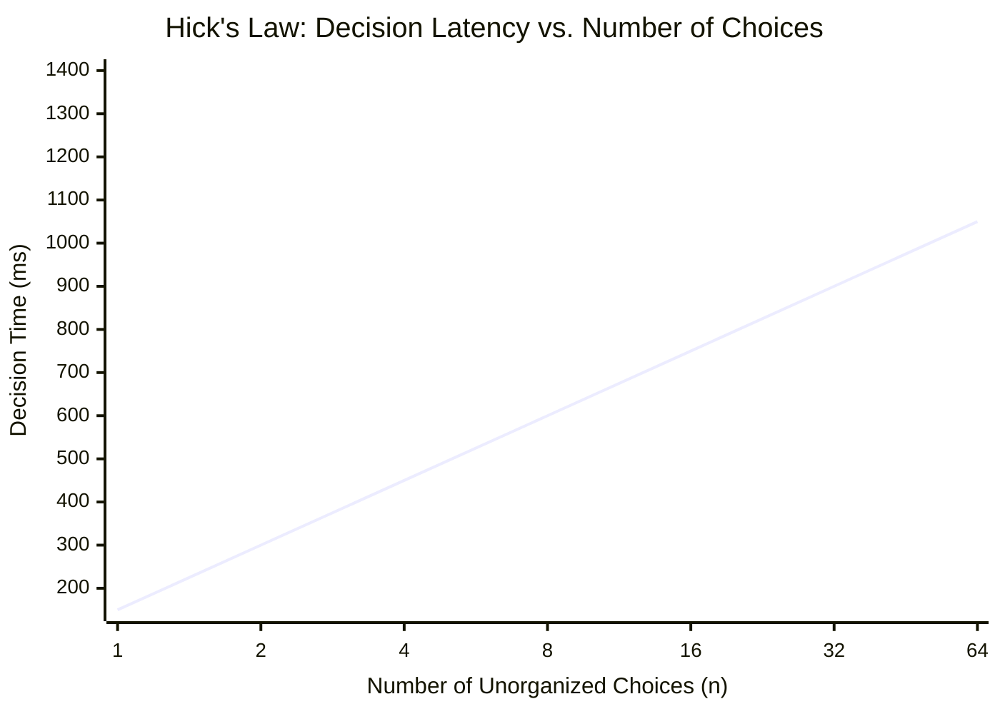

# Interaction Laws, Affordances, and Signifiers

Physical products have tactile form: a knob physically affords twisting; a recessed handle affords pulling. In digital software, screens are flat sheets of glass and pixels. Every interaction depends entirely on **signifiers**—perceivable clues that tell the user where and how an interaction can occur.

---

## 1. Affordance vs Signifier

Coined by perceptual psychologist James J. Gibson and popularized in design by Don Norman, understanding the difference between affordance and signifier is critical for agent UI design:

| Concept | Definition in Digital Systems | Concrete Example |
| :--- | :--- | :--- |
| **Affordance** | What is computationally possible between the user and the system. | A database record *can* be deleted; a form *can* be submitted; a table row *can* be expanded. |
| **Signifier** | The perceivable visual, tactile, or audible signal indicating *where* and *how* the action is taken. | A trash icon button; a high-contrast primary button with an active hover state; a chevron rotating $90^\circ$ on click. |

### The Digital "Norman Door"
A "Norman Door" is a design failure where signifiers contradict affordances (e.g. a flat plate on a door that must be pulled). In software created by autonomous agents, digital Norman Doors manifest frequently:

```
[ Norman Door Anti-Patterns ]
✖ A clickable card styled with flat borders, static cursor (cursor: default), and no hover elevation.
✖ A button styled identically to a static metadata badge (e.g., both use rounded gray pill containers).
✖ A horizontal scrolling row with items cut off exactly at container boundaries, leaving zero peeking.
✖ A toggle switch whose active track color matches the inactive background.
✖ A text field that uses light gray placeholder text as its only label, vanishing on focus.
```

### Self-Evident Signifiers
To eliminate Norman Doors, agents must apply explicit, multi-sensory signifiers:
1. **Interactive Cursor**: Always ensure interactive elements set `cursor: pointer`.
2. **Surface Depth Shift**: Elevate interactive cards on hover using layered transparent shadows (`shadow-sm` $\rightarrow$ `shadow-md`).
3. **Resting vs Active State Contrast**: Active toggles, selected tabs, and pressed buttons must have unambiguous contrast ($>3:1$ against surface background).
4. **Directional Glyphs**: Use carats, chevrons, and arrows ($\vee, >, \rightarrow$) strictly to signify expansion or transition.

---

## 2. Hick's Law: Taming Decision Time

Formulated by William Edmund Hick and Ray Hyman, Hick's Law models the time it takes for a person to make a decision as a function of the number of possible choices:

$$T = b \cdot \log_2(n + 1)$$

Where:
- $T$ is the total reaction / decision time.
- $n$ is the number of equiprobable choices.
- $b$ is an empirical cognitive constant (typically $\sim 150\text{–}200\text{ ms}$).



### Implications for Agent Interface Design
When an interface presents 32 unorganized links or options, the user experiences significant cognitive latency ($\approx 1050\text{ ms}$) simply scanning and choosing.

### Mitigation Strategies:
1. **Categorical Hierarchies**: Grouping 32 items into 4 distinct semantic categories drops the cognitive search from $n=32$ to two sequential decisions of $n=4$ and $n=8$, reducing visual search time by more than $50\%$.
2. **Default / Recommended Paths**: Highlighting the standard path ("Recommended" badge or pre-selected radio option) short-circuits the formula by providing an immediate anchor.
3. **Progressive Disclosure**: Reveal only top-level actions immediately; tuck secondary or specialized tools behind an "Advanced" drawer or popover.

---

## 3. Fitts's Law: Ergonomics and Target Acquisition

Formulated by Paul Fitts, this law predicts the time required to rapidly move to a target area based on distance and target size:

$$T = a + b \cdot \log_2\left(\frac{2D}{W}\right)$$

Where:
- $T$ is the movement time to acquire the target.
- $D$ is the distance from the starting cursor / touch position to the target center.
- $W$ is the effective width/size of the target along the axis of motion.
- $\log_2\left(\frac{2D}{W}\right)$ is the **Index of Difficulty** ($ID$).

```mermaid
flowchart LR
    Start["Cursor / Thumb Starting Point"] -->|Distance (D)| Target["Interactive Target (Width: W)"]
    style Target fill:#dff0d8,stroke:#3c763d,stroke-width:2px;
```

### Strategic Applications for Agents:

#### 1. Minimum Hit Areas
Never equate the visible pixel size of an icon with its hit target. 
- **Touch / Mobile**: Minimum $44 \times 44\text{px}$ touch target.
- **Desktop**: Minimum $40 \times 40\text{px}$ hit target ($32 \times 32\text{px}$ in dense data tables).
- **Implementation Recipe**: If an icon is $16 \times 16\text{px}$, expand its hit target using an invisible pseudo-element:
```css
.icon-btn {
  position: relative;
  width: 16px;
  height: 16px;
}
.icon-btn::before {
  content: "";
  position: absolute;
  top: 50%;
  left: 50%;
  transform: translate(-50%, -50%);
  min-width: 44px;
  min-height: 44px;
}
```

#### 2. Minimizing Distance ($D$): Proximity to Context
Do not place row-level actions $1200\text{px}$ away on the far-right corner of a widescreen monitor while the user scans row text on the left.
- **Pattern**: Anchor contextual actions directly next to the cursor, active row, or selected item (e.g. floating selection bars, right-click popovers, or row hover buttons).

#### 3. Screen Edges as Infinite Targets
On desktop, the edges and corners of the screen have an effective width $W = \infty$ because the cursor cannot overshoot the physical monitor boundary. Pinning global navigation or primary drawer triggers to the absolute edge optimizes acquisition speed.

---

## 4. The Steering Law: Avoiding Nested Flyout Menus

An extension of Fitts's Law (the Accot-Zhai Steering Law) models the difficulty of moving a pointer through a constrained physical tunnel of length $s$ and width $W$:

$$T = a + b \cdot \int_{C} \frac{ds}{W(s)}$$

### Why Deep Cascading Menus Fail
Multi-level flyout menus (e.g. Menu $\rightarrow$ Submenu $\rightarrow$ Sub-submenu) force the user to navigate a narrow corridor without moving the mouse outside the bounding box. If the cursor slips by even $2\text{px}$, the entire submenu collapses.

### Agent Directive:
- **Never build multi-level hover flyout menus**.
- Replace cascading hover menus with:
  1. **Clickable Popover Menus** that lock open until dismissed.
  2. **Categorized Command Palettes** (`Cmd+K`).
  3. **Inline Expandable Accordions**.

---

## 5. The Doherty Threshold: Real-Time Flow & Pacing

In 1982, Walter J. Doherty and Aravind J. Thadani established that human-computer interaction flow is maintained when the system feedback loop occurs in **less than 400 milliseconds**:

| Latency Window | User Perception & UX Impact | Required System Behavior |
| :--- | :--- | :--- |
| **$< 100\text{ ms}$** | Perceived as **instantaneous**. | Tactile feedback (button depression `scale(0.96)`, toggle switch slide). |
| **$100\text{–}300\text{ ms}$** | Perceived as **direct response**. | Micro-transitions (modal open, drawer slide, icon cross-fade). |
| **$300\text{–}1000\text{ ms}$** | User senses a **delay** but stays focused. | Display inline loading skeleton or subtle progress indicator. |
| **$> 1000\text{ ms}$ ($> 1\text{s}$)** | User loses flow; mental context degrades. | Full skeleton state, progress percentage, or non-blocking async background job. |
| **$> 10000\text{ ms}$ ($> 10\text{s}$)** | User abandons task or assumes error. | Asynchronous notification or background task queue with status polling. |

### Tactical Agent Rule:
Never permit a state mutation to fire without an immediate ($<100\text{ms}$) visual acknowledgment. Even if the network call takes $800\text{ms}$, depress the button immediately and render an optimistic state or spinner.
