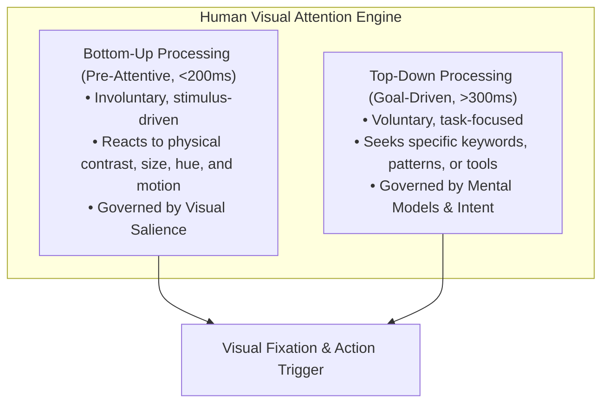
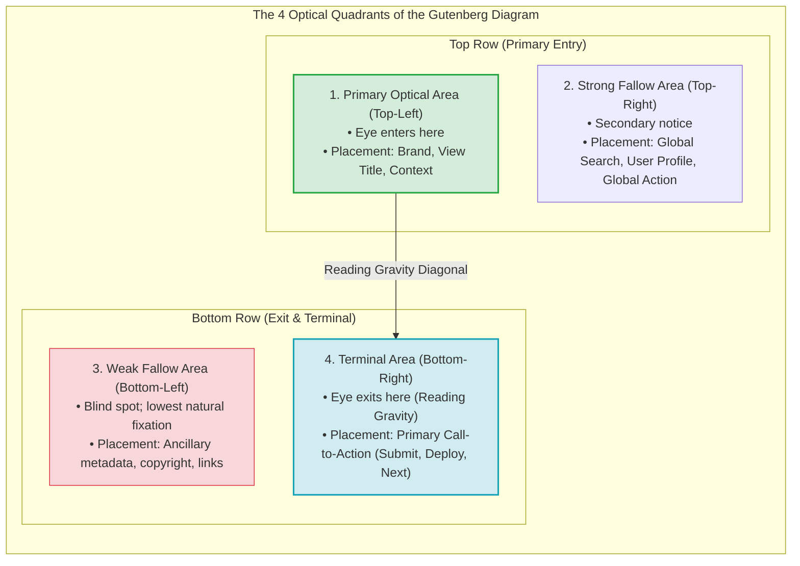

# Visual Salience, Eye-Tracking Scan Patterns & Attention Flow

Human vision does not process a screen sequentially like a computer reading a file line-by-line. Instead, the human eye performs rapid, discontinuous ballistic jumps (**saccades**) separated by brief pauses (**fixations**, $\approx 200\text{–}300\text{ ms}$) where visual information is extracted.

When autonomous agents design interfaces, they must understand how human vision scans space so they can guide attention to the correct focal points rather than scattering eyes across unstructured layouts.

---

## 1. Top-Down vs Bottom-Up Visual Processing

Human perception relies on two concurrent neurological mechanisms:



- **Bottom-Up Processing (Salience-Driven)**: Involuntary neurological response. If a screen is 95% dark gray, and one element is a bright saturated emerald green, the eye fixates on that green point automatically before the conscious mind evaluates what it is.
- **Top-Down Processing (Task-Driven)**: Conscious search. An operator looking for "Node Health" scans headings, labels, and familiar spatial locations based on long-term memory schemas.
- **The Design Objective**: Align bottom-up salience with top-down goals. The most visually salient element on the screen **must** be the most important task target. If an irrelevant decorative badge or banner has the highest contrast, human attention is derailed.

---

## 2. Standard Eye-Tracking Scan Patterns

Extensive eye-tracking research (notably by the Nielsen Norman Group) demonstrates that users rarely read interface copy word-for-word. Instead, their eyes follow predictable scan patterns dictated by the page layout and their immediate task goals.

### 2.1. The F-Pattern (Dense Content & Data Tables)
Common on text-dense documentation, articles, and multi-column data views:
1. **Top Bar Scan**: The eye sweeps horizontally across the upper section of the content area.
2. **Left Margin Drop**: The gaze drops down the left margin and scans a second, shorter horizontal bar.
3. **Vertical Margin Trace**: The gaze flows straight down the leading left edge of the content, scanning initial words and icons.

```
[ The F-Pattern Heatmap ]
████████████████████████ (Long top scan)
██████████
██████████████           (Shorter second scan)
█████
█████                    (Vertical left margin drop)
███
```

#### Implications for Agents:
- **Front-Load Value**: Place critical keywords, node IDs, and primary status signifiers in the first two words of labels and in the leftmost columns of data tables.
- **Never Bury Core Signals in the Middle**: Placing a status badge in column 6 of an 8-column table guarantees it will be missed during an F-scan.

---

### 2.2. The Gutenberg Diagram & Reading Gravity
Formulated by typography pioneer Arthur Turnbull and Russell Baird, the Gutenberg Diagram describes the natural sweep of the eye across a uniformly distributed display:



#### Strategic Placement by Quadrant:
- **Top-Left (Primary Optical Area)**: Immediate context. Name the workspace, active project, and core operational state.
- **Top-Right (Strong Fallow)**: Navigation anchors, search triggers, and non-blocking secondary filters.
- **Bottom-Left (Weak Fallow)**: The cognitive dead zone. Never place primary submit buttons or urgent status alerts in the bottom-left corner.
- **Bottom-Right (Terminal Area)**: The ultimate destination of reading gravity. Place the primary submit, continue, or execution button here.

---

### 2.3. The Z-Pattern (Landing & Overview Pages)
For minimal, visual-first pages with sparse text (login screens, initial setup screens, dashboard overviews):
1. **Top Sweep**: Gaze moves from top-left (logo) to top-right (actions/nav).
2. **Diagonal Slash**: Gaze cuts diagonally across the center canvas, scanning the dominant visual element.
3. **Bottom Sweep**: Gaze moves across the lower bar, terminating at the primary action button on the bottom right.

---

## 3. Visual Salience Tools: How to Guide Attention

To deliberately pull the human eye away from passive scanning toward an intentional focal point, designers modulate **salience dimensions**:

| Salience Dimension | High Salience (Focal Magnet) | Low Salience (Subdued Canvas) | Agent Rule |
| :--- | :--- | :--- | :--- |
| **Luminance Contrast** | High contrast ($>7:1$ against surface) | Low contrast ($2.5:1$ to $4:1$) | Reserve high luminance contrast strictly for primary CTAs and active states. |
| **Hue Saturation** | Vibrant semantic accent (Emerald, Crimson) | Muted neutral tones (Zinc, Slate, Grayscale) | Never colorize multiple unrelated cards with different saturated background hues. |
| **Whitespace Halo** | Element surrounded by generous isolation padding | Elements packed closely into tight grids | Surround the primary focal element with negative space to amplify its importance. |
| **Scale & Mass** | Large display typography ($24\text{–}32\text{px}$ bold) | Metadata captions ($12\text{–}13\text{px}$ regular) | Maintain strict typographic step intervals (e.g. $1.25\times$ or $1.333\times$ scale). |
| **Visual Isolation** | A single floating toolbar or pill | A dense wall of 20 bordered boxes | A solitary element on an elevated layer commands immediate fixation. |

---

## 4. The Monochromatic 90/10 Discipline

A classic hallmark of poorly engineered agent interfaces is the **"Rainbow Dashboard"**:
- Blue headers, purple cards, yellow filter badges, green metrics, orange tags, and red buttons all shouting for attention simultaneously.
- Result: **Zero visual salience**. When everything is emphasized, nothing is emphasized.

```
[ Monochromatic Pixel Allocation ]

┌────────────────────────────────────────────────────────┐
│ 90% of Viewport: Grayscale & Dark Surface Neutrals     │
│ (bg-zinc-950, bg-zinc-900, text-zinc-100, text-zinc-400│
│                                                        │
│   ┌──────────────────────────────────────────────┐     │
│   │ Card Surface (bg-zinc-900/50, border-white/5)│     │
│   │                                              │     │
│   │ Metric: 1,420 rps    Latency: 24 ms          │     │
│   │                                              │     │
│   │ 10% Saturated Accent: [ Start Node ] (Emerald│     │
│   └──────────────────────────────────────────────┘     │
└────────────────────────────────────────────────────────┘
```

### The 90/10 Rule:
1. **90% Neutral Grayscale**: 90% of all pixels must consist of neutral dark or light surface tones (slate, zinc, or OKLCH neutrals). Structural grouping and hierarchy must be 100% understandable in pure grayscale.
2. **10% Semantic Color**: Saturated color is strictly rationed for:
   - Primary action / conversion target (1 accent color across the view).
   - Real-world semantic status:
     - **Emerald / Green**: Success, healthy, active lease.
     - **Amber / Yellow**: Degraded, warning, latency spike.
     - **Rose / Red**: Critical failure, destructive deletion, blocked lease.
3. **The Grayscale Litmus Test**:
   - If an interface cannot be navigated, parsed, or understood when viewed in black-and-white, its visual hierarchy is defective. Color was being used as a crutch to compensate for inadequate spacing, weight, and layout.
