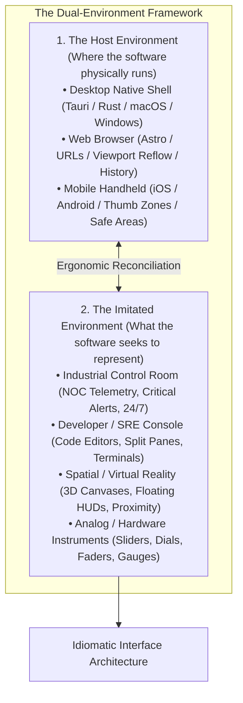
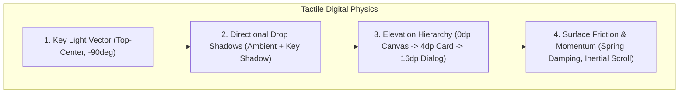

# Environmental Context, Platform Idioms & Simulated Realities

Interfaces do not exist in an abstract digital vacuum. Every piece of software runs inside a specific **host environment** (a desktop operating system, a browser tab, a mobile handheld, an embedded console) and frequently seeks to **imitate a domain environment** (an analog audio console, an industrial control room, a physical workspace, or a spatial HUD).

When autonomous agents design user interfaces, they often succumb to the **"Lowest Common Denominator" trap**—building generic, flat web interfaces that ignore the conventions, physical affordances, and material idioms of the host or simulated environment.

This document formalizes **Environmental Ergonomics**, **Idiomatic Platform Conventions**, **Material Surfaces and Simulated Realities**, and **Contextual Hardware Sensing**.

---

## 1. The Dual-Environment Framework

Every interface must be evaluated across two distinct environmental axes:



### 1.1. The Host Environment (The Container)
The container dictating physical user inputs, screen boundaries, and operating system expectations:
- **Desktop Shell (Tauri 2 / Electron / Native OS)**: Relies on high-precision mouse tracking, keyboard shortcuts (`Cmd+K`, `Ctrl+S`), multi-window capabilities, persistent sidebars, and native titlebar/traffic light controls.
- **Web Browser (Astro / Svelte / React)**: Relies on URL-based routing (bookmarkable state), browser history (`Back`/`Forward`), text selection, standard zoom levels, and responsive reflow.
- **Mobile Handheld (Touchscreens)**: Governed by thumb reach zones, edge-swipe back navigation, dynamic island / notch safe areas (`env(safe-area-inset-*)`), and touch targets ($44 \times 44\text{px}$).

### 1.2. The Imitated Environment (The Domain Metaphor)
The mental model the user brings from their specialized profession or real-world practice:
- A network engineer monitoring crawler clusters expects a **Network Operations Center (NOC)** idiom: high density, monochromatic base, high-contrast status dots, and live streaming metrics.
- A graphic artist expects a **Creative Studio** idiom: floating panels, infinite canvas pan/zoom, and canvas-first prominence.
- An audio technician expects **Physical Instrument** idioms: faders with logarithmic decibel scales, rotary potentiometers, and tactile meter bridges.

---

## 2. Idiomatic Platform Conventions vs The Generic Trap

When cross-platform codebases (like Svelte, React, or Tauri) compile to multiple targets, agents often generate "chameleon slop"—interfaces that look like web pages pretending to be apps, or desktop apps clumsily formatted like giant mobile phones.

| Interaction Paradigm | Desktop Native Idiom | Modern Web Idiom | Mobile Handheld Idiom | Agent Anti-Pattern to Avoid |
| :--- | :--- | :--- | :--- | :--- |
| **Window Frame & Chrome** | Custom native titlebar with OS window controls (minimize, maximize, close); system tray integration. | Clean browser viewport; relies on browser back/forward and address bar. | Edge-to-edge content; honors notch and home indicator safe areas. | Building fake browser URL bars inside a desktop native shell. |
| **Primary Navigation** | Collapsible vertical left sidebar (`w-16` to `w-64`); persistent multi-pane split view. | Top horizontal navigation bar or left drawer; deep URL routing. | Bottom navigation tab bar (3–5 items) within easy thumb reach. | Forcing a bottom mobile tab bar onto a $34\text{-inch}$ desktop monitor. |
| **Secondary Inspection** | Resizable sliding side inspector or floating dockable panel. | Slide-out Sheet (`Drawer`) or dedicated sub-route. | Bottom sheet sliding up from bottom edge ($50\%\text{–}90\%$ screen height). | Spawning a tiny, fixed $300\text{px}$ desktop popover on a smartphone screen. |
| **Context Menus** | Right-click custom context menu anchored to cursor coordinates. | Standard browser context menu or explicit three-dot (`⋮`) trigger. | Long-press gesture triggering haptic tap and bottom action sheet. | Requiring right-click on touch devices without a visible three-dot button. |
| **Data Manipulation** | Dense data table with keyboard row navigation (`ArrowUp`/`Down`) and column resizing. | Filterable data grid with pagination or virtualized infinite scroll. | Stacked list cards with swipe micro-actions (left: archive, right: bookmark). | Rendering a 12-column unscrollable data table on a mobile viewport. |

---

## 3. Environmental Skeuomorphism & Material Surfaces

The historical debate between hyper-realistic **skeuomorphism** (glossy 2008 leather and beveled glass) and **flat design** (2013 borderless, depthless minimalism) has evolved into **Modern Material Realism**.

### 3.1. The Physics of Digital Materials
Modern interfaces treat pixels as a physical material existing in 3D space with **mass, friction, light, and elevation**:



1. **Light and Elevation**:
   - Interfaces assume a consistent virtual light source positioned above the screen.
   - Elements with higher elevation cast dual-layer shadows: a diffuse ambient shadow (representing ambient room light) and a crisp directional shadow (representing key light).
   - Never place inconsistent light vectors on the same screen (e.g. one card casting a shadow to the right, and an adjacent button casting a shadow to the left).
2. **Concentric Curvature**:
   - Materials nested within one another share concentric radii: $\text{Radius}_{\text{outer}} = \text{Radius}_{\text{inner}} + \text{Padding}$. This mimics how physical materials bend and nest without pinching corners.
3. **Simulated Tactile Resistance**:
   - When pulling or dragging an element past its boundary (pull-to-refresh or swipe actions), apply physical tension ($d^{0.75}$ power dampening). Physical materials resist deformation; digital controls must feel like they have mass.

---

## 4. Contextual Hardware Sensing & Ambient Adaptation

An intelligent interface adapts dynamically to the physical ambient environment of the human operator:

### 4.1. Ambient Lighting & High Contrast (`forced-colors`)
1. **Dark vs Light Adaptation (`prefers-color-scheme`)**:
   - Dark surfaces (`bg-zinc-950`) reduce ocular fatigue in dimly lit control rooms, nighttime developer sessions, and OLED battery consumption.
   - Light surfaces (`bg-slate-50`) enhance readability in high-glare environments (direct sunlight, brightly lit offices).
2. **High-Contrast System Mode (`forced-colors: active`)**:
   - Users with visual impairments enable OS-level forced contrast.
   - **Agent Rule**: When `forced-colors: active` is detected, CSS background colors and box shadows are stripped by the operating system. You **must** provide explicit $1\text{px}$ borders (`border: 1px solid transparent` or `border: 1px solid ButtonText`) so controls do not vanish into the canvas.

### 4.2. Display Capabilities & Refresh Rate
1. **$120\text{Hz}$ ProMotion vs $60\text{Hz}$ Panels**:
   - High-refresh displays expose animation stutter. If JavaScript animates layout properties (`height`, `width`, `top`), frame drops are immediately perceptible at $120\text{Hz}$.
   - Restrict animations strictly to GPU compositor layers: `transform: translate3d(...)` and `opacity`.
2. **Safe Area Insets (`env(safe-area-inset-*)`)**:
   - Modern mobile screens have hardware cutouts (notches, dynamic islands, rounded corners, home indicators).
   - Any fixed or sticky element at the viewport boundary must incorporate safe areas:
     ```css
     .fixed-bottom-bar {
       padding-bottom: calc(1rem + env(safe-area-inset-bottom));
       padding-left: calc(1rem + env(safe-area-inset-left));
       padding-right: calc(1rem + env(safe-area-inset-right));
     }
     ```

---

## 5. Agent Operational Directives for Host Adaptation

Before generating or refactoring interface code, an autonomous agent must execute this environmental audit:

```markdown
### Agent Environmental Audit Checklist

1. [ ] HOST DETECTION: Am I building for Desktop Native (Tauri), Web Browser, or Mobile Touch?
2. [ ] CHROME INVARIANTS: If Desktop, did I integrate native titlebars and avoid fake browser URL bars?
3. [ ] INPUT RECONCILIATION: Did I provide both pointer hover states AND visible touch alternatives?
4. [ ] MATERIAL LIGHTING: Do all shadows and elevations assume a unified top-down light vector?
5. [ ] SAFE AREAS: Are fixed headers and footers padded with `env(safe-area-inset-*)`?
6. [ ] FORCED COLORS: Do interactive cards retain transparent borders for `forced-colors: active` mode?
7. [ ] NO SLOPPY TRANSPORTS: Did I avoid porting a mobile bottom-sheet directly onto a 4K desktop monitor?
```
