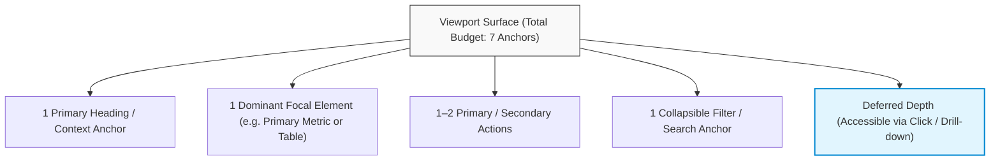

# Preventing View Bloat & Managing Information Density

One of the most persistent failure modes of AI-generated interfaces is **view overpopulation**—the uncontrolled accumulation of data fields, badges, buttons, toolbars, and filters into a single uncurated screen. 

When an agent builds an interface by dumping every schema attribute onto a layout, it forces the user into sensory overload. This document outlines architectural patterns and mathematical rules to budget visual density and protect cognitive clarity.

---

## 1. The Overpopulation Trap

### Why Agents Overpopulate Views
Agents possess total comprehension of the entire codebase, database schema, and API surface. Consequently, agents default to:
1. **Schema Exfiltration**: Exposing every table column in a single data grid because "the data is available."
2. **Action Flattening**: Rendering all create, read, update, delete, export, filter, and batch actions as persistent buttons on the primary toolbar.
3. **Explanatory Compensation**: Adding instruction boxes, tips, and paragraph descriptions to explain the resulting visual chaos.

```
[ Overpopulated View Anti-Pattern ]
┌────────────────────────────────────────────────────────────────────────┐
│ Global App Header [Search] [Profile] [Settings] [Help] [Logout]        │
├────────────────────────────────────────────────────────────────────────┤
│ ℹ Info Banner: Welcome to Nodes! Click any row to view, use filters... │
│ Filter: [Status v] [Region v] [CPU >] [RAM >] [Version v] [Date From]  │
│ Actions: [+ Add] [Batch Edit] [Delete Selected] [Export CSV] [Sync]    │
├────────────────────────────────────────────────────────────────────────┤
│ Node ID │ IP Addr │ Port │ Status │ CPU% │ RAM% │ Uptime │ ... (18 cols)│
│ #10291  │ 10.0.1.2│ 8080 │ ACTIVE │ 24%  │ 1.2G │ 14d    │ [Edit][Del]  │
└────────────────────────────────────────────────────────────────────────┘
Result: 35 distinct interactive targets competing for visual attention simultaneously.
```

---

## 2. Density Budgeting & View Hierarchy

Interfaces must be budgeted like financial resources. A single viewport tier has a finite capacity for human attention.

### 2.1. The Rule of 7 Cognitive Anchors
At any single level of visual hierarchy (the top-level page, a specific card, or an active modal), limit persistent interactive anchors to **no more than 5 to 7 elements**.



### 2.2. Surface Layering & Depth Budgeting
Depth creates structure without adding lines. Layer surfaces using elevation rather than borders:

| Layer Level | Purpose | Recommended Styling Token | Typical Content |
| :--- | :--- | :--- | :--- |
| **Layer 0 (Canvas)** | Base canvas background | `bg-zinc-950` or `bg-slate-50` | Page background, gutters |
| **Layer 1 (Card/Section)** | Content groupings | `bg-zinc-900` or `bg-white` + `shadow-sm` | Data cards, tables, forms |
| **Layer 2 (Elevated Chrome)** | Active overlays, dropdowns | `bg-zinc-800` or `bg-white` + `shadow-md` | Popovers, context menus, sticky bars |
| **Layer 3 (Modal / Focus)** | High-interruption focus | `bg-zinc-800` + backdrop scrim (`bg-black/60`) | Dialogs, destructive confirmations |

---

## 3. Whitespace as Structural Grammar

Novice interface builders separate sections using explicit `<hr>` tags or border strokes (`border-zinc-700`). Experienced designers use **whitespace ratios**.

### 3.1. The 2× Gap Ratio
Space groups first; background containers second; separator lines last and only when space alone fails.
$$\text{Gap}_{\text{inter-group}} \ge 2 \cdot \text{Gap}_{\text{intra-group}}$$

- **Inside a group** (e.g. between an input field and its label): Use `4px` to `8px`.
- **Between fields in a section**: Use `12px` to `16px`.
- **Between distinct sections**: Use `32px` to `48px`.

If the gap between two unrelated sections is identical to the gap between fields inside a section, the user cannot perceive where one concept ends and the next begins.

### 3.2. Concentric Border Radius
When nesting containers (e.g. a button inside a card, or a badge inside a list item), mismatched corner radii create visual disharmony that reads as sloppy engineering:

$$\text{Radius}_{\text{outer}} = \text{Radius}_{\text{inner}} + \text{Padding}$$

```
[ Concentric Radius Geometry ]
Outer Card: padding = 12px, inner radius = 8px
-> Outer Radius MUST be: 8px + 12px = 20px

[ Formula Check ]
✔ Correct: Outer radius 20px, Padding 12px, Inner radius 8px (Smooth concentric curve)
✖ Incorrect: Outer radius 8px, Padding 12px, Inner radius 8px (Inner corner looks pinched)
```

---

## 4. Optical Alignment vs Geometric Centering

Code places elements geometrically based on bounding boxes. The human eye evaluates visual weight.

### Common Optical Corrections:
1. **Play Triangles & Asymmetric Glyphs**: The visual mass of a triangle points toward the base. A play icon centered inside a circle by geometric pixels will always appear pushed to the left. **Nudge it optically $1\text{–}2\text{px}$ toward the point**.
2. **Icons Beside Text**: A 16px icon next to uppercase or title-case text often sits too high. Nudge it down $1\text{px}$ to align with the cap height of the typography.
3. **Pills & Badges with Numbers**: Digits like "1" have less visual width than "8". Always apply `font-variant-numeric: tabular-nums` to numbers to prevent jumpy layout shifts during dynamic updates.

---

## 5. Layout Invariants: Content Bleeds, Controls Float

When structuring screen real estate, follow these rules:

1. **Content Bleeds**: Backgrounds, charts, maps, and media extend to the edges of the container or viewport.
2. **Controls Float & Inset**:
   - Interactive buttons, form inputs, and text content must remain strictly inside layout margins (minimum $16\text{px}$ on mobile, $24\text{–}32\text{px}$ on desktop).
   - Inset primary buttons from the bottom edge on touch devices, honoring `env(safe-area-inset-bottom)`.
3. **Sticky Chrome Floats Above**:
   - Sticky navigation headers and floating action bars must float over the content layer with subtle backdrop blurs (`backdrop-blur-md bg-zinc-900/80`), never abruptly truncating content.
4. **Hold Structure Until It Breaks**:
   - Do not collapse multi-column desktop layouts into a mobile drawer simply because a generic breakpoint (e.g. `1024px`) was crossed. Collapse only when the content physically stops fitting without clipping.
