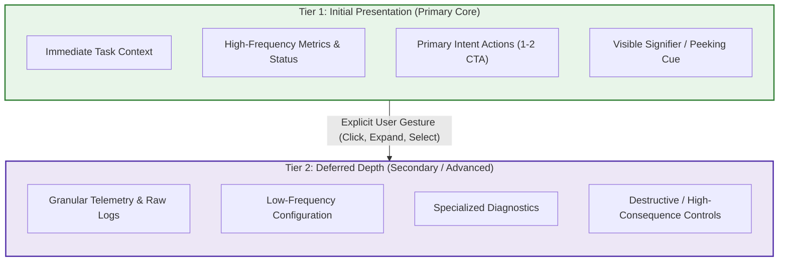
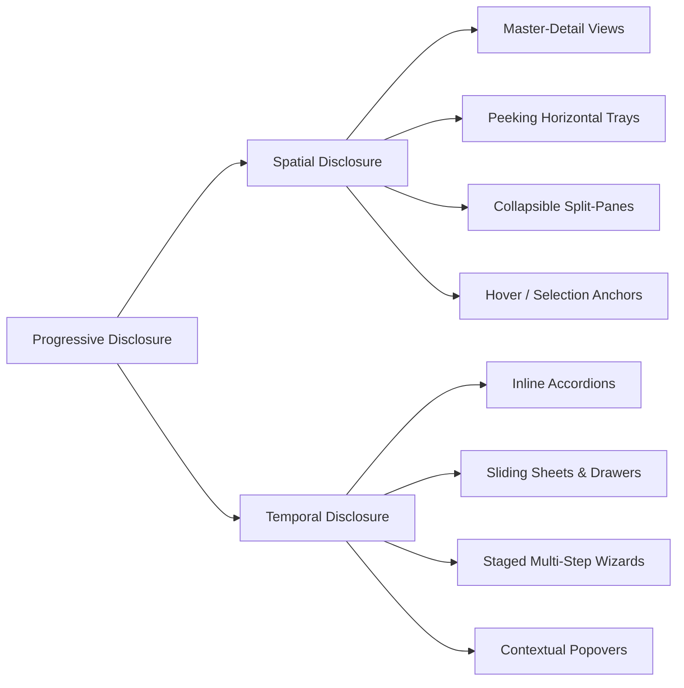
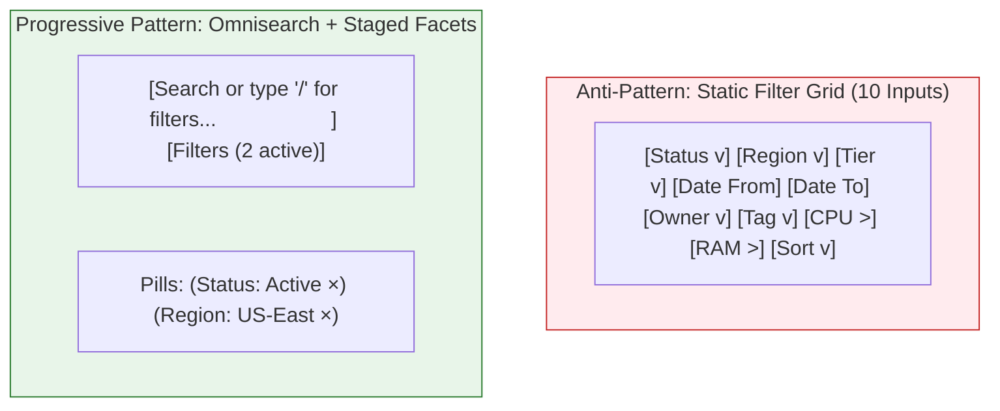

# Progressive Disclosure: Staging Information Dynamically

Progressive disclosure is an interaction design technique that defers advanced, secondary, or situational details until the user explicitly requests them or enters a relevant context.

When an artificial intelligence agent builds an interface, it must prevent the "everything-everywhere" failure mode. This document formalizes the principles, mechanics, and selection criteria for progressive disclosure.

---

## 1. Foundational Concept: Primary vs Secondary Information

Coined in interface design by Jakob Nielsen, progressive disclosure addresses the fundamental tension between feature power and interface simplicity:



### The Agent Fallacy: "The Data Exists, Therefore Show It"
Autonomous agents frequently construct views where every database field and configuration knob is rendered on first paint. This overwhelms novice users and degrades the speed of expert operators who must visually scan through irrelevant parameters.

### The Rule of Primary Core
On first paint:
1. Show **strictly what 80% of users need for 80% of tasks**.
2. Provide **unambiguous, subtle visual signifiers** pointing toward the remaining 20% of depth.
3. Keep the initial cognitive load below 4 discrete informational chunks.

---

## 2. Spatial vs Temporal Progressive Disclosure

Progressive disclosure manifests along two distinct axes: **spatial** (where content sits in the viewport) and **temporal** (when content appears across time).



### 2.1. Spatial Disclosure
Spatial disclosure uses screen geography and physical layout to hint at hidden depth without navigation:
- **Master-Detail Layout**: A list on the leading edge (30% width) controls what renders in the detail canvas (70% width). The user maintains high-level orientation while inspecting granular details.
- **Peeking Trays**: Items in a horizontal scroll row intentionally clip past the right viewport boundary by $16\text{–}32\text{px}$. The physical clipping signals that more items exist without requiring an instruction banner ("Scroll to see more").
- **Collapsible Rails**: Secondary inspectors or telemetry monitors collapse into a thin $48\text{px}$ icon bar on the trailing edge, expandable on demand.

### 2.2. Temporal Disclosure
Temporal disclosure reveals content sequentially in response to state transitions or user actions:
- **Inline Expansion (Accordions)**: Clicking a summary row reveals nested details directly beneath it, pushing downstream content downward smoothly.
- **Sliding Drawers (Sheets)**: Secondary inspection or editing workflows slide in over the main canvas from the trailing edge, keeping the parent view dimmed but visible beneath.
- **Staged Wizards**: Multi-step workflows divide 20 inputs into 3–4 logical phases, validating each step before revealing the next.

---

## 3. The Peeking Rule and Invisible Content

In human-computer interaction:
> *Content that is hidden without a perceivable visual signifier does not exist to the user.*

### The Truncation Anti-Pattern
If an agent places 10 cards in a horizontal container, and card #4 aligns exactly with the right edge of the viewport down to the pixel, the human eye perceives the container as complete. The remaining 6 cards are effectively lost.

```
[ Visual Peeking Geometry ]

✖ BAD: Perfect Container Boundary Alignment (No Peeking)
┌──────────────────────────────────────────────┐
│ [ Card 1 ]    [ Card 2 ]    [ Card 3 ]       │  <-- Looks complete; user never scrolls.
└──────────────────────────────────────────────┘

✔ GOOD: 24px Visual Peeking Past Viewport Edge
┌──────────────────────────────────────────────┐
│ [ Card 1 ]    [ Card 2 ]    [ Card 3 ]    [ C│  <-- Truncated shape triggers curiosity.
└──────────────────────────────────────────────┘
```

### Implicit Signifiers for Deferred Content
Never write prose to explain that more content exists. Instead, use these standard implicit signifiers:
1. **Geometric Truncation**: Cutting off a shape or avatar at the boundary.
2. **Directional Chevrons ($\vee, >$)**: A chevron pointing down indicates expansion; a chevron pointing right indicates navigation. Rotate the glyph $90^\circ$ upon activation.
3. **Count Badges**: A badge reading `+4 more` or `12 items` indicates the exact scale of deferred information.
4. **Faded Edge Gradients**: A subtle $24\text{px}$ CSS gradient mask fading to transparent at the scroll edge indicates overflowing content.

---

## 4. Selection Matrix: Expanding Inline vs Drawer vs New Page

When the user selects an entity or requests deeper information, which progressive disclosure container should the agent render?

| Disclosure Mechanism | When to Choose | Advantages | Disadvantages |
| :--- | :--- | :--- | :--- |
| **Inline Accordion / Row Expand** | Entity has 1–5 additional fields; reading flow is linear. | Preserves reading position; zero navigation context loss. | Pushes downstream elements down; can cause vertical jump. |
| **Side Sheet / Drawer** | Complex inspection or editing of a selected item (6–15 fields); user needs to cross-reference parent list. | Maintains background list context; ample vertical space for forms. | Obscures trailing content; requires careful backdrop handling. |
| **Hover Popover / Tooltip** | Lightweight metadata (1–3 lines, status explanation, timestamp formatting). | Zero permanent layout cost; instant dismissal. | Inaccessible on touch devices without click fallback; ephemeral. |
| **Modal Dialog** | High-consequence decision, confirmation, or self-contained mini-task requiring full focus. | Eliminates background distraction; forces decision. | High interruption; completely blocks parent interaction. |
| **Dedicated Route / Page** | Deep analytical workspace, complex multi-tab records, independent history state. | Full viewport utilization; bookmarkable URL; deep linking. | Destroys immediate parent context; requires browser navigation back. |

---

## 5. Filter & Search Progressive Disclosure

Agents frequently overpopulate search views by rendering 10 distinct dropdown filters simultaneously above a table.



### The Omnisearch + Facet Pattern:
1. **Primary State**: Single unified search input with keyboard shortcut hint (`/` or `Cmd+K`).
2. **Filter Button**: A single "Filters" button displaying an active count badge (`Filters (2)`).
3. **Active Filter Pills**: Render selected filters as dismissible pills directly beneath the search bar. This provides instant visibility into applied constraints without occupying screen space with unused filter dropdowns.
4. **Facet Sheet / Popover**: Secondary filters live inside a slide-out drawer or popover, organized by frequency of use.

---

## 6. Implementation Invariants for Autonomous Agents

1. **Limit Initial View Anchors to 7**: Count interactive targets on first render. If the total exceeds 7, group secondary controls into an "Advanced" disclosure or action menu.
2. **Never Bury Irreversible Actions Behind More than 2 Taps**: While secondary options should be deferred, emergency stops, pause controls, and immediate save actions must remain accessible within 1–2 clicks.
3. **Animate Expansion with Composited Transitions**: When expanding accordions or drawers, use CSS transitions on `opacity` and `transform` or use established layout primitives (`details`/`summary` or accessible component libraries). Never animate raw layout heights if it causes frame drops.
4. **Preserve Scroll Anchoring**: Expanding an inline element must not throw the user's viewport out of view. Use `scroll-margin-top` to ensure expanded content remains centered.
