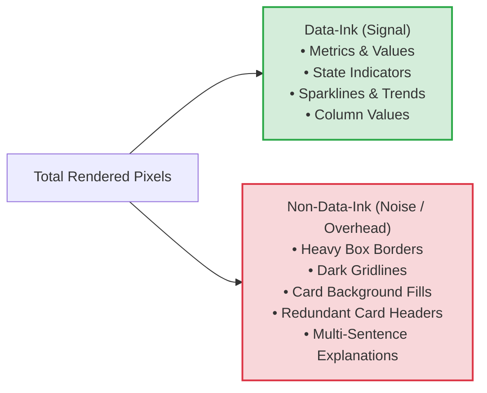
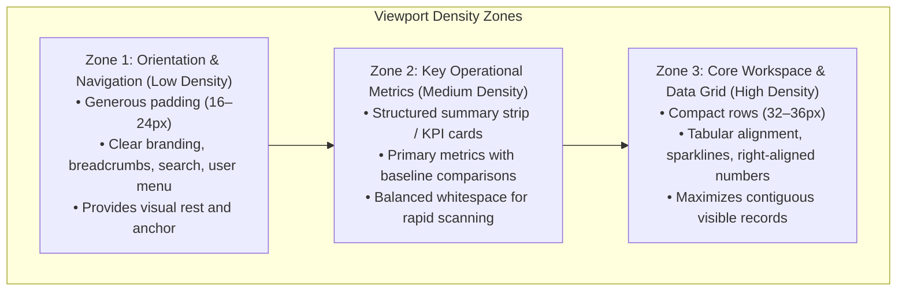

# Information Density & The Data-Ink Ratio

Information density is the quantitative measure of useful data and functional capability packed into a given screen space and time.

Autonomous agents often vacillate between two extremes: either cramming 50 unformatted data fields into a visual traffic jam, or over-spacing a dashboard with vast expanses of consumer-grade whitespace that frustrates professional operators.

This document formalizes **density budgeting, Edward Tufte's Data-Ink Ratio, density scaling tiers, and zone-based density architectures**.

---

## 1. Enterprise Density vs Consumer Whitespace

Consumer applications prioritize leisure, discovery, and brand immersion. Generous margins and large decorative imagery are acceptable because the user's primary goal is casual engagement.

Enterprise, analytical, and developer interfaces operate under fundamentally different human constraints:
- **The High-Cost Penalty of Paging**: Every time an analyst or operator must scroll down, toggle a tab, or open a sub-page to compare two numbers, working memory is taxed.
- **Simultaneous Context**: Detecting anomalies across nodes, networks, or financial logs requires seeing contiguous data points side-by-side.
- **The Power User Axiom**: Power users prefer higher information density. For an expert who spends 8 hours daily inside a tool, excessive whitespace is not "breathing room"—it is latency.

```
[ Density Comparison ]

Consumer Spacing (Low Density)
┌────────────────────────────────────────────────────────┐
│  ( Avatar )                                            │
│                                                        │
│  Crawler Node 01                                       │
│  Active status                                         │
│                                                        │
│  [ View Details ]                                      │
└────────────────────────────────────────────────────────┘
Height: 180px | Data points: 2 | Data-Ink Ratio: 0.12

Enterprise Spacing (High Density, High Organization)
┌────────────────────────────────────────────────────────┐
│ [●] node-01  10.0.1.2  US-East  24% CPU  1.2G  14d  [⋮]│
└────────────────────────────────────────────────────────┘
Height: 36px  | Data points: 7 | Data-Ink Ratio: 0.78
```

> **Crucial Distinction**: High density is about **organization and structure**, not clutter. Clutter is unorganized noise; high density is tightly structured signal.

---

## 2. Edward Tufte's Data-Ink Ratio

Coined by statistician and information design pioneer Edward Tufte (*The Visual Display of Quantitative Information*), the **Data-Ink Ratio** evaluates the efficiency of visual communication:

$$\text{Data-Ink Ratio} = \frac{\text{Data-Ink}}{\text{Total Ink Used to Print the Graphic}} = \frac{\text{Pixels strictly presenting functional data}}{\text{Total pixels rendered on the surface}}$$



### The 4 Laws of Data-Ink Maximization:
1. **Eradicate "Chart Junk" and Container Spam**: Do not wrap every individual KPI in its own bordered card with an independent shadow and header. Render metrics as clean, borderless typographic groups separated by whitespace.
2. **Subdue Structural Gridlines**: When building data tables, never use dark, high-contrast borders (`#333` on `#111`). Use ultra-subtle hairline dividers (`rgba(255,255,255,0.06)` or `oklch(0.25 0 0)`) so the eye tracks numbers, not lines.
3. **Aggressive Context-Aware Rounding**: Raw numbers clutter interfaces and slow scanning. Never display unformatted integers like `1,492,851 ops/sec` in high-level summaries. Format aggressively: `1.5M ops/sec`. Provide exact precision only on hover or granular inspection.
4. **Data-Dense Micro-Visualizations**: Replace verbose text explanations with compact inline sparklines or micro-gauges. A $48 \times 16\text{px}$ sparkline conveys 24 hours of trend history in less space than a two-word status string.

---

## 3. Zone-Based Density Architecture

A common failure of automated interface generation is applying uniform density across the entire screen. A well-designed interface divides the viewport into **three distinct density zones**:



1. **Orientation Zone (Low Density)**: Global header and primary navigation. Uses spacious padding ($16\text{–}24\text{px}$) to provide visual relief and anchor spatial memory.
2. **Synthesis Zone (Medium Density)**: KPI overview cards and primary system filters. Uses medium gutters ($12\text{–}16\text{px}$) so operators quickly parse top-level health.
3. **Execution Zone (High Density)**: Data tables, log streams, and configuration trees. Employs tight vertical spacing ($4\text{–}8\text{px}$ cell padding) to maximize visible rows per screen, eliminating the need to scroll through routine lists.

---

## 4. Density Scaling Tiers: Compact, Default, Comfortable

To accommodate varying hardware displays (laptop vs dual $4\text{K}$ monitors) and differing user proficiencies, professional enterprise interfaces implement **density scaling tiers**:

| Density Tier | Row / Control Height | Typical Typography | Optimal Use Case | Target Audience |
| :--- | :--- | :--- | :--- | :--- |
| **Compact** | `32px` (`h-8`) | `12px` (`text-xs`) | High-throughput monitoring, log inspectors, network routing tables | Power users, SREs, Financial analysts |
| **Default** | `40px` (`h-10`) | `14px` (`text-sm`) | Standard administrative tables, user management, form views | Daily operators, developers |
| **Comfortable** | `48px` (`h-12`) | `14px` / `16px` | Touch screens, tablet interfaces, executive overviews | Casual users, mobile devices |

### Technical Implementation:
Bind container density to CSS variables or Tailwind tokens:
```css
/* Density Tier Tokens */
[data-density="compact"] {
  --row-height: 2rem;       /* 32px */
  --cell-padding-y: 0.25rem; /* 4px */
  --font-size-table: 0.75rem;/* 12px */
}

[data-density="default"] {
  --row-height: 2.5rem;     /* 40px */
  --cell-padding-y: 0.5rem;  /* 8px */
  --font-size-table: 0.875rem;/* 14px */
}

[data-density="comfortable"] {
  --row-height: 3rem;       /* 48px */
  --cell-padding-y: 0.75rem; /* 12px */
  --font-size-table: 0.875rem;/* 14px */
}
```

---

## 5. Numeric Data Alignment & Contextualization

Raw numbers without alignment or comparative context generate cognitive friction.

### 1. The Right-Alignment Rule
- **Text and Identifiers**: Left-align (`text-left`) so the eye anchors on the initial letter.
- **Numbers, Latency, and Currency**: Right-align (`text-right`) so decimal points and digit places line up vertically.
- **Badges and Status Indicators**: Center (`text-center`).

```
[ Table Alignment Comparison ]

✖ BAD: Left-Aligned Numbers (Impossible to compare scale)
Latency
42 ms
1204 ms
3 ms
240 ms

✔ GOOD: Right-Aligned with Tabular Figures (Scale visible at a glance)
   Latency
     42 ms
   1204 ms
      3 ms
    240 ms
```

### 2. Tabular Numerals
Proportional figures have varying character widths (e.g. the digit "1" is significantly narrower than "8"). In dynamic tables or streaming telemetry, updating numbers causes words to jump horizontally.
- **Mandate**: Apply `font-variant-numeric: tabular-nums` (Tailwind `tabular-nums`) to all numbers, timestamps, and percentages.

### 3. Contextual Baselines: Never Show Isolated Metrics
A metric of `842 ms` is meaningless without context:
- Is 842ms normal or an emergency?
- Is it trending upward or downward?
- Always pair raw metrics with:
  1. **Comparative delta**: `+14% vs 1h ago` (colored amber or green based on polarity).
  2. **Micro-sparkline**: Indicating the trajectory over the last 30 intervals.
  3. **Threshold indicator**: Subtle semantic dot indicating healthy, warning, or critical.
