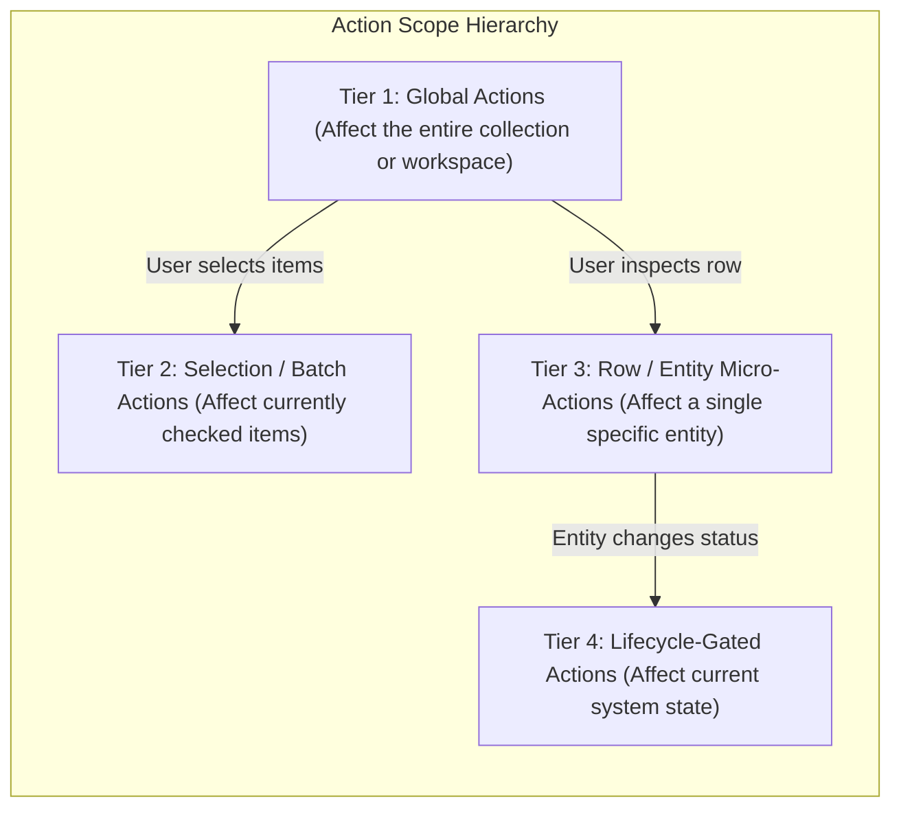
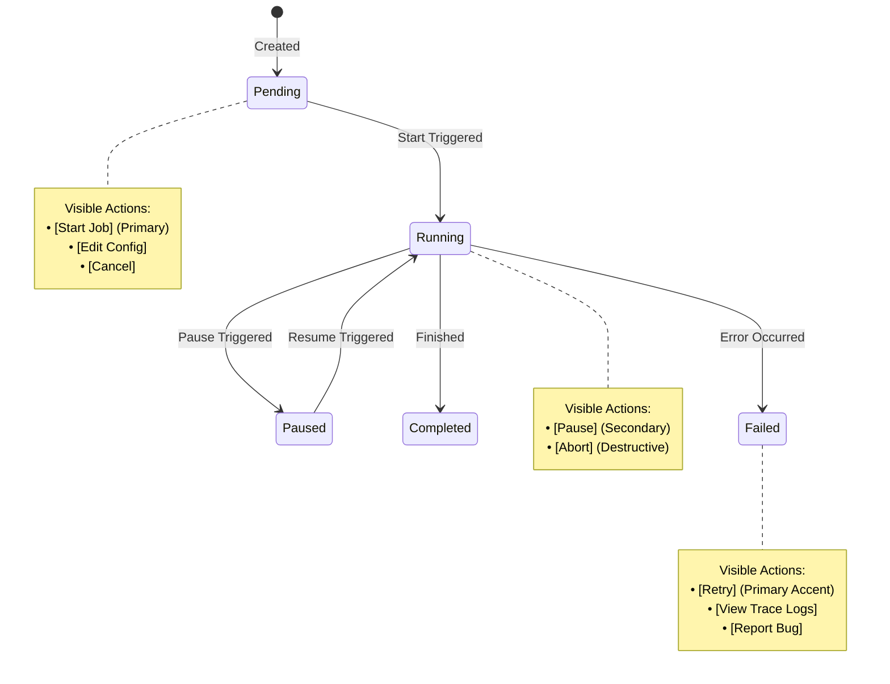

# Contextual Action Scoping: Surfacing Relevance Dynamically

Static interfaces display every possible action all the time. Sophisticated interfaces surface **strictly the actions relevant to the current entity, selection state, and operational lifecycle**.

When an autonomous agent designs an action system, it must not clutter the screen with disabled buttons or generic toolbars. This document establishes the principles and design patterns for contextual action scoping.

---

## 1. The Global Action Anti-Pattern

A hallmark of unrefined agent UI is the **Omnipresent Action Bar**:

```
[ Anti-Pattern: Static Global Toolbars ]
┌────────────────────────────────────────────────────────────────────────┐
│ [ New Item ] [ Edit ] [ Delete ] [ Export ] [ Batch Tag ] [ Sync ]     │
└────────────────────────────────────────────────────────────────────────┘
```
In this layout:
- If no row is selected, "Edit", "Delete", and "Batch Tag" are disabled or pop up an annoying toast: *"Please select an item first"*.
- If 50 rows are selected, "Edit" is disabled because only single editing is supported.
- The user is forced to mentally filter out inactive or invalid choices.

### The Contextual Action Axiom:
> *If an action cannot be executed in the current state, it should not compete for visual attention in the primary action tier.*

---

## 2. The 4 Tiers of Action Scoping

Actions must be scoped to the spatial and logical level where they operate:



| Action Tier | Scope of Effect | Optimal Spatial Position | Trigger / Visibility Condition | Examples |
| :--- | :--- | :--- | :--- | :--- |
| **Tier 1: Global** | Entire view / workspace | Top trailing corner of page header | Always visible | "Create Project", "Import CSV", "Refresh View" |
| **Tier 2: Selection / Batch** | Checked collection items | Floating bottom bar or replacing table header | Visible only when $\text{Selection Count} \ge 1$ | "Export (4)", "Assign Tag", "Delete Selected" |
| **Tier 3: Row Micro-Action** | Single row / card | Trailing edge of row, revealed on hover/focus | Visible on row hover or keyboard focus | "Copy ID", "Quick Edit", "Open Inspector" |
| **Tier 4: Lifecycle-Gated** | Single entity in specific state | Primary slot in detail inspector or card | Visible only during matching lifecycle phase | "Retry" (Failed only), "Resume" (Paused only) |

---

## 3. The Floating Selection Action Bar Pattern

When managing tabular or grid data, batch actions must not occupy permanent space in the global header. Instead, employ the **Floating Selection Bar**:

```
[ Selection Action Bar Behavior ]

State A: Zero Items Selected (Default)
┌────────────────────────────────────────────────────────────────────────┐
│ Nodes (14)           [Search nodes...]           [Filter] [+ Add Node] │
├────────────────────────────────────────────────────────────────────────┤
│ [ ] Node-01   Active    10.0.1.2   14h uptime                          │
│ [ ] Node-02   Active    10.0.1.3   12h uptime                          │

State B: 2 Items Selected (Floating Bar Appears)
┌────────────────────────────────────────────────────────────────────────┐
│ Nodes (14)           [Search nodes...]           [Filter] [+ Add Node] │
├────────────────────────────────────────────────────────────────────────┤
│ [✓] Node-01   Active    10.0.1.2   14h uptime                          │
│ [✓] Node-02   Active    10.0.1.3   12h uptime                          │
│                                                                        │
│            ┌──────────────────────────────────────────────┐            │
│            │ 2 selected  │  [Restart]  [Drain]  [Delete]  │            │
│            └──────────────────────────────────────────────┘            │
└────────────────────────────────────────────────────────────────────────┘
```

### Architectural Requirements:
1. **Zero Layout Shift**: The floating bar sits in a fixed overlay layer (`position: fixed; bottom: 24px; left: 50%; transform: translateX(-50%)`). It does not push table rows or cause content jumping.
2. **Clear Dismissal**: The bar must display the selection count and an explicit "Clear selection" or "Deselect all" escape hatch (`Escape` key shortcut).
3. **Smooth Enter/Exit**: Animate with a subtle slide-up ($12\text{px}$) and opacity crossfade ($150\text{ms}$, `ease-out`).

---

## 4. Row Micro-Actions: Fitts's Law in Data Grids

Placing row-level actions $1200\text{px}$ away on the far right of a wide desktop screen forces long mouse travel times ($D$ in Fitts's Law is high).

### Best Practices for Row Actions:
1. **Keep 1 Dominant Action Visible**: Show the most frequent single action as an explicit button or icon (e.g. "View" or "Inspect").
2. **Tuck Secondary Actions into an Overflow Menu (`...`)**: Secondary actions ("Duplicate", "Export JSON", "Audit History") belong in an attached popover menu.
3. **Reveal on Row Hover / Keyboard Focus**: In high-density tables, rendering 4 action buttons on every single row creates visual vibration. Fade in the action buttons when the user hovers over the row or focuses it with arrow keys.
4. **Accessible Hit Target**: Ensure the hover action target maintains a minimum $32 \times 32\text{px}$ hit area, even if the visible icon is $16 \times 16\text{px}$.

---

## 5. Lifecycle-Gated Action Surfacing

Software entities transition through state machines. Instead of rendering every action with disabled states, dynamically swap the primary action based on the entity's active state:



### The "Disabled vs Hidden" Heuristic:
- **Hide the Action** when:
  - The action is never applicable in this state (e.g. "Resume" on a job that is already running).
  - The user lacks administrative permissions for that capability.
  - The action belongs to a completely different mode or entity type.
- **Disable the Action (with a Tooltip Signifier)** when:
  - The action is normally available here, but a specific prerequisite is currently missing (e.g. "Submit Form" disabled because required inputs are invalid).
  - The user needs to learn *what* is blocking the action. Always accompany a disabled button with an explicit tooltip explaining the blocking condition.

---

## 6. Implementation Checklist for Agents

- [ ] Does the top-level toolbar contain only global actions?
- [ ] Are batch actions hidden until at least one item is checked?
- [ ] Do data table rows reveal secondary actions on hover/focus to reduce static visual noise?
- [ ] Are state-incompatible buttons pruned rather than rendered as mystery disabled controls?
- [ ] Is keyboard navigation supported (`ArrowUp`/`ArrowDown` to navigate rows, `Space` to select, `Enter` to open)?
