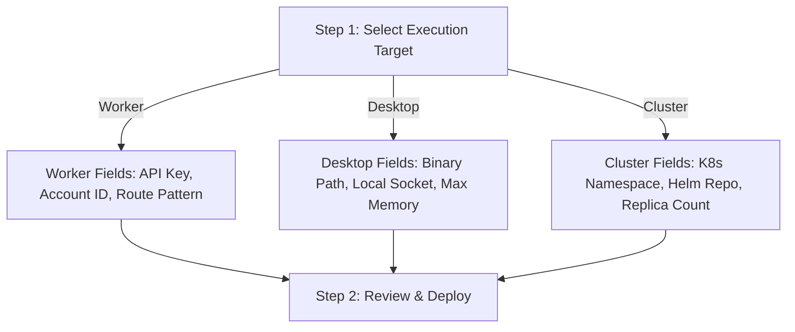

# Branching Navigation Trees & Dynamic Form Pruning

Monolithic forms and static wizards force users to parse irrelevant inputs. When an interface contains multiple operational modes, configurations, or entity types, it must use **dynamic branching trees** to prune unnecessary fields and sequence decisions.

This document outlines architectural patterns for conditional form branching, state containment, and dynamic navigation trees.

---

## 1. The Monolithic Form Trap

When an autonomous agent designs a settings or creation view, it typically inspects the backend schema and renders every potential field in a single vertical stack:

```
[ Anti-Pattern: Monolithic Unpruned Form ]
┌────────────────────────────────────────────────────────────────────────┐
│ Create Crawler Profile                                                 │
│ Type: (o) Cloudflare Worker   ( ) Desktop Node   ( ) Distributed Pod   │
│                                                                        │
│ [ Cloudflare API Key                ]                                  │
│ [ Account ID                        ]                                  │
│ [ Local Binary Path (Desktop only)  ] (Disabled)                       │
│ [ Local Port (Desktop only)         ] (Disabled)                       │
│ [ Kubernetes Namespace (Pod only)   ] (Disabled)                       │
│ [ Helm Chart Repo (Pod only)        ] (Disabled)                       │
│ [ Pod Replica Count (Pod only)      ] (Disabled)                       │
│ ... (20 more fields, 70% disabled)                                     │
└────────────────────────────────────────────────────────────────────────┘
```

### Cognitive Failure:
1. **Visual Pollution**: Over half the viewport consists of grayed-out inputs that do not apply to the chosen profile type.
2. **Validation Confusion**: The user is unsure whether disabled fields need values or whether they trigger validation failures on submit.
3. **High Extraneous Load**: The human brain must read each field label simply to determine whether it is relevant.

---

## 2. Dynamic Input Pruning

Dynamic input pruning removes irrelevant form branches from the layout entirely. The interface presents only the inputs necessary for the currently selected path.



### Architectural Principles:
1. **Branch Selection First**: Always place the discriminator choice (radio cards or segmented toggle) at the root of the form before branch-specific inputs appear.
2. **Immediate DOM Pruning**: When the user switches modes, unmount irrelevant fields immediately. Do not hide them with `opacity: 0` or leave them disabled in the DOM.
3. **Smooth Layout Transitions**: When branch fields mount or unmount, apply subtle height and opacity transitions so the form does not snap abruptly.

---

## 3. Linear Wizards vs Dynamic Branching Workflows

Choosing the appropriate multi-step pattern depends on whether the sequence is invariant or branch-dependent:

| Workflow Pattern | When to Choose | Visual Signifier | Failure Mode to Avoid |
| :--- | :--- | :--- | :--- |
| **Linear Wizard (Stepped)** | Fixed 3–4 steps; all users complete the exact same sequence in order. | Stepper indicator (`Step 1 of 4`) with completed checkmarks. | Forcing users through 6+ trivial steps (e.g. 1 input per step). |
| **Dynamic Branching Workflow** | The choices in Step 1 fundamentally alter what Step 2 and Step 3 require. | Dynamic step titles that update based on active branch selection. | Showing static step numbers when steps 3 and 4 may be skipped entirely. |
| **Inline Expandable Form** | Short sub-branches (1–3 fields) triggered by a single checkbox or toggle. | Smoothly expanding drawer or accordion directly below the toggle. | Spawning a full multi-step wizard for just two optional fields. |

---

## 4. State Containment & Preservation Across Branches

A major UX irritation occurs when a user toggles between branches and loses their entered data:

```
[ The State Loss Frustration ]
1. User selects "Worker", fills in Account ID: "cf_99420".
2. User clicks "Desktop" to see what options it offers.
3. User clicks back to "Worker".
✖ Form state wiped: Account ID is blank!
```

### State Partitioning Architecture
In component state (e.g. Svelte 5 `$state` or React state), store form values in partitioned sub-objects keyed by branch discriminator:

```typescript
// Svelte 5 Rune Example
interface FormState {
  targetType: 'worker' | 'desktop' | 'cluster';
  shared: {
    name: string;
    description: string;
  };
  branches: {
    worker: { accountId: string; apiToken: string };
    desktop: { binaryPath: string; port: number };
    cluster: { namespace: string; replicas: number };
  };
}

let form = $state<FormState>({
  targetType: 'worker',
  shared: { name: '', description: '' },
  branches: {
    worker: { accountId: '', apiToken: '' },
    desktop: { binaryPath: '/usr/local/bin/crawler', port: 8080 },
    cluster: { namespace: 'default', replicas: 3 },
  }
});
```

### Benefits:
- Switching between branches does not wipe entered values.
- Submission payloads serialize strictly `form.shared` plus `form.branches[form.targetType]`.
- Schema validators validate only the active branch, eliminating validation leaks from inactive fields.

---

## 5. Visualizing the Decision Tree

When workflows have deep branching, users need orientation without cluttered diagrams:

1. **Segmented Radio Cards with Visual Affordance**:
   - Instead of plain `<input type="radio">`, use structured interactive cards featuring an icon, a bold title, and a one-sentence discriminator.
   - Selected card: Highlight with active brand border (`border-primary`) and subtle background tint (`bg-primary/5`).
2. **Contextual Breadcrumb Pills**:
   - In deep multi-level branches, render a compact breadcrumb trail at the top of the pane: `Configuration > Worker Target > Cryptographic Keys`.
3. **Dynamic Review Step**:
   - The final step must summarize strictly the choices made along the active branch path, omitting unselected paths.

---

## 6. Implementation Checklist for Agents

- [ ] Does the discriminator selection sit above the branch-specific fields?
- [ ] Are irrelevant branch fields completely pruned from the layout rather than rendered as disabled clutter?
- [ ] Is branch state preserved in memory if the user toggles between choices during editing?
- [ ] Does validation run strictly against fields belonging to the active branch?
- [ ] Does the review step summarize only active parameters?
