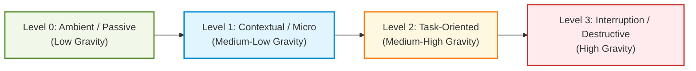
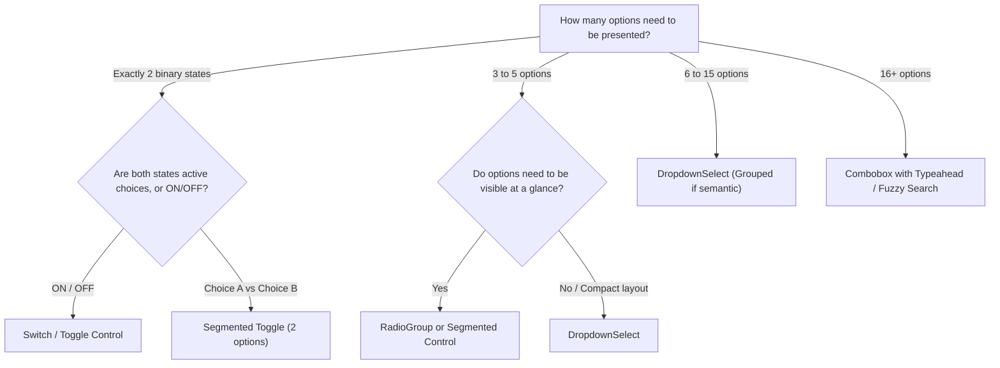

# Component-Action Selection Matrix

Autonomous agents frequently choose the wrong UI primitive for a user action. They display full-screen modal dialogs for trivial success messages, bury destructive actions inside unconfirmed popovers, or use a dropdown menu for a binary toggle.

This document formalizes a deterministic **Component-Action Selection Matrix** that maps user intent, cognitive gravity, and data scale to the exact appropriate UI primitive.

---

## 1. Action Gravity Scale

Every action in an interface possesses an intrinsic **gravity**—a measure of its interruption cost, cognitive demand, and irreversibility:

1. **Level 0: Ambient / Passive**: Status changes, background syncing, non-critical telemetry updates. Must never steal focus or interrupt typing.
2. **Level 1: Contextual / Micro**: Selecting a filter, viewing a timestamp, revealing a row menu. Anchored directly to the triggering element.
3. **Level 2: Task-Oriented**: Editing an entity (5–12 fields), configuring complex filters, inspecting deep telemetry. Requires dedicated screen real estate but benefits from maintaining parent context.
4. **Level 3: Interruption / Destructive**: Deleting database records, rotating cryptographic secrets, system restarts. Requires mandatory modal focus trap and unambiguous confirmation.

---

## 2. Intent-to-Primitive Decision Matrix

| User Intent & Scenario | Recommended Primitive | Focus & Keyboard Behavior | Dismissal Pattern | Anti-Pattern to Avoid |
| :--- | :--- | :--- | :--- | :--- |
| **Destructive / Irreversible Action** (Delete cluster, wipe data) | `AlertDialog` | Trapping focus strictly inside dialog. Default focus on "Cancel" button. | Explicit `Cancel` button click or `Escape` key. Clicking backdrop must NOT delete. | Using a silent toast or non-modal banner that can be accidentally missed. |
| **Inspect / Edit Entity** (5–15 fields, user needs to see parent list) | `Sheet` / `Drawer` (Slide-out panel from right) | Focus shifts to first input in sheet. Tab cycles within sheet. | `Escape` key, explicit close button, or clicking dimmed backdrop. | Navigating to a full-page route for a 4-field edit, losing table scroll position. |
| **Micro-Action Menu** (Duplicate, Copy ID, Export JSON) | `DropdownMenu` | Focus moves to first menu item; `ArrowDown`/`ArrowUp` navigation. | `Escape`, clicking outside, or selecting an action. | Opening a full modal dialog just to offer 3 simple choices. |
| **Contextual Definition / Help** (Explaining a complex metric or term) | `Tooltip` (or `Popover` on click) | Not keyboard focusable directly; appears on trigger focus/hover. | Pointer leave or focus loss. | Putting large paragraphs or interactive buttons inside a hover tooltip. |
| **Transient Action Feedback** ("Item copied to clipboard", "Draft saved") | `Toast` / `Snackbar` | Does NOT steal focus. Screen reader receives polite announcement (`aria-live="polite"`). | Auto-dismisses in 3–4 seconds. Optional "Undo" action. | Using a blocking modal dialog saying "Successfully Saved!". |
| **System Warning / Degraded State** (API offline, read-only mode) | `Inline Notice` / `Alert Banner` | Inline in DOM flow above affected view. | Persistent until resolved, or manual dismiss button. | Firing repeated toasts that disappear while the problem persists. |
| **Quick Filtering / Date Range** | `Popover` | Focus shifts inside popover. Supports full keyboard navigation. | `Escape` or clicking outside. | Spawning a full modal dialog for selecting a simple date range. |

---

## 3. Form Input Selection Rules: Choosing the Right Control

Agents often default to a generic `<select>` for all choices. Select controls according to option count and spatial context:

### Input Selection Rules:
1. **Never use a Dropdown for 2 choices**: A dropdown hides both choices behind a click. Use a `Switch` for boolean states (ON/OFF) or a `SegmentedControl` for mutually exclusive modes (e.g. "Table" vs "Chart").
2. **Use Radio Groups for 3–5 items when comparison matters**: If users need to read options side-by-side to choose (e.g. pricing plans or node roles), keep them visible with radio cards.
3. **Add Typeahead Search when options exceed 15**: Scrolling through a 50-item raw select list is an ergonomic failure. Use a searchable `Combobox`.

---

## 4. Destructive Action Engineering

When an action causes data loss or downtime:

### 1. The Verb-Specific Button Rule
A destructive confirmation dialog must never say "OK" and "Cancel":
- **Bad**: `[ OK ]` and `[ Cancel ]` (The user must read the paragraph to know what OK does).
- **Good**: `[ Delete 3 Nodes ]` (Destructive Red) and `[ Keep Nodes ]` (Neutral Gray).

### 2. High-Consequence Double Gates
For catastrophic, non-recoverable operations (e.g. deleting a production database or revoking master credentials):
1. **Require Typed Confirmation**: Present an input requiring the user to type the exact entity name:
   > *To confirm, type `prod-crawler-us-east` below:*
2. **Keep the Confirm Button Disabled**: The submit button remains disabled until the exact string matches case-sensitively.
3. **Default Focus to Cancel**: When the dialog opens, focus must land on the `Cancel` button, never the destructive button.

---

## 5. Overlay Positioning & Layer Budgeting

When stacking interactive overlays, enforce a deterministic `z-index` scale:

| Surface Layer | `z-index` Token | Purpose |
| :--- | :--- | :--- |
| **Base Surface** | `z-0` | Standard page content, data grids, cards |
| **Sticky Chrome** | `z-10` | Sticky headers, floating search bar, table column headers |
| **Floating Action Bar** | `z-20` | Batch selection toolbar |
| **Dropdown / Popover** | `z-30` | Context menus, filter popovers |
| **Slide-out Sheet** | `z-40` | Side drawers and inspectors |
| **Modal Dialog** | `z-50` | Blocking dialogs and alert confirmations |
| **Toast Notifications** | `z-60` | Global transient toasts (must float above modals) |

---

## 6. Implementation Checklist for Agents

- [ ] Is an `AlertDialog` used for all destructive operations?
- [ ] Are transient success updates sent to a non-blocking `Toast` rather than a modal dialog?
- [ ] Are binary choices rendered as a `Switch` or `SegmentedControl` instead of a dropdown?
- [ ] Does every confirmation button specify the exact action verb (`Delete Project` vs `OK`)?
- [ ] Is focus trapped properly inside open dialogs and sheets?
- [ ] Does pressing `Escape` reliably dismiss the topmost overlay layer?
