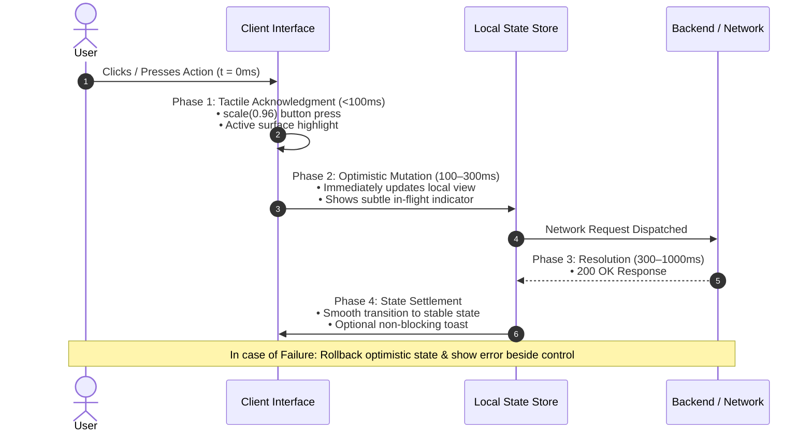
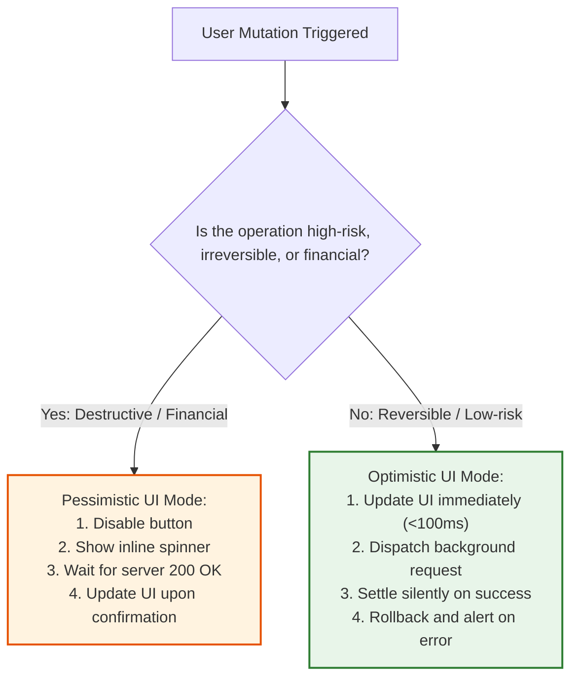

# Feedback Loops, State Orchestration & Tactile Response

Software is experienced through its responsiveness. A static interface that clicks without tactile acknowledgement feels sluggish, broken, or unresponsive, even if backend execution succeeds.

This document establishes the **4-Phase Feedback Loop**, latency thresholds, optimistic UI orchestration, and tactile motion physics required for agent-crafted interfaces.

---

## 1. The 4-Phase Interaction Feedback Loop

Every state-altering interaction must progress through four sequential phases:



### Phase 1: Physical / Tactile Acknowledgment ($< 100\text{ ms}$)
- **The Rule**: Never wait for the network to confirm a click.
- **Visual Mechanics**: Depress the button using `scale(0.96)` and shift background tint slightly. The user immediately receives physical proof that the interaction was captured.

### Phase 2: Optimistic Mutation & In-Flight Indication ($100\text{–}300\text{ ms}$)
- **The Rule**: For high-frequency, low-risk actions (toggles, bookmarks, status changes), update the local UI immediately.
- **Visual Mechanics**: Flip the toggle switch or increment the counter. If the operation takes $>300\text{ms}$, cross-fade the icon with a subtle spinning loader.

### Phase 3: Resolution & State Settlement ($300\text{–}1000\text{ ms}$)
- **The Rule**: Settle into the confirmed state without jarring layout jumps.
- **Visual Mechanics**: Cross-fade the spinner to a transient checkmark or stable active color.

### Phase 4: Error Recovery & Rollback
- **The Rule**: If the network call fails, silently roll back the optimistic change and notify the user immediately.
- **Visual Mechanics**: Revert the toggle to its original position and display an inline error message or toast explaining the failure with an immediate "Retry" button.

---

## 2. Optimistic vs Pessimistic UI Architecture

Not all actions should be optimistic. Agents must classify mutations based on risk and reversibility:



| Action Type | Recommended Mode | Rationale | Example UI Handling |
| :--- | :--- | :--- | :--- |
| **Favorite / Bookmark / Like** | **Optimistic** | $99.9\%$ success rate; reversible; zero real-world harm on failure. | Icon fills immediately; background network call syncs. |
| **Checkbox / Task Completion** | **Optimistic** | Instant tactile satisfaction is critical for perceived speed. | Row crosses out immediately; rolls back with toast if offline. |
| **Inline Title / Name Edit** | **Optimistic** | Typing latency must feel local. | Text updates in DOM; subtle saving dot appears in header. |
| **Delete Database / Cluster** | **Pessimistic** | High consequence; irreversible. | Modal button shows spinner: "Deleting..."; modal closes only after server returns 200 OK. |
| **Payment / Fund Transfer** | **Pessimistic** | Financial state must never be spoofed or assumed. | Button shows spinner; screen locks until cryptographic receipt arrives. |

---

## 3. Ambient Status Indicators & Live Telemetry

Autonomous systems and background crawlers generate high-volume telemetry. Agents must not blast users with popups or noisy alerts for normal operating changes.

### The Ambient Cue Hierarchy
Use subtle visual signifiers to communicate background health:

```
[ Ambient Telemetry Signifiers ]

● Active / Healthy (Solid Emerald):  bg-emerald-500
◐ Syncing / Busy (Subtle Pulse):    bg-emerald-500 animate-pulse
▲ Degraded / Lag (Solid Amber):     bg-amber-500
✖ Offline / Error (Solid Rose):      bg-rose-500
○ Dormant / Idle (Subtle Ring):     border-zinc-600 bg-transparent
```

### Tactical Rules for Ambient Indicators:
1. **Pulse Sparingly**: Restrict CSS `animate-pulse` strictly to elements actively performing work (e.g. an active crawl lease). Once complete, snap to a solid static color.
2. **Tabular Numerics**: Any counter, latency metric, or countdown must have `font-variant-numeric: tabular-nums` to prevent the digits from jittering adjacent text.
3. **Muted Skeletons Over Spinners**: When a table or card is loading data, render a gray structural skeleton matching the final content geometry (`h-4 bg-zinc-800 rounded`). Skeletons reduce perceived wait time by communicating final layout shape.

---

## 4. Motion Curves & Tactile Physics

In professional desktop and enterprise interfaces, motion exists strictly to **communicate spatial relationships and state changes**, never as decorative flair.

### Non-Negotiable Motion Standards:
1. **Scale on Press**:
   - Standard: `active:scale-[0.96]` (`transform: scale(0.96)`).
   - Never use values below `0.95` (feels cartoonish and exaggerated).
2. **Spring Physics**:
   - For UI elements (menus, toolbars, drawers), use critically damped springs:
     $$\text{bounce} = 0, \quad \text{duration} = 0.2\text{s} \text{ to } 0.3\text{s}$$
   - **Bounce must always be zero**. Bouncy, rubber-band animations in enterprise tools read as sloppy amateur work.
3. **Standard Easing**:
   - Enter transitions: `ease-out` (`cubic-bezier(0.2, 0, 0, 1)` or `cubic-bezier(0, 0, 0.2, 1)`).
   - Exit transitions: `ease-out` with a shorter duration ($150\text{ms}$ vs $250\text{ms}$).
4. **Transition Property Specificity**:
   - **Never write `transition: all`**. It forces the browser to evaluate every layout and paint property on every frame.
   - Always name exact compositor properties: `transition-property: transform, opacity, background-color`.
5. **Accessibility Requirement**:
   - Respect user accessibility preferences by wrapping motion in `@media (prefers-reduced-motion: reduce)`:
     ```css
     @media (prefers-reduced-motion: reduce) {
       *, *::before, *::after {
         animation-duration: 0.01ms !important;
         transition-duration: 0.01ms !important;
       }
     }
     ```

---

## 5. Implementation Checklist for Agents

- [ ] Does every interactive button provide immediate ($<100\text{ms}$) `scale(0.96)` tactile feedback?
- [ ] Are low-risk state mutations (likes, bookmarks, toggles) handled optimistically?
- [ ] Are high-risk mutations (deletions, payments) handled pessimistically with blocking spinners?
- [ ] Do dynamic numbers and timestamps use `font-variant-numeric: tabular-nums`?
- [ ] Are skeletons used instead of jarring full-page loading spinners?
- [ ] Is `bounce: 0` enforced on all spring animations?
- [ ] Are all animations disabled or clamped under `prefers-reduced-motion`?
