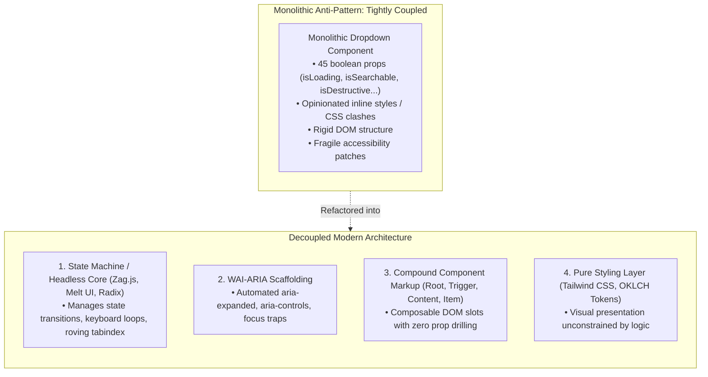
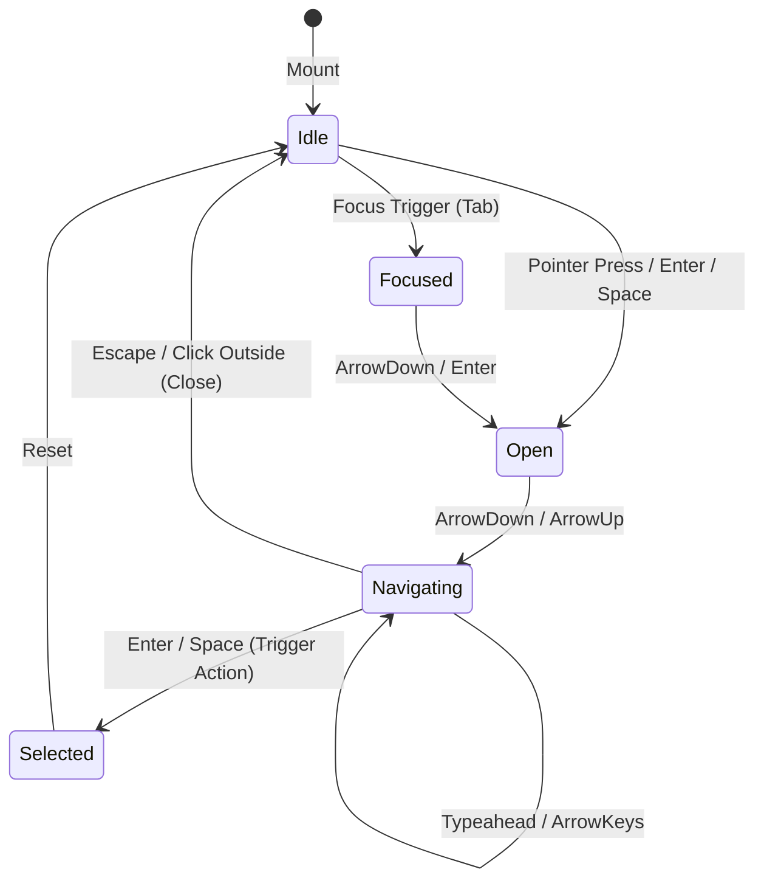

# Headless Primitives, Compound Components & State Machines

Modern frontend architecture has moved decisively away from tightly coupled, monolithic component libraries. When visual styling, state management, and accessibility logic are tangled together in a single file, codebases suffer from **boolean prop explosion**, accessibility regressions, and fragile refactoring cycles.

This document formalizes the architecture of **Headless Primitives, Compound Components, and Finite State Machines (FSMs)** to guarantee maintainability, accessibility (a11y), and visual scannability.

---

## 1. The Death of Monolithic Component Kits

Early component libraries (e.g. Bootstrap, legacy MUI) bundled three orthogonal concerns into monolithic components:
1. **State & Event Logic** (Open/close status, active index, drag positions).
2. **Accessibility & Keyboard Navigation** (WAI-ARIA roles, roving `tabindex`, focus traps).
3. **Visual Styling & CSS** (Colors, border-radii, typography, spacing).



### The "Boolean Prop Explosion" Anti-Pattern:
When developers build monolithic components, every new product requirement adds another boolean flag:
```tsx
// Anti-Pattern: 14 props competing for control
<Dropdown
  items={data}
  isOpen={isOpen}
  showIcons={true}
  isSearchable={true}
  isLoading={false}
  hasError={false}
  variant="secondary"
  placement="bottom-right"
  size="compact"
  onSelect={handleSelect}
  renderHeader={() => <div>...</div>}
  customIconClass="text-zinc-400"
  disableBackdropClick={false}
/>
```
This pattern fails because:
- **Combinatorial State Space**: 14 boolean props create $2^{14} = 16,384$ potential component states, impossible to fully test.
- **Inflexible DOM Hierarchy**: If a designer requests a divider between item #2 and item #3, the component author must invent an `itemDividers={[2]}` prop.
- **Accessibility Degradation**: Custom render props often omit essential ARIA attributes and keyboard handlers.

---

## 2. Compound Components: Composable Assembly

Compound components invert control by letting parent and child components communicate implicitly via context (or Svelte snippets/slots), acting like Lego blocks:

```svelte
<!-- Modern Compound Pattern (Svelte 5 / bits-ui / shadcn-svelte style) -->
<DropdownMenu.Root>
  <DropdownMenu.Trigger class="btn btn-secondary">
    Options <ChevronDown class="size-4" />
  </DropdownMenu.Trigger>

  <DropdownMenu.Content class="menu-surface shadow-md">
    <DropdownMenu.Group>
      <DropdownMenu.Label>Cluster Actions</DropdownMenu.Label>
      <DropdownMenu.Item onSelect={handleRestart}>
        <RefreshCw class="size-4" /> Restart Node
      </DropdownMenu.Item>
      <DropdownMenu.Item onSelect={handleDrain}>
        <ShieldAlert class="size-4" /> Drain Leases
      </DropdownMenu.Item>
    </DropdownMenu.Group>

    <DropdownMenu.Separator />

    <DropdownMenu.Item onSelect={handleDelete} variant="destructive">
      <Trash class="size-4" /> Delete Cluster
    </DropdownMenu.Item>
  </DropdownMenu.Content>
</DropdownMenu.Root>
```

### Why Compound Components Win:
1. **Zero Prop Drilling**: Sub-components (`Trigger`, `Content`, `Item`) inherit parent state (open/close, active index) automatically through context.
2. **Natural DOM Readability**: The code directly mirrors the rendered HTML structure, making code review fast and intuitive.
3. **Infinite Visual Customizability**: Adding separators, grouping headers, or custom badge pills requires no component API changes.

---

## 3. Finite State Machines (FSMs) for UI Complexity

Complex interactive controls (command palettes, multi-tier navigation, accessible menus, date pickers) quickly descend into "spaghetti state" when managed via ad-hoc boolean flags (`isHovered`, `isFocused`, `isLoading`, `isClosing`).

Finite State Machines (FSMs) guarantee that a component can exist in **exactly one state at any given moment**, making impossible states physically impossible:



### Implementing Impossible States Impossible:
Consider an async action button:
- **Spaghetti Boolean State**:
  `let isLoading = false; let isSuccess = false; let isError = false;`
  *Bug risk*: What happens if both `isLoading = true` and `isError = true` simultaneously?
- **FSM State**:
  `type ButtonState = 'idle' | 'loading' | 'success' | 'error';`
  `let state = $state<ButtonState>('idle');`
  *Guarantee*: The component can never display a loading spinner and an error banner at the same instant.

---

## 4. Accessibility (a11y) as an Architectural Guarantee

Accessibility must never be an afterthought bolted on with manual `tabindex` patches. Headless primitives encapsulate the **WAI-ARIA Authoring Practices Guide (APG)** at the architecture level.

### 4.1. Roving `tabindex` vs. `aria-activedescendant`
When building keyboard-navigable lists, menus, or toolbars:

| Navigation Pattern | DOM Mechanism | Best Use Case | Performance Trade-Off |
| :--- | :--- | :--- | :--- |
| **Roving `tabindex`** | Exactly one focused item has `tabindex="0"`; all other items have `tabindex="-1"`. Arrow keys move focus physically via `.focus()`. | Toolbars, tabs, radio groups, compact menus. | High DOM attribute updates, but absolute screen-reader compatibility. |
| **`aria-activedescendant`** | Focus remains permanently on the parent container (`<ul>` or `<input>`). The container points to the active child's ID: `aria-activedescendant="item-4"`. | Virtualized tables, large search comboboxes with 1,000+ items. | Zero DOM focus jumping; optimal for virtual scrolling where children mount/unmount. |

### 4.2. Focus Trap & Restoration Invariants
For overlays (`Dialog`, `Sheet`, `AlertDialog`):
1. **Focus Trap**: When the dialog mounts, focus is trapped inside its boundaries. Pressing `Tab` on the last focusable element loops around to the first element.
2. **Initial Focus**: Default focus must land on the safest action (e.g. `Cancel` button for destructive dialogs, or the primary input for creation forms).
3. **Focus Restoration**: When the dialog unmounts, focus **must** return to the exact element that originally triggered it (the trigger button). If focus is lost, screen reader and keyboard operators are thrown to the top of the `<body>`.
4. **Escape Key Dismissal**: Pressing `Escape` must close only the topmost active overlay layer.

### 4.3. Live Regions (`aria-live`) for Async Telemetry
When background processes complete or toasts fire:
- **`aria-live="polite"`**: Screen reader announces the update when the user is idle (ideal for toasts, copy confirmations, non-critical metrics).
- **`aria-live="assertive"`**: Screen reader interrupts current speech immediately (strictly reserved for critical system errors, network disconnects, or emergency crawler aborts).

---

## 5. Architectural Checklist for Headless Components

- [ ] Does the component avoid boolean prop bloat by utilizing compound patterns?
- [ ] Are impossible UI states prevented using a Finite State Machine or unified enum state?
- [ ] Does keyboard navigation support `ArrowDown`, `ArrowUp`, `Home`, `End`, and `Escape`?
- [ ] Are overlays equipped with focus traps and trigger focus restoration on unmount?
- [ ] Do asynchronous status changes leverage `aria-live="polite"` rather than stealing active focus?
- [ ] Is styling completely decoupled from logic using design tokens and utility classes?
