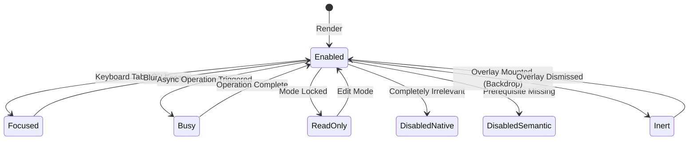
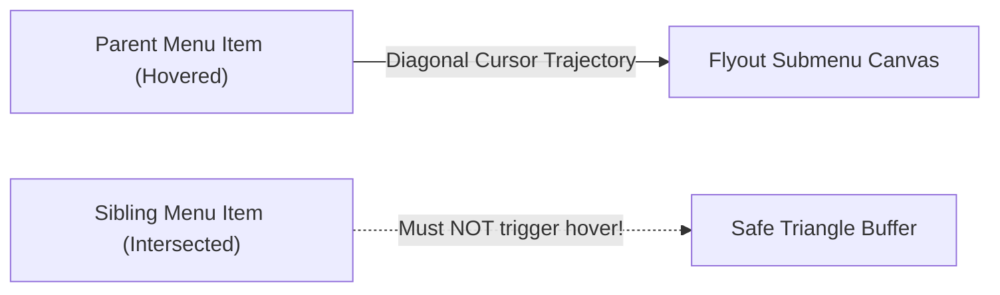
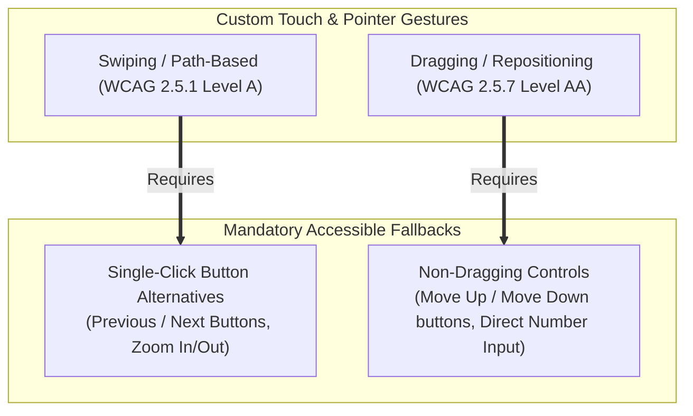
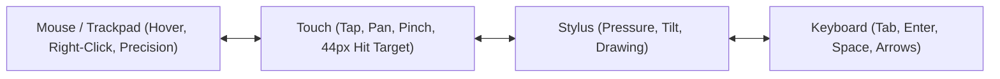

# Control Types, Availability & Extended Interaction Physics

Interfaces must be operable across every modality: mouse pointers, keyboard focus, multi-touch gestures, stylus inputs, and assistive technology (screen readers, switch devices).

When autonomous agents generate UI components, they often make controls inaccessible: disabling buttons with native attributes that blind screen-reader users to *why* a form is incomplete, inventing swipe gestures without click fallbacks, or applying `touch-action: none` across full screens.

This document formalizes **Control Availability States**, **Pointer Physics**, **Gesture Engineering (WCAG 2.2 standards)**, and **Multi-Modal Input Availability**.

---

## 1. The 7 States of Control Availability

A control is not merely "clickable" or "disabled." In accessible systems, controls transition across seven distinct operational states:



| Availability State | DOM Mechanism | Keyboard / Tab Order | Screen Reader Announcement | Optimal Use Case |
| :--- | :--- | :--- | :--- | :--- |
| **1. Enabled / Active** | Standard interactive element | Fully focusable (`tabindex="0"`) | Fully announced; interactive role | Normal operating state |
| **2. Focused / Visible** | `:focus-visible` pseudoclass | Active focus receiver | Focused element announced | Navigating via keyboard |
| **3. Busy / Loading** | `aria-busy="true"` + inline loader | Retains focus; prevents duplicate clicks | "Busy" / in-flight announced | Async network mutations |
| **4. Read-Only** | `readonly` / `aria-readonly="true"` | Focusable in tab order; selectable | Announced as "Read-only" | Data display where copy/paste is needed |
| **5. Disabled (Native)** | Native `disabled` attribute | **Skipped entirely** (removed from tab order) | Announced as "Disabled" (if reached) | Irrelevant actions with no informational value |
| **6. Disabled (Semantic)** | `aria-disabled="true"` + `tabindex="0"` | **Kept in tab order** (focusable) | Announced as "Disabled" / "Dimmed" | Discoverable controls (explains missing prerequisites) |
| **7. Inert** | HTML `inert` attribute | **Subtree completely blocked** | Subtree ignored by virtual cursor | Dimmed background canvas behind a Modal Dialog |

---

## 2. Native `disabled` vs. Semantic `aria-disabled="true"`

The choice between native `disabled` and `aria-disabled="true"` is one of the most critical accessibility decisions in interface engineering:

```
[ The Form Submission Dilemma ]

Scenario: A form requires a valid email and password before the "Submit" button activates.

Choice A: Native <button disabled>
• Keyboard user tabs through fields and presses Tab on the password input.
✖ The browser skips the Submit button completely and jumps into the footer!
• The user has no idea whether the form has a submit button or why it cannot be submitted.

Choice B: Semantic <button aria-disabled="true" tabindex="0">
• Keyboard user tabs to the Submit button.
✔ Focus lands on the button; screen reader announces: "Submit, disabled button".
✔ Tooltip appears explaining: "Please enter a valid email address to submit".
• User receives immediate, self-evident instruction on what is blocking progress.
```

### The Architectural Rule:
1. **Use Native `disabled`** when:
   - The action is completely irrelevant to the user in this state (e.g. pagination "Previous" on page 1).
   - Skipping the control streamlines keyboard navigation and reduces extraneous cognitive load.
2. **Use Semantic `aria-disabled="true"`** when:
   - The control is a primary destination or submit trigger.
   - The user needs to **discover** that the control exists and learn **what prerequisite is missing**.
   - **Mandatory**: When using `aria-disabled="true"`, suppress click and keyboard handlers in code:
     ```typescript
     function handleClick(e: MouseEvent) {
       if (button.getAttribute('aria-disabled') === 'true') {
         e.preventDefault();
         showPrerequisiteTooltip();
         return;
       }
       executeAction();
     }
     ```

---

## 3. Pointer Movement Physics & Mouse Mechanics

### 3.1. Pointer Cancellation (WCAG 2.5.2 Level A)
Users with tremors, motor impairments, or touchscreen devices frequently initiate pointer presses by mistake.
- **The Rule**: Never execute irreversible actions on `pointerdown` or `mousedown`.
- **The Execution**: Actions must trigger on `pointerup` / `click`. If the user slides their cursor or finger outside the target boundary before releasing, the action **must abort cleanly without side effects**.

### 3.2. Target Size Minimums (WCAG 2.2 Criterion 2.5.8)
- **Desktop Minimum**: At least $24 \times 24\text{px}$ target area, or sufficient spacing offset between adjacent targets.
- **Touch / Mobile Enhanced**: At least $44 \times 44\text{px}$ hit target (WCAG 2.5.5 Level AAA & Apple HIG).
- **The Pseudo-Target Recipe**: If an icon is visually $16 \times 16\text{px}$, expand its clickable bounds with an invisible pseudo-element:
  ```css
  .icon-action-btn {
    position: relative;
    width: 16px;
    height: 16px;
  }
  .icon-action-btn::after {
    content: '';
    position: absolute;
    inset: -12px; /* Expands hit target to 40x40px */
  }
  ```

### 3.3. Intent Detection: The Amazon Mega-Menu Safe Triangle
When moving a pointer from a navigation item across sibling menus into a nested flyout panel, the cursor naturally cuts diagonally across other menu items:



If the interface switches hover states instantly on every pixel move, the flyout vanishes before the cursor arrives.
- **Solution**: Implement a **safe directional trajectory polygon** (using pointer tracking or CSS pseudo-element bridges) or introduce a small delay ($150\text{–}200\text{ms}$) before unmounting submenus.

### 3.4. Pointer Capture for Scrubbers & Resizers
When building draggable split-panes, volume sliders, or timeline scrubbers:
- If the user drags rapidly, the cursor moves outside the slider's bounding box and drops the drag event.
- **Solution**: Call `element.setPointerCapture(event.pointerId)` on `pointerdown`, and `element.releasePointerCapture(event.pointerId)` on `pointerup`. This ensures the draggable handle receives all pointer move events even if the cursor flies across the screen.

---

## 4. Gesture Engineering & Dragging Accessibility

Complex gestures (swiping, dragging, pinching) make interfaces engaging on mobile devices, but introduce severe accessibility barriers if implemented without non-gesture fallbacks.



### 4.1. WCAG 2.5.1: Path-Based Pointer Gestures
A path-based gesture requires moving a pointer along a specific geometric trajectory (e.g. swiping a card, drawing a gesture pattern, or pinching to zoom).
- **Rule**: Every path-based or multi-point gesture **must have a single-pointer alternative without gestures**.
- **Example**: If a mobile feed supports swipe-to-delete, it must also provide an explicit trash button or a long-press popover menu with "Delete".
- **Example**: If an image canvas supports pinch-to-zoom, it must also feature visible `[ + ]` and `[ − ]` zoom buttons.

### 4.2. WCAG 2.5.7: Dragging Movements (WCAG 2.2 Standard)
Dragging interactions require the user to press down, hold, drag to a target location, and release (e.g. reordering a kanban board or dragging a range slider).
- **Rule**: Any functionality operated by dragging must also be operable via a single-pointer click action *without dragging*.
- **Implementation**:
  - Reorderable list: Provide "Move Up" and "Move Down" action buttons alongside drag handles.
  - Range slider: Allow clicking on the track or clicking the value label to open an editable numeric `<input>`.

### 4.3. The `touch-action` Property & Physics Scoping
To build smooth horizontal swipes or custom drag physics, browsers must be told when to surrender native page scrolling:

```css
/* ✖ CATASTROPHIC ANTI-PATTERN: Traps mobile users */
body, .main-container {
  touch-action: none; /* User can no longer scroll the page! */
}

/* ✔ ACCESSIBLE PATTERN: Scoped axis locking */
.swipeable-card {
  touch-action: pan-y; /* Protects native vertical scrolling, delegates horizontal swipe */
}

.slider-thumb, .splitter-handle {
  touch-action: none; /* Isolates touch capture strictly to the 40px draggable target */
}
```

### 4.4. Gesture Dampening Physics ($d^{0.75}$ Resistance)
When implementing drag actions (pull-to-refresh or swipe-to-archive), linear dragging feels rigid and unnatural.
- Beyond the trigger activation threshold ($X_{\text{threshold}} \approx 80\text{px}$), apply exponential or power decay:
  $$X_{\text{rendered}} = X_{\text{threshold}} + (\Delta X - X_{\text{threshold}})^{0.75}$$
- This physical resistance signals to the human motor cortex that the action has reached its tension point.

---

## 5. Multi-Modal Availability & Concurrent Input

Modern hardware is rarely single-mode. A user with a Microsoft Surface or an iPad with a Magic Keyboard alternates continuously between:
1. Touching the screen with a finger.
2. Pointing with a mouse / trackpad.
3. Drawing with a precision stylus.
4. Typing with a physical keyboard.



### Common Agent Input Bugs:
1. **The "Touch Device" Assumption**: Detecting `navigator.maxTouchPoints > 0` and permanently disabling hover menus or tooltips. (Laptops with touchscreens still use mice!).
2. **Focus Ring Suppression**: Hiding the keyboard focus outline with `outline: none` because mouse users dislike visual rings.
   - **Fix**: Use the `:focus-visible` pseudo-class:
     ```css
     /* Suppress outline on mouse click, keep high-contrast outline on keyboard Tab */
     button:focus {
       outline: none;
     }
     button:focus-visible {
       outline: 2px solid oklch(0.7 0.14 182);
       outline-offset: 2px;
     }
     ```
3. **The Skip Link Invariant**:
   - Provide an invisible skip link at the absolute top of the page that becomes visible on keyboard focus:
     ```html
     <a href="#main-content" class="sr-only focus:not-sr-only focus:absolute focus:top-4 focus:left-4 btn btn-primary">
       Skip to main content
     </a>
     ```
   - This allows keyboard users to bypass repetitive navigation bars and jump straight to primary data.

---

## 6. Implementation Checklist for Agents

- [ ] Does every primary action utilize `aria-disabled="true"` with a prerequisite explanation instead of a silent native `disabled` button?
- [ ] Do all critical state mutations fire on `pointerup` (release) rather than `pointerdown` to support pointer cancellation?
- [ ] Are draggable controls accompanied by non-dragging alternatives (e.g. "Move Up/Down" buttons)?
- [ ] Are path-based gestures accompanied by single-click button alternatives?
- [ ] Is `touch-action: pan-y` applied to horizontally swipable cards to protect vertical scrolling?
- [ ] Are hit targets at least $40 \times 40\text{px}$ on desktop and $44 \times 44\text{px}$ on touch devices?
- [ ] Is `:focus-visible` styled with high-contrast outlines for keyboard operators?
- [ ] Does the page include a functional "Skip to main content" link at the root level?
