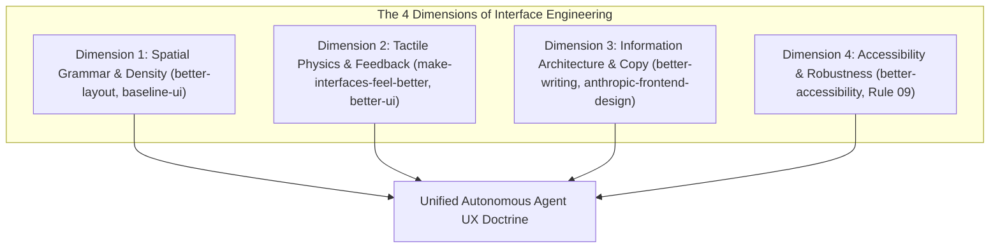

# Agent Skills Assessment & Architectural Synthesis

This document conducts a critical engineering evaluation of twelve specialized UI/UX agent skills available within the development environment.

We assess each skill's core contributions, operational axioms, gaps, and how they synthesize into a cohesive UX doctrine for autonomous coding agents.

---

## 1. Inventory of Assessed Agent Skills

| Skill Identifier | Source Domain | Core Focus |
| :--- | :--- | :--- |
| **`make-interfaces-feel-better`** | Design Engineering | Compounding micro-details: tactile press, concentric radii, optical nudging, icon transitions |
| **`better-layout`** | Layout & Ergonomics | Spatial grouping, $2\times$ gap ratio, logical properties, peeking, adaptive breakpoints |
| **`better-ui`** | Surface Polish | Shadows vs borders, theme switch suppression, motion restraint, image outlines |
| **`better-writing`** | Interface Copy | Verb-first actions, plain voice, positive error instructions, forward-pointing empty states |
| **`better-accessibility`** | WCAG & Standards | Hit targets ($44\text{px}$ touch / $40\text{px}$ desktop), focus traps, keyboard navigation, contrast |
| **`better-interface`** | Holistic Audit | Multi-domain synthesis auditing layout, typography, accessibility, and visual polish |
| **`anthropic-frontend-design`** | Creative Direction | Anti-slop taxonomy (avoiding warm cream/terracotta cliches, SaaS card spam, arbitrary eyebrows) |
| **`baseline-ui`** | Structural Sanitation | Strict Tailwind baseline, `AlertDialog` for deletions, `h-dvh` over `h-screen`, zero gradients |
| **`improve-ui`** | Read-Only Audit | Non-destructive UI audit against project evidence, writing bounded implementation plans |
| **`mobile-feed-experience`** | Touch & Gestures | $120\text{Hz}$ scroll, swipe micro-actions ($\Delta X > 80\text{px}$ with $d^{0.75}$ damping), haptics, local scoring |
| **`fixing-motion-performance`**| Compositor Physics | Eliminating layout thrashing, GPU compositing (`transform`/`opacity`), scroll-linked motion |
| **`Rule 09 (Monorepo Invariant)`**| Architectural Standard | 3-tier component hierarchy, `tokens.ts`, `CONTROL_HEIGHTS`, `mira`/`mist` OKLCH profile |

---

## 2. In-Depth Evaluation by Architectural Dimension



### 2.1. Spatial Grammar & Information Density
- **Key Contributions**:
  - `better-layout` establishes the foundational **$2\times$ Gap Ratio**: $\text{Gap}_{\text{inter-group}} \ge 2 \cdot \text{Gap}_{\text{intra-group}}$. Space groups first; borders are an exception for structural division.
  - `better-layout` codifies the **Peeking Rule**: Deferred horizontal content must peek $16\text{–}32\text{px}$ past the scroll edge to signal overflow without verbose text.
  - `baseline-ui` mandates the use of `h-dvh` over `h-screen` to prevent iOS URL-bar layout clipping.
- **Identified Gaps**:
  - Neither skill provides formal guidance on **density budgets** (limiting persistent interactive anchors to $\le 7$ per viewport tier).
  - Lacks architectural decision models for master-detail split panes vs slide-out inspectors.

### 2.2. Tactile Physics & Micro-Interactions
- **Key Contributions**:
  - `make-interfaces-feel-better` provides exact, non-negotiable physical parameters:
    - **Scale on press**: Strictly `active:scale-[0.96]`. Values $<0.95$ read as cartoonish.
    - **Concentric radius**: $\text{Radius}_{\text{outer}} = \text{Radius}_{\text{inner}} + \text{Padding}$.
    - **Spring physics**: Zero bounce ($\text{bounce} = 0$). Rubber-band motion is forbidden in productive software.
    - **Icon transitions**: Scale $0.25 \rightarrow 1$, opacity $0 \rightarrow 1$, blur $4\text{px} \rightarrow 0$.
  - `better-ui` establishes theme-switch suppression (disabling transitions during color-mode flips to eliminate smeared repaints).
  - `mobile-feed-experience` establishes gesture resistance: $d^{0.75}$ dampening past activation thresholds.
- **Identified Gaps**:
  - Skills detail *how* to animate an element, but not *when* to animate vs remain static.
  - Lacks state-orchestration rules for handling **network rollback on optimistic failure**.

### 2.3. Information Architecture, Cognitive Load & Copy
- **Key Contributions**:
  - `better-writing` enforces **verb-first buttons** ("Delete project" instead of "OK") and requires that empty states point forward with one clear next action.
  - `anthropic-frontend-design` provides an incisive taxonomy of **AI Interface Slop**:
    1. The terracotta/warm-clay color crutch.
    2. The "SaaS Card Kit": Chopping all content into identical cards with identical gray shadows.
    3. Tracked-out all-caps eyebrow labels (`FEATURE — DETAILS`) decorating every section.
    4. Decorative numbers (`01 / 02 / 03`) on non-sequential content.
- **Identified Gaps**:
  - `better-writing` focuses on text clarity, but AI agents often write *too much* text to compensate for poor visual affordance.
  - Lacks rules for dynamic action scoping (floating selection bars, row-level micro-actions).

### 2.4. Accessibility, Components & Monorepo Invariants
- **Key Contributions**:
  - `better-accessibility` enforces minimum hit targets ($44\text{px}$ touch, $40\text{px}$ desktop) and keyboard focus traps.
  - `Rule 09` anchors the component architecture to a **3-tier hierarchy**:
    - **Tier 1**: Accessible UI primitives (`src/lib/components/ui/` across forms, navigation, overlays, feedback, display, telemetry).
    - **Tier 2**: Admin/Operator panels and state stores.
    - **Tier 3**: Top-level route pages.
  - Binds controls to standardized `CONTROL_HEIGHTS` (`xs: h-7`, `sm: h-8`, `md: h-10`, `lg: h-12`) and unified OKLCH dark surface tokens.
- **Identified Gaps**:
  - Rule 09 defines component paths, but does not provide the behavioral decision tree for selecting when to use a Sheet vs a Dialog vs a Popover.

---

## 3. The Synthesis: Constructing the Agent UX Doctrine

By synthesizing the strengths of these twelve skills and bridging their respective blind spots, we extract the core pillars of the **Agent UX Doctrine**:

```
[ Synthesis Matrix ]
┌─────────────────────────────────┬────────────────────────────────────────────┐
│ Skill Insight                   │ Synthesized UX Engineering Rule            │
├─────────────────────────────────┼────────────────────────────────────────────┤
│ 2× Gap Ratio (better-layout)    │ Group with space, eliminate visual noise.  │
│ Scale on Press (make-feel-better│ Immediate <100ms tactile acknowledgement.  │
│ Anti-Slop (frontend-design)     │ No generic cards, no verbose text banners. │
│ Verb Buttons (better-writing)   │ Explicit consequences on all CTA triggers. │
│ 3-Tier Hierarchy (Rule 09)      │ Standardized accessible primitives only.   │
│ Hit Areas (better-accessibility)│ Expand 16px icons with 40px pseudo-targets.│
│ Optimistic Loops (this corpus)  │ Instant local state update with rollback.  │
│ Contextual Pruning (this corpus)│ Surface actions strictly when state valid. │
└─────────────────────────────────┴────────────────────────────────────────────┘
```

This synthesis directly informs the actionable operating checklist in [02-agent-ux-doctrine.md](02-agent-ux-doctrine.md).
