# The Autonomous Agent UX Doctrine

This document serves as the **operational mandate** for autonomous coding agents designing, generating, or refactoring user interfaces.

It codifies how interfaces communicate through spatial position, contrast, subtle signifiers, and interaction physics rather than verbose text generation and screen clutter.

---

## 1. The Core Philosophy: Implicit Signifiers Over Verbose Text

When language models build software, their training biases them toward text generation. When faced with an interface challenge, an unguided agent writes paragraphs:

```
[ The Agent Slop Failure ]
┌────────────────────────────────────────────────────────────────────────┐
│ ℹ INSTRUCTIONS: To manage crawler nodes, select an individual row from │
│ the table below. Once selected, the action bar will become active. You │
│ can click the 'Drain' button to safely decommission a node, or click   │
│ 'Restart' to reboot its runtime process. Please note that restarting   │
│ will temporarily interrupt active leases.                              │
└────────────────────────────────────────────────────────────────────────┘
```

### The Implicit UX Axiom:
> *A well-engineered interface is self-explanatory. Every paragraph an agent writes to explain how to navigate the screen is an admission of an interaction design defect.*

Replace explanatory prose with implicit visual signifiers:
- Instead of explaining that rows are selectable, provide visible checkboxes, subtle hover row highlights, and a floating selection action bar that appears smoothly upon selection.
- Instead of writing instructions on what "Restart" does, use a clear confirmation dialog (`AlertDialog`) with an explicit button: `[ Restart Node (Interrupts Leases) ]`.

---

## 2. The 10 Invariants of Autonomous Agent UX

Autonomous agents must strictly uphold these ten invariants across all interface tasks:

```mermaid
flowchart TD
    subgraph CoreTenets["The 10 Invariants of Agent UX"]
        direction TB
        I1["1. Implicit Signifiers Over Prose"]
        I2["2. Density Budgeting (≤7 Anchors)"]
        I3["3. The 2× Space-Over-Lines Grammar"]
        I4["4. Visible Peeking for Deferred Depth"]
        I5["5. Contextual Action Scoping"]
        I6["6. State-Gated Action Surfacing"]
        I7["7. Intent-to-Primitive Determinism"]
        I8["8. Instant Tactile Acknowledgment (<100ms)"]
        I9["9. Optimistic Loops with Safe Rollback"]
        I10["10. Ergonomic Hit Areas & Focus Traps"]
    end
```



### 1. Implicit Signifiers Over Prose
Never add instruction banners, tip boxes, or multi-sentence descriptions for basic navigation. Communicate through placement, icons, elevation, and affordance.

### 2. Density Budgeting ($\le 7$ Anchors per Tier)
Limit persistent interactive targets in any single view to between 5 and 7 anchors. Defer secondary details behind progressive disclosure (drawers, popovers, tabs).

### 3. Space-Over-Lines Structural Grammar
Separate content groups using whitespace ratios first ($\text{Gap}_{\text{inter-group}} \ge 2 \cdot \text{Gap}_{\text{intra-group}}$) and surface elevation second. Reserve physical border strokes for active selection, focus, or essential table gridlines.

### 4. Visible Peeking for Deferred Depth
Never hide overflowing or scrollable content flush against container edges. Ensure the next item peeks $16\text{–}32\text{px}$ past the scroll edge, or display explicit item count pills (`+4 more`).

### 5. Contextual Action Scoping
Do not display disabled global action buttons. Keep global toolbars focused on creation and global filters. Surface batch actions in a floating selection bar when $\ge 1$ item is checked. Reveal row actions on hover/focus.

### 6. State-Gated Action Surfacing
Swap primary actions dynamically based on entity lifecycle state machines (e.g. "Start" on Pending $\rightarrow$ "Pause" on Running $\rightarrow$ "Retry" on Failed). Do not show irrelevant disabled buttons.

### 7. Intent-to-Primitive Determinism
Select component primitives based on action gravity:
- `AlertDialog`: Destructive / irreversible operations.
- `Sheet` / Drawer: Complex multi-field entity editing while maintaining parent list context.
- `Popover`: Lightweight anchored menus and micro-filters.
- `Toast`: Ephemeral non-blocking success feedback.
- `Inline Notice`: Persistent degraded system state.

### 8. Instant Tactile Acknowledgment ($< 100\text{ ms}$)
Acknowledge all user gestures instantly with tactile feedback: button depression `active:scale-[0.96]`, hover elevation, and cursor updates. Never leave a click unacknowledged while awaiting a network roundtrip.

### 9. Optimistic Loops with Safe Rollback
Mutate low-risk state (bookmarks, toggles, likes, status checks) optimistically in the client store. On network failure, silently roll back the state and display a clear inline error.

### 10. Ergonomic Hit Targets & Focus Traps
Enforce minimum hit targets ($40\times 40\text{px}$ desktop, $44\times 44\text{px}$ mobile), expand icon hit boxes with pseudo-elements, trap keyboard focus inside open dialogs, and honor `prefers-reduced-motion`.

---

## 3. Pre-Flight Operational Checklist for Coding Agents

Before writing or editing any UI file, run through this pre-flight checklist:

```markdown
### Agent UI Pre-Flight Checklist

1. [ ] DENSITY CHECK: Does the primary view have 7 or fewer interactive anchors?
2. [ ] NO PROSE TRAP: Have I removed all unneeded instruction banners or help cards?
3. [ ] WHITESPACE RATIO: Is inter-group spacing at least 2× intra-group spacing?
4. [ ] CONCENTRIC RADII: Does outer radius equal inner radius + padding?
5. [ ] PEEKING SIGNIFIER: If a container scrolls, does the next item peek past the edge?
6. [ ] ACTION SCOPING: Are batch actions hidden until items are selected?
7. [ ] PRIMITIVE SELECTION: Am I using an AlertDialog for destructive actions, and a Toast for routine success?
8. [ ] TACTILE PRESS: Does the button include `active:scale-[0.96]`?
9. [ ] MOTION RESTRAINT: Are all springs configured with `bounce: 0`?
10. [ ] ACCESSIBLE HIT TARGET: Are all icon buttons at least 40×40px in clickable area?
```

---

## 4. The "AI Slop" Elimination Guide

| "AI Slop" Symptom | Root Cause | Immediate Agent Refactoring |
| :--- | :--- | :--- |
| **Instruction Card at Top of Page** | Agent tries to explain confusing controls with text. | Delete the card entirely. Make controls self-evident with labels and icons. |
| **10 Static Dropdowns Above a Table** | Exposing all schema filters simultaneously. | Replace with single search bar + "Filters" button with active badge. |
| **Disabled "Delete" and "Edit" Buttons** | Showing item-level actions in global toolbar. | Move actions to row-level hover or floating batch selection bar. |
| **Modal Dialog Saying "Success!"** | Interrupting user workflow for low-gravity feedback. | Replace with transient non-blocking Toast in bottom-right corner. |
| **Unconcentric Nested Corners** | Arbitrary Tailwind rounded classes (`rounded-lg` everywhere). | Compute concentric radius: $\text{Radius}_{\text{outer}} = \text{Radius}_{\text{inner}} + \text{Padding}$. |
| **Jumping Numbers in Counters** | Proportional font digits altering word width. | Apply `font-variant-numeric: tabular-nums` (Tailwind `tabular-nums`). |
| **Exaggerated Bouncy Animations** | Using default spring physics with high bounce. | Set spring `bounce: 0` and duration $\le 0.3\text{s}$. |
