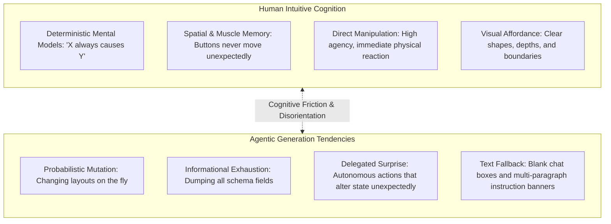
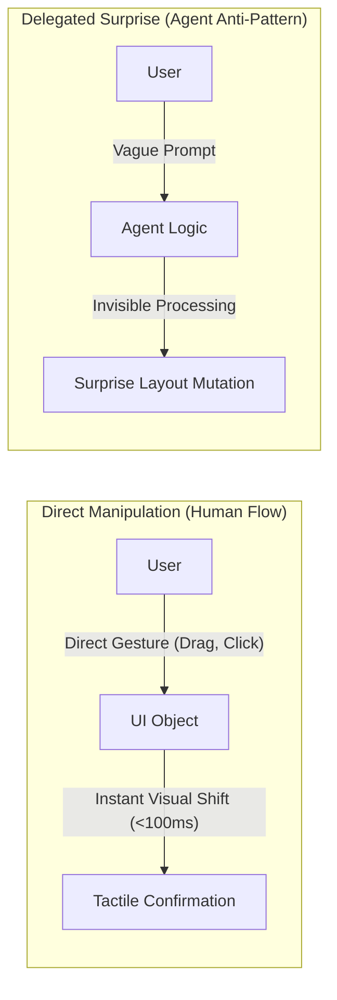
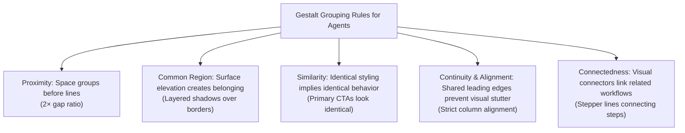

# Human Intuition Patterns vs. Agentic UI Generation

When human beings interact with digital software, they do not read code or inspect database schemas. They rely on **human intuition**—an evolutionary cognitive system built upon spatial memory, subconscious muscle memory, predictable mental models, and direct manipulation.

When artificial intelligence agents design or generate interfaces, they frequently violate these core human intuitions. Agents prioritize raw informational completeness, probabilistic adaptation, and text-based explanations.

This document establishes the boundaries between human intuition and agentic patterns, formalizing where agent autonomy must yield to human perceptual habits.

---

## 1. The Fundamental Architectural Conflict



| Dimension | Human Intuition Requirement | Common Agentic Failure Mode | Root Cause of Failure |
| :--- | :--- | :--- | :--- |
| **Spatial Stability** | Controls remain anchored in identical coordinates across sessions to build muscle memory. | Dynamically re-sorting or re-arranging toolbars based on "predicted relevance". | Agent optimizes for instantaneous context while destroying long-term motor memory. |
| **System Predictability** | Clicking an element produces a deterministic, repeatable state transition. | AI introduces non-deterministic, varying behaviors for the same button click. | Agent injects probabilistic LLM reasoning into standard deterministic interaction loops. |
| **Affordance & Salience** | Clear visual containers, depth cues, and contrast indicating what is interactive. | Blank conversational inputs or flat, unbordered "ghost" text elements. | Agent assumes natural language is the universal interface and strips away UI scaffolding. |
| **User Agency** | The human operator retains direct, tactile control over every state mutation. | The agent performs irreversible background mutations autonomously without explicit consent. | Agent equates human assistance with taking over the operational steering wheel. |

---

## 2. Spatial Memory: Why Predictability Trumps Optimization

The human brain possesses dedicated neural circuitry (the hippocampal spatial map and motor cortex) that maps physical and virtual environments:
- When a user clicks "Deploy" or opens "Settings", they do not scan the screen reading labels after the third visit.
- Their hand and eyes dart to the top-right corner via **unconscious muscle memory**.

### The "Adaptive Layout" Trap
A frequent architectural mistake in agent-designed systems is **hyper-adaptive rearrangement**:
- The agent reasons: *"The user didn't use the 'Filters' button yesterday, but used 'Export' three times. Let me move 'Export' to the primary slot and hide 'Filters'!"*
- The human experience: The user reaches for "Filters", finds it missing, pauses, suffers saccadic confusion, and experiences frustration.

### The Spatial Invariant for Autonomous Agents:
> **Predictability trumps optimization.** An interface that is slightly sub-optimal but 100% spatially predictable is far superior to an interface that is continuously "optimizing" its layout by shifting controls.

1. **Fixed Navigation Anchors**: The primary sidebar, top header, breadcrumb line, and global action zone must never shift positions based on dynamic data.
2. **Stable Sorting**: Tables and lists must maintain user-defined sort order. Never re-sort a table while a user is actively viewing or clicking rows.
3. **Persistent Toolbar Slots**: If an action is unavailable, disable or dim it in its predictable slot (with an explanatory tooltip) unless it belongs to a dedicated contextual overlay like the Floating Selection Bar.

---

## 3. Direct Manipulation vs Delegated Surprise

Human intuition thrives on **direct manipulation** (formulated by Ben Shneiderman):
1. Continuous representation of the objects of interest.
2. Physical actions (clicking, dragging, sliding) instead of complex syntax.
3. Rapid, incremental, reversible operations whose impact on the object is immediately visible.



### The Autonomous Boundary:
- **Where Agents Must NOT Act Autonomously**:
  - Never alter user layouts without explicit instruction.
  - Never delete, deploy, publish, or overwrite data without an explicit confirmation gate (`AlertDialog`).
  - Never collapse or expand navigation menus automatically based on inferred user intent.
- **Where Agents Excel**:
  - **Inline Scaffolding**: Providing ghost text / inline suggestions that the human can accept with `Tab` or ignore.
  - **Ambient Telemetry**: Displaying real-time validation badges or status indicators alongside fields while the user works.
  - **Predictive Pre-Fetching**: Loading data in the background so that when the user clicks a tab, the render is instantaneous ($<100\text{ms}$).

---

## 4. The "Chat Box Fallacy" and Blank-Page Syndrome

A pervasive anti-pattern in modern AI software is replacing structured graphical controls with a blank natural language prompt box:

```
[ The Blank Chat Box Failure ]
┌────────────────────────────────────────────────────────┐
│ Ask anything or type a command...                      │
│ [                                                    ] │
└────────────────────────────────────────────────────────┘
Result: The user stares at a blank screen, wondering:
- What syntax does it accept?
- What parameters can I filter by?
- Can I sort? Can I export? What data exists?
```

### Cognitive Friction:
A blank input field forces the user into **pure recall** (the hardest cognitive task), whereas graphical UI relies on **recognition** (the easiest cognitive task).

### The Hybrid Scaffolding Pattern:
Never offer an unstructured prompt without visual scaffolding:
1. **Provide Structured Seed Prompts**: Display 3–4 clickable chip suggestions indicating common tasks.
2. **Expose Graphical Fallbacks**: Always pair conversational inputs with visible graphical filters, toggles, and data tables.
3. **Command Palette (`Cmd+K`) with Visual Affordance**: Group actions semantically with visible keyboard shortcuts and clear category headers.

---

## 5. Design Rules of Grouping: Expanding Gestalt for Agents

To guide human vision reliably, agents must strictly apply Gestalt grouping laws in layout construction:



### Tactical Implementation Rules:
1. **The 8pt / 4pt Spatial Grid**:
   - Every padding, margin, gutter, and height must be an exact multiple of `4px` (for compact telemetry) or `8px` (for layout spacing):
     $$\text{Spacing} \in \{4, 8, 12, 16, 24, 32, 48, 64\}\text{ px}$$
   - Arbitrary pixel values (`margin-top: 13px`) break visual continuity and read as unpolished code.
2. **Typographic Hierarchy & Optical Sizing**:
   - Limit type scales to a strict 4-step hierarchy per view:
     - **Title / View Anchor**: `20px` to `24px` bold (Leading edge).
     - **Section Heading**: `16px` semibold.
     - **Body / Interactive Text**: `14px` regular.
     - **Metadata / Caption**: `12px` muted (`text-zinc-400`).
   - Line length must never exceed $75\text{–}80$ characters for continuous text to prevent saccadic line-tracking loss.
3. **Connectedness**:
   - When a multi-step sequence is active, connect steps with a subtle $2\text{px}$ line (`border-zinc-800`). The physical connection guides the human eye along the path of execution.

---

## 6. The Agent UX Boundary Protocol

Before generating or updating any interface, the agent must evaluate this boundary protocol:

```
[ Agent UX Boundary Protocol ]

Q1: Does this change relocate an existing control that the user previously clicked?
    -> IF YES: ABORT. Keep the control anchored in its predictable coordinate.

Q2: Does this change add a verbose explanatory paragraph to explain a UI button?
    -> IF YES: ABORT. Redesign the button with an explicit verb label and signifier.

Q3: Does this view present more than 7 persistent interactive targets?
    -> IF YES: DEFER. Move secondary targets behind progressive disclosure.

Q4: Is an irreversible mutation being triggered without a modal confirmation?
    -> IF YES: BLOCK. Render an AlertDialog requiring explicit confirmation.

Q5: Does the layout rely on saturated colors to establish structure?
    -> IF YES: REFACTOR. Enforce the 90/10 Monochromatic rule (90% neutral, 10% semantic).
```
