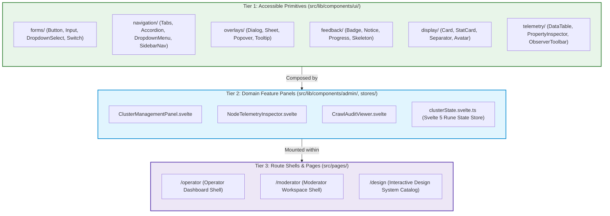

# Code Organization, Maintainability & UI Readability

Writing accessible, visually scannable UI code requires strict architectural discipline. Without a clear structural convention, frontend codebases rapidly degrade: styles become fragmented, megabarrels introduce circular dependencies, components turn into spaghetti with 30 props, and accessibility regressions go unnoticed.

This document establishes the **3-Tier Component Cascade**, the **State Module Pattern**, **Import Hygiene**, and **Code Readability Invariants** for maintainable, enterprise-scale user interfaces.

---

## 1. The 3-Tier Component Cascade

To prevent architectural chaos, UI codebases must organize components into three strictly bounded, hierarchical tiers:



### Tier 1: Accessible UI Primitives (`src/lib/components/ui/<domain>/`)
- **Scope**: Reusable, headless-backed atomic controls with zero domain-specific business logic.
- **Rules**:
  - Organized across orthogonal functional directories: `forms/`, `navigation/`, `overlays/`, `feedback/`, `display/`, `telemetry/`, and `workbench/`.
  - Strictly agnostic of backend schemas, API endpoints, or database types.
  - Encapsulates all WAI-ARIA roles, keyboard event handlers, and standardized design tokens.

### Tier 2: Domain Feature Panels (`src/lib/components/admin/` & `src/lib/stores/`)
- **Scope**: Stateful business modules, operator dashboards, and inspector drawers.
- **Rules**:
  - Composed strictly from Tier 1 primitives (never raw HTML `<button>` or unstyled `<select>`).
  - Manages domain business logic, API calls, and local state transitions.
  - Backed by dedicated state modules (`*.svelte.ts` in Svelte 5).

### Tier 3: Route Shells & Pages (`src/pages/`)
- **Scope**: Top-level route layouts, routing wrappers, and navigation shells.
- **Rules**:
  - Responsible strictly for page metadata, URL parameters, and high-level grid layouts.
  - Mounts Tier 2 feature panels into a persistent application chrome (e.g. `SidebarNav`).

---

## 2. Replacing the Container/Presenter Pattern with State Modules

The traditional **Container/Presenter (Smart/Dumb) Pattern** forced an arbitrary split into two separate files (`UserListContainer.tsx` and `UserListView.tsx`) purely to separate data fetching from rendering. In modern frontend engineering, this pattern is obsolete:
- It creates severe **prop-drilling boilerplate** as 20 parameters are passed down across layers.
- It fragments reading context, forcing developers to alternate between files.

### The Modern Alternative: State Modules (Svelte 5 Runes / Custom Hooks)
Extract state, asynchronous queries, and mutations into dedicated state modules (`*.svelte.ts`), allowing feature components to consume state reactively:

```typescript
// src/lib/stores/clusterState.svelte.ts (Svelte 5 State Module)
import type { NodeSummary } from 'vrc-packages-api';

class ClusterState {
  nodes = $state<NodeSummary[]>([]);
  selectedNodeId = $state<string | null>(null);
  isLoading = $state<boolean>(false);
  error = $state<string | null>(null);

  // Derived state computes reactively with zero boilerplate
  selectedNode = $derived(
    this.nodes.find(n => n.id === this.selectedNodeId) ?? null
  );
  activeCount = $derived(
    this.nodes.filter(n => n.status === 'active').length
  );

  async fetchNodes() {
    this.isLoading = true;
    try {
      const res = await fetch('/api/v1/nodes');
      this.nodes = await res.json();
    } catch (err: any) {
      this.error = err.message;
    } finally {
      this.isLoading = false;
    }
  }
}

export const cluster = new ClusterState();
```

### Benefits:
- **Clean Feature Markup**: The view component imports `cluster` and reads properties directly.
- **Testable Business Logic**: `ClusterState` can be unit-tested without mounting any DOM or mocking component render lifecycles.
- **Zero Prop Drilling**: Deeply nested controls access the state module without intermediary props.

---

## 3. Import Hygiene: The Megabarrel Trap

A persistent architectural trap in large codebases is the **Megabarrel** (`index.ts` re-exporting every component across the repository):

```typescript
// Anti-Pattern: Megabarrel (src/lib/components/index.ts)
export * from './ui/forms/Button.svelte';
export * from './ui/forms/Input.svelte';
export * from './ui/navigation/Accordion.svelte';
// ... 80 more re-exports
```

### Why Megabarrels Degrade Maintainability:
1. **Broken Tree-Shaking**: Bundlers frequently pull in unused dependencies, bloating client bundle sizes.
2. **Circular Dependencies**: When components import from the shared barrel, circular module resolution chains cause runtime `undefined` crashes.
3. **Slow Build Times**: The compiler must parse all 80 modules whenever a single component changes.

### The Direct Import Invariant:
Import primitives directly from their source files:
```typescript
// ✔ GOOD: Direct, explicit, fast compilation
import Button from '$lib/components/ui/forms/Button.svelte';
import DropdownSelect from '$lib/components/ui/forms/DropdownSelect.svelte';
import { CONTROL_HEIGHTS } from '$lib/components/ui/tokens';
```

---

## 4. Centralized Token Architecture (`tokens.ts`)

Hardcoding arbitrary pixel strings (`h-[38px]`, `bg-[#18181b]`) directly in component markup degrades maintainability. Centralize design tokens in a single source of truth:

```typescript
// src/lib/components/ui/tokens.ts
export const CONTROL_HEIGHTS = {
  xs: 'h-7',  // 28px: Compact telemetry
  sm: 'h-8',  // 32px: Data tables & compact forms
  md: 'h-10', // 40px: Default controls & inputs
  lg: 'h-12', // 48px: Touch & prominent CTAs
} as const;

export const SURFACE_TOKENS = {
  canvas: 'bg-zinc-950',
  surface: 'bg-zinc-900',
  elevated: 'bg-zinc-800',
  border: 'border-white/5',
  borderFocus: 'border-primary',
} as const;
```

### The Invariant:
Interactive controls (`Button`, `Input`, `Select`, `DropdownSelect`, `ToggleGroup`) must bind directly to `CONTROL_HEIGHTS`. This guarantees that an `Input` and its adjacent `Button` in an inline form will always have identical heights down to the pixel.

---

## 5. UI Readability & Developer Experience (DX)

Code is read far more often than it is written. UI components must be structured so that a developer scanning the file immediately comprehends its layout and behavior.

### 1. The Single Responsibility Principle (SRP) per File
- A single component file should not exceed $200\text{–}300$ lines.
- If a table row has complex hover logic, slide-out actions, and editable cells, extract it to a dedicated sub-component (`NodeTableRow.svelte`).

### 2. Eliminate Nested Ternary Hell
Deeply nested ternaries in templates destroy visual scannability:
```svelte
<!-- ✖ BAD: Nested Ternary Spaghetti -->
<div>
  {isLoading ? 'Loading...' : isError ? 'Error!' : data ? data.items.length === 0 ? 'Empty' : 'Show List' : 'Idle'}
</div>

<!-- ✔ GOOD: Declarative Semantic Branches -->
{#if isLoading}
  <Skeleton class="h-20 w-full" />
{:else if isError}
  <Notice variant="error">{error}</Notice>
{:else if data.items.length === 0}
  <EmptyState title="No nodes found" action={handleCreate} />
{:else}
  <NodeTable items={data.items} />
{/if}
```

### 3. Colocation of Props Interfaces and Semantic Markup
Keep the TypeScript `$props()` interface at the absolute top of the file, immediately followed by event declarations, local state, and template markup. A developer inspecting the component should understand its public contract in the first 10 lines of code.

---

## 6. Maintainability & Code Quality Checklist

- [ ] Is the component situated in the correct architectural tier (Tier 1 primitive, Tier 2 feature panel, or Tier 3 route)?
- [ ] Are styles bound to centralized tokens (`CONTROL_HEIGHTS`, `SURFACE_TOKENS`) rather than arbitrary inline styles?
- [ ] Does the component import dependencies directly rather than through megabarrel re-exports?
- [ ] Has complex state been lifted into a dedicated state module (`*.svelte.ts`) rather than passed through multi-layer prop drilling?
- [ ] Is template logic clean, declarative, and free of deeply nested ternary expressions?
- [ ] Does the component maintain strict WAI-ARIA accessibility compliance and keyboard navigation?
