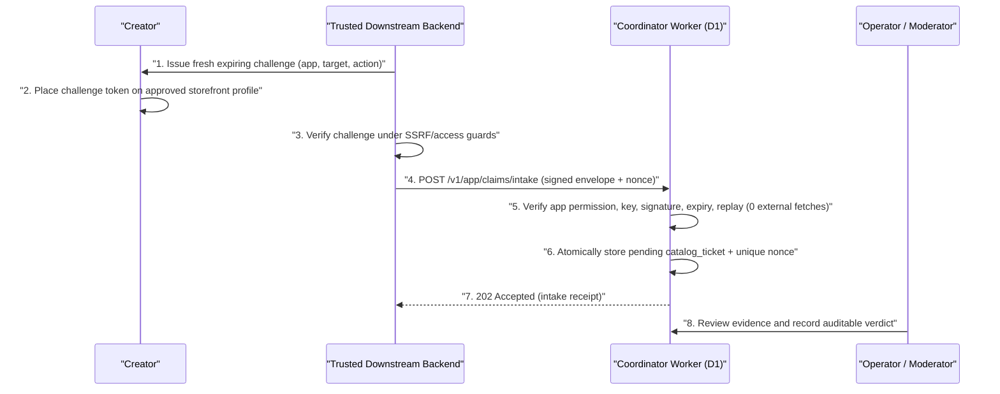

# Cryptographic Delegation and Creator-Removal Proof Research

> **Status:** Candidate Security Architecture Research (Not Implemented Protocol)  
> **Owning Sector:** Sector 5 (`legal-research`) / Sector 1 (`crawler-network`)  
> **Related Audit:** [`api_contract_review.md`](../audits/api_contract_review.md)

This document defines the threat model, protocol comparisons, candidate verification sequence, Worker CPU budget constraints, and open security decisions for delegated creator-removal claims (`R54-C38` / G15).

## 1. Reconciled Direction and Threat Model

- **Reconciled owner direction (`R54-C38`)**: Immediate automated removal on unverified submission is superseded. Approved, trusted downstream application backends verify storefront creator challenges and submit authenticated takedown requests to the Worker for **manual operator/moderator review** (`catalog_tickets`). Neither the Worker nor the crawler fleet probes storefronts for removal proof.
- **Three distinct trust claims** (never conflate them):
  1. **Key possession**: The sender authenticated the payload under an active registered app key.
  2. **Verifier authority**: The app holds current permission (`claims:delegate` / `takedowns:submit`) for that action and target scope.
  3. **Observation truthfulness**: The creator actually controlled the claimed storefront during the challenge window.
- **Fundamental threat-model limit**: Cryptography mitigates impersonation, tampering, and replay, but **cannot force a compromised or malicious authorized verifier to tell the truth**. Verifier admission, scoped permissions, immutable audit logs, key revocation, and wrongful-removal recovery are mandatory.

## 2. Delegated Responsibility Boundaries

| Actor | Permitted Role | Hard Security Prohibition |
| :--- | :--- | :--- |
| **Creator** | Places a fresh, random, expiring single-use challenge token on an approved creator profile location. | Do not rely on predictable `vendorId` markers or arbitrary product-page text. Domain control on a shared marketplace does not prove ownership of unrelated fronts. |
| **Approved Downstream Backend** | Verifies the challenge under access/SSRF rules (body limits, no redirects, private-IP denial) and signs the exact target, action, and minimal outcome digest. | **Never** ship app private keys or shared HMAC secrets inside static websites, browser bundles, npm packages, or distributed desktop binaries. Never forward raw profile dumps, cookies, or excess PII. |
| **Coordinator Worker (`src-worker/`)** | Validates app/key status, permissions, signature, expiry, rate limits, and replay nonce with **zero external HTTP fetch**; records pending intake and consumed nonce atomically. | Never perform outbound storefront fetches on removal intake; never auto-apply destructive deletion before operator/staff review. |
| **Crawler Fleet (`src-crawler/`)** | Zero role in creator-removal challenge verification. | Never schedule removal probes as crawl jobs. |

## 3. Cryptographic Pattern Comparison (`Candidate`)

| Pattern / Standard | Evaluation for VRCP Delegated Removal | Verdict |
| :--- | :--- | :--- |
| **HOTP / TOTP** (RFC 4226 / RFC 6238) | Account step-up only; does not bind target URL, removal action, or evidence digest; public bio exposes codes. | **Reject** for attestation envelopes. |
| **Payment-Webhook Pattern** (Stripe signatures + event idempotency) | Closest operational pattern (authenticates exact bytes, environment-scoped secrets, replay protection), except admitted apps are multiple independent verifiers. | **Reference model**. |
| **Shared-Secret HMAC-SHA-256** (RFC 2104 / JWS HS256) | One dedicated secret per approved app (never reuse bearer tokens, stored hashes, or one global key). Fast on Workers Web Crypto; Worker key compromise enables forgery. | **Owner candidate** (benchmark vs asymmetric JWS). |
| **Public-Key JWS / JWT** (RFC 7515 / RFC 8725) | App signs with private key; Worker stores public JWK only (`jose` or Web Crypto); pin `alg`, `iss`, `aud`, `typ`; never fetch remote `jku`/`x5u` URLs. | **Strong alternative** eliminating shared-secret custody risk. |
| **OAuth RAR** (RFC 9396) | Transaction-bound scope pattern reusable without running a full OAuth server. | **Pattern reference**. |
| **DPoP** (RFC 9449) | Binds HTTP method/URI only, not request body bytes. | **Optional transport hardening only**. |

## 4. Eight-Step Candidate Verification Sequence

Candidate signed envelope fields (reject unknown keys; enforce HTTPS and replay checks per RFC 9421 §§7.1–7.2): `schemaVersion`, `appId`, `keyId`, `challengeRef`, `normalizedTarget`, `action`, `evidenceDigest`, `nonce`, `audience`, `expiresAt`. Exact duplicate replay returns the original receipt; reusing a `nonce` with a different payload must fail closed.

## 5. Worker CPU Budget and Unresolved Decisions (`UNRESOLVED`)

- **Compute budget**: Cloudflare Workers Free allows **10 ms CPU per request** (Error 1102 on overrun). Benchmark HMAC-SHA-256 vs Ed25519/ECDSA JWS across cold/warm key import, max payload size, invalid signatures, replay checks, and concurrent load before committing to an algorithm. Never return 202 before the D1 intake transaction commits.
- **SDK boundary**: `src-package` currently depends only on `zod` (not `jose`) and has no signing helper, key registration, or key rotation endpoints.
- **Unresolved security decisions**:
  1. Verifier admission criteria and mandatory backend-only custody enforcement.
  2. Challenge issuer (downstream app vs coordinator) and canonical proof-to-front blast radius.
  3. Key custody, rotation, and emergency revocation workflow.
  4. Wrongful-removal recovery without undoing unrelated valid suppressions (`R13-C4`).
  5. Reconciling `LEGAL.md` §§9.4–9.5 (coordinator probes / direct routes) with §§10.4–10.5 (delegated app verification + manual review).
