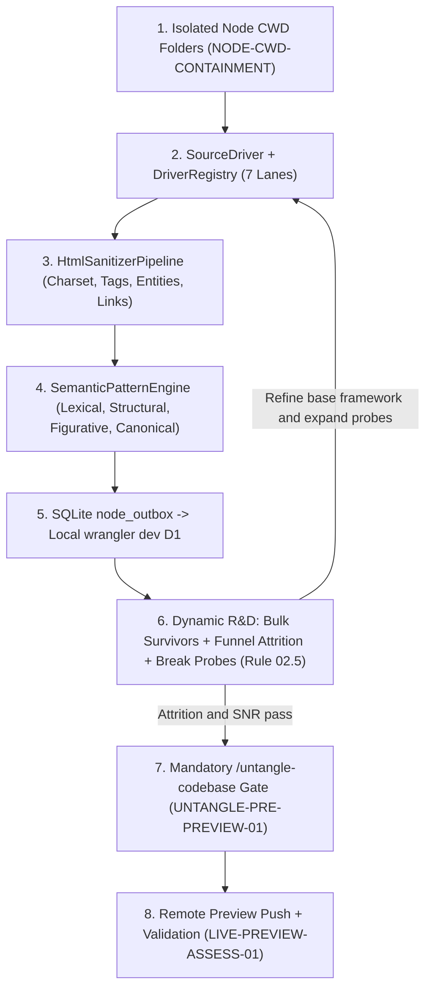

# Live Ingestion, First-Principles Abstraction, and Data Assessment Strategy

> **Status:** Investigative Engineering Strategy (`[P19]` / `PN-010`)  
> **Owning Sector:** Sector 4 (`pipeline`) / Sector 1 (`crawler-network`)  
> **Related Current Source:** [`coordinator_worker.md`](../../source/specifications/coordinator_worker.md), [`crawler_node.md`](../../source/specifications/crawler_node.md), [`coordinator_d1.md`](../../source/schemas/coordinator_d1.md), [`logging_and_telemetry.md`](../../source/schemas/logging_and_telemetry.md)

This strategy governs Version 0 live debugging before remote preview pushes (`REORIENT-LIVE-DEBUG`). Unit test fixtures verify isolated code paths, but they cannot capture noisy real storefronts or edge failures.

## Evidence Record

| Evidence Item | Label | Scope and Basis | Author Date | Next Falsifiable Check |
| :--- | :--- | :--- | :--- | :--- |
| **Cloudflare Free Limits** | `Retrieved` | `10 ms` CPU, `50` D1 queries, `5M` reads/day, `100k` writes/day ([`infrastructure_and_quotas.md`](infrastructure_and_quotas.md)). | `2026-11-24` | Measure live multi-node usage in `LIVE-LOCAL-ASSESS-01`. |
| **Live Code Defects** | `Retrieved` | Audit of `observation_adapter.ts`, `catalog_hygiene.ts`, `avatar_compatibility.ts`, `sanitizer.ts`, `logger.ts`. | `2026-11-24` | Replace via `REORIENT-CN-02..05` and `NODE-CWD-CONTAINMENT`. |
| **OOP & Semantic Framework** | `Candidate` | Proposed `SourceDriver`, `HtmlSanitizerPipeline`, `SemanticPatternEngine`, `VpmQualityAnalyzer`, and `PaginationController`. | `2026-11-24` | Refactor `src-crawler/` and verify in `LIVE-LOCAL-ASSESS-01`. |
| **Funnel, Bulk & Chaos Audit** | `Candidate` | Local `wrangler dev` + multi-node funnel conservation, initial 9 buckets, and initial 9 break tests. | `2026-11-24` | `Measured` totals stay pending until `LIVE-LOCAL-ASSESS-01`. |

## Consolidated Owner Prompt Lineage (`P1` to `P4`)

Per [Rule 02 Section 5](../../../.agents/rules/02-boundary-and-review.md), initial debugging packets, attrition buckets, and chaos scenarios are starting suggestions. Unpack the true R&D lifecycle dynamically when live debugging starts.

| Prompt ID | Date | Source | Retained Core Directive |
| :--- | :--- | :--- | :--- |
| **`P1`** | `2026-11-24` | `/goal` | Coordinate `docs/scratch-pipeline/`, oversee all 5 sector ledgers, and delegate bounded skill-driven slices. |
| **`P2`** | `2026-11-24` | `/untangle-codebase` | Boot local `wrangler dev` + isolated CWD nodes, bulk-assess signal/noise/bloat, break edges, optimize via OOP/semantic frameworks, and run `/untangle-codebase` before preview pushes. |
| **`P3`** | `2026-11-24` | Addendum | Uphold anti-survivorship-bias funnel conservation (`survivors + accounted_attrition === total_attempted`) and audit dropped, blocked, rejected, and excluded rows. |
| **`P4`** | `2026-11-25` | Addendum | Treat initial packets, buckets, and scenarios as starting suggestions only. Expand live R&D without tunnel vision ([Rule 02.5](../../../.agents/rules/02-boundary-and-review.md)). |



## 1. First-Principles OOP and Semantic Pattern Framework (Starting Design Hypothesis, `Candidate`)

Live `src-crawler/` and `src-worker/` code reveals systemic coupling where local fixes create downstream defects. Fixing each HTML edge case with an inline regex produces fragile, crooked patch chains. Instead, distill ingestion into five starting abstractions, and refine them when live data exposes real gaps.

### 1.1 Five Core Abstractions

1. **`SourceDriver` and `DriverRegistry` (Strategy Pattern)**

   Replace `if (job.platform === ...)` chains in `observation_adapter.ts` with one typed interface per `(platform, purpose)`. Each driver declares its own `Accept` header, origin check, discovery parser, and observation extractor. `DriverRegistry` resolves drivers deterministically without branching inside `fetchJobOutcome()`.

2. **`HtmlSanitizerPipeline` (Ordered Value Transform)**

   Run a deterministic five-stage text pipeline across every extracted field. Normalize Unicode (`NFKC`), strip structural HTML tags (`<script>`, `<style>`, `<br>`), decode numeric and named entities (`unescapeHtml`), strip promotional markdown noise, and clean tracking query parameters (`cleanTrackingParams`).

3. **`SemanticPatternEngine` (Layered Signal Extraction)**

   Live `cleanTitle()` in `catalog_hygiene.ts` strips all brackets before Worker `extractAvatarCompatibility()` runs. Live `avatar_compatibility.ts` relies on isolated negative lookbehinds such as `/(?<!サン)グラス/` for `grus`. Replace ad-hoc regexes with four explicit semantic layers.

   - **Structural wrapper extraction**: Tokenize brackets (`【...】`, `[...]`, `(...)`), JSON-LD tags, and link anchors with their container context first.
   - **Figurative and context disambiguation**: Score positive compatibility cues (`対応`, `向け`, `fit`, `compatible`) against figurative traps (`サングラス`, `glass shader`, `milk tea`, `lime green`, `Autodesk Maya`).
   - **Lexical noise trimming**: Strip marketing prefixes (`[Sale]`, `【無料】`, trailing SemVer tokens) only after signal extraction finishes. Map VPM `displayName` or cleaned storefront titles into `ObservationSchema.title`.
   - **Platform-agnostic normalization**: Project canonical base slugs, `vrchatRelevance`, `desktopToolEvidence`, and `platformTags` into uniform `ObservationSchema` fields across all lanes. Map `platformTags` to `CatalogPackageSchema.tags`.

4. **`VpmQualityAnalyzer` (Deterministic VPM Diagnostics)**

   Evaluate VPM `index.json` and `package.json` entries without fabricating versions. Select the highest valid SemVer release (`compareVpmVersions`), strip `.zip` binaries from `outboundLinks`, and compute `qualityFlags` (`skeleton`, `fork_suspected`, `missing_release`, `incomplete_metadata`, `missing_zip_sha256`).

5. **`PaginationController` (Bounded Lead Cursor)**

   Live `parseBoothBrowseLeads()` and `parseShopifyProductSitemapLeads()` fail the whole job when a feed exceeds 100 links. `PaginationController` caps each batch at 100 `DiscoveryLead` items. It tracks `paginationDepth <= maxPaginationDepth` and emits one `nextPageLead`.

### 1.2 Crooked Patches vs First-Principles Design

| Defect Pattern | Crooked Patch Approach | First-Principles Abstraction (`Candidate`) |
| :--- | :--- | :--- |
| **Bracket loss before extraction** | Copy `extractAvatarCompatibility()` into each driver. | Extract structural tokens before `ObservationSchema.title` trimming. |
| **False-positive avatar matches** | Add per-word negative lookbehinds like `(?<!サン)グラス`. | Score figurative vs compatibility context inside `SemanticPatternEngine`. |
| **Raw HTML or entities in summaries** | Patch entity strings inside one storefront parser. | Enforce `HtmlSanitizerPipeline` globally on all driver outputs. |
| **>100-link discovery page failure** | Raise array limits until Worker payloads reject. | Split pages cleanly with `PaginationController` and `nextPageLead`. |
| **Mismatched `Accept` headers** | Add `if` branches inside `fetchJobOutcome()`. | Let each `SourceDriver` specify per-purpose request headers. |

## 2. Triangulated Optimization Axes (`Retrieved` and `Candidate`)

Optimize three runtime axes together so improving one axis never breaks another axis.

### 2.1 Axis 1: Coordinator Edge Budget (`Retrieved`)

- **Worker limits**: `10 ms` CPU per request, `100,000` requests/day. Offload HTML/Cheerio parsing and semantic regexes onto Crawler Nodes.
- **D1 query and row limits**: `50` queries per call, `5M` reads/day, `100k` writes/day. Omit `robots_body` in `origin_state` claim queries and batch updates in `db.batch()`.
- **Isolate robots matcher cache**: Cache compiled `robotsMatchers` at module scope keyed by `(origin, snapshot_id)` instead of recompiling `512 KiB` bodies per request.

### 2.2 Axis 2: Node Throughput and CWD Isolation (`NODE-CWD-CONTAINMENT`)

- **Local SQLite and outbox**: Keep `node.db` in WAL mode with `busy_timeout = 10000` and `maxPendingOutboxQuota = 1000`. Flush up to `50` due rows in chunks of `10` (`MAX_BATCH_RESULTS`).
- **Heartbeat and idle clocks**: Scale active heartbeats dynamically (`5s` to `30s`) under `120s` leases. Scale idle backoff (`5s` to `60s`).
- **Strict CWD containment**: Purge `import.meta.dir`, `homedir()`, `%LOCALAPPDATA%`, `~/Library/Logs`, and `~/.local/state` defaults from `src-crawler/src/utils/logging/logger.ts`. Keep every node artifact strictly inside `process.cwd()`.

| Node Artifact | Required CWD Path | Isolation Rule |
| :--- | :--- | :--- |
| **SQLite database & WAL** | `<cwd>/node.db` (`-wal`, `-shm`) | Two node processes must never share one directory or database file. |
| **Logs & archives** | `<cwd>/logs/latest.log`, `<cwd>/logs/archive/` | Resolve default via `path.resolve(process.cwd(), "logs")`. |
| **Runtime config & env** | `<cwd>/node.config.json`, `<cwd>/.env` | Load scoped `GITHUB_TOKEN` inside `runtime_config.ts`, never `observation_adapter.ts`. |
| **Stop control file** | `<cwd>/node.stop` | Terminate only the target node inside that working directory. |

### 2.3 Axis 3: Catalog Signal-to-Noise Ratio

- **Zero raw text leaks**: Reject raw HTML tags, undecoded entities, and truncated bracket titles before staging `node_outbox` payloads.
- **Accurate field provenance**: Preserve `owner_key`, `owner_name`, `price`, `currency`, `availability`, `vpm_latest_version`, and `quality_flags_json`.
- **Clean boundary quarantine**: Park unknown non-VPM `custom_domain` hosts in `source_leads` (`pending_review`). Keep crawled `canonical_packages` rows `unverified` by default.

## 3. Bulk Data Quality Assessment Rubric (Starting Hypothesis, `Candidate`)

Start local `wrangler dev` (`VRCP_ENV=development`) alongside multiple isolated node folders (`node-a/`, `node-b/`). Seed real preview steering profiles across all seven lanes (`vpm`, `booth`, `gumroad`, `jinxxy`, `itch`, `shopify`, `github`). Run live ingestion across discovery and leaf metadata phases. Expand inspection queries whenever real storefronts expose unexpected bloat or parsing patterns (Rule 02 Section 5).

Because unit tests mock upstream HTML, manually inspect bulk Coordinator D1 tables and per-node logs. Verify data comprehension in `src-package/` SDK responses and local `src-web/` views.

### 3.1 Bulk Inspection Targets

- **Coordinator D1 (`VRCP_D1`)**: Query `canonical_packages`, `listing_sources`, `listing_relations`, `source_items`, and `source_leads` grouped by `platform` and `target_host`.
- **Crawler Node (`<cwd>/`)**: Inspect `logs/latest.log` (`[ACTIVITY]`, `[FINDING]`, `[WARN]`, `[ERROR]`, `[RATE_LIMIT]`) and SQLite `node_runs`, `node_tasks`, and `node_outbox`.
- **Consumer View (`src-package/`, `src-web/`)**: Read `/v1/app/index`, `/v1/app/index/search`, and `/v1/operator/*` payloads to confirm human comprehension.

### 3.2 Signal, Noise, and Bloat Rubric

| Quality Dimension | Pass Criterion (`Candidate` Target) | Noise / Failure Signal |
| :--- | :--- | :--- |
| **Text Coherence** | Zero raw HTML tags, decoded entities (`&amp;`, `&#x27;`), readable titles and summaries. | Garbled CJK strings, cut-off brackets, or markdown noise. |
| **Semantic Precision** | `vrchatRelevance`, `tags_json`, `listing_relations`, and `desktopToolEvidence` match item type. | Generic `Maya` tools, `sunglasses`, or `milk tea` tagged as VRChat avatars. |
| **Metadata Completeness** | Valid `owner_key`, `owner_name`, `price`, `currency`, `availability`, and `quality_flags_json`. | Missing price set to `0` instead of `null`, or `.zip` leaks. |
| **Bloat & Deduplication** | One `canonical_packages` row per item, bounded `source_items`, clean `304` skip. | Duplicate query-param listings or `source_items` churn on `304`. |
| **Boundary Quarantine** | Unknown `custom_domain` hosts stay in `pending_review`. Crawled items stay `unverified`. | Unapproved sites auto-promoted or crawled rows marked `verified`. |

`Measured` local corpus counts stay `Pending execution in LIVE-LOCAL-ASSESS-01`. Record exact query totals, error counts, and D1 row telemetry during the live run without estimating numbers ahead of time.

## 4. Anti-Survivorship-Bias Funnel and Attrition Audit Protocol (`Candidate`)

Inspecting only surviving `canonical_packages` rows creates blind spots. High-signal survivors can hide silent parser drops, stalled queues, or harsh relevance filters. Audit every lane from seed to public index.

### 4.1 Per-Lane Funnel Conservation

Track exact stage counts per preview lane (`vpm`, `booth`, `gumroad`, `jinxxy`, `itch`, `shopify`, `github`) and `custom_domain`:

```text
Seeded -> Claimed -> Robots-Checked -> Fetched -> Parsed -> Relevance-Passed -> Promoted -> Canonicalized -> Published
```

Verify that `survivors + accounted_attrition === total_attempted` for every lane. Never certify any driver or lane from survivor samples alone without measured attrition ratios and sampled review of dropped, rejected, and blocked URLs.

These nine buckets serve strictly as starting suggestions per Rule 02 Section 5. Unpack the true R&D lifecycle dynamically when `LIVE-LOCAL-ASSESS-01` begins, and add newly observed attrition buckets freely.

### 4.2 Initial Non-Survivor Attrition Buckets (Starting Suggestions, Buckets 1 to 5)

| Attrition Bucket | Storage / Log Source | What to Measure and Sample |
| :--- | :--- | :--- |
| **1. Stalled or Blocked Jobs** | `crawl_jobs`, `/v1/operator/jobs` | Count `blocked`, `backoff`, and stuck `pending` rows grouped by `claimabilityBlockers`. |
| **2. Quarantined / Rejected Leads** | `source_leads` | Group `pending_review` and `rejected` leads by `target_host` to catch false negatives. |
| **3. Incomplete / Gone Items** | `source_items` | Inspect `complete = 0`, non-empty `issues_json`, and `gone_at` spikes per platform. |
| **4. HTTP 200 Silent Drops** | `node_tasks`, `logs/latest.log` | Find fetched HTTP `200` pages that emitted zero observations and zero leads. |
| **5. Relevance-Filter Drops** | Node `[FINDING]` / `[DEBUG]` logs | Sample items dropped by `vrchatRelevance` to measure real false-negative rates. |

### 4.3 Initial Non-Survivor Attrition Buckets (Starting Suggestions, Buckets 6 to 9)

| Attrition Bucket | Storage / Log Source | What to Measure and Sample |
| :--- | :--- | :--- |
| **6. Robots Denials & Stalls** | `origin_state`, `crawl_jobs` | Audit `robots_status_code`, `Disallow` paths, and `robots_deferred_until` / `refresh_lease_id` stalls. |
| **7. Node Tasks & Outbox Drops** | `node.db`, `logs/latest.log` | Inspect `node_tasks` failures, `node_outbox` retries or `dead` rows, and `[WARN]` / `[ERROR]` / `[RATE_LIMIT]`. |
| **8. Pagination Truncation** | `crawl_jobs`, `steering_profiles` | Flag jobs hitting `pagination_depth >= max_pagination_depth` or losing links past batch caps. |
| **9. Public Index Exclusions** | `canonical_packages`, `listing_sources` | Count rows excluded from `/v1/app/index` by `content_rating`, `lifecycle`, `publishClasses`, or provisional sources. |

## 5. Initial Adversarial Chaos and Break-Testing Matrix (Starting Suggestions, `Candidate`)

Purposefully break local Coordinator and node processes during `LIVE-LOCAL-ASSESS-01` to uncover real failure boundaries. These nine scenarios are starting suggestions per Rule 02 Section 5. Expand R&D probing dynamically whenever unexpected failure modes or noise patterns appear, and record each reproduced failure as a permanent fixture.

### 5.1 Lease, Concurrency, Feed, and Encoding Traps (Scenarios 1 to 5)

| Chaos Scenario | Fault Injection Method | Expected Fail-Closed Outcome |
| :--- | :--- | :--- |
| **1. Coordinator Outage** | Kill `wrangler dev` mid-fetch during active `120s` leases. | Nodes abort on lost authority, stage in `node_outbox`, and replay on recovery. |
| **2. Multi-Node Races** | Start two isolated nodes targeting overlapping origins at once. | `origin_state` locks grant single-winner leases without concurrent bursts. |
| **3. Malformed & >100-Link Feeds** | Serve truncated JSON, XML `<!DOCTYPE>`/`<!ENTITY>`, and >100 links. | VPM reports `partial_batch`. XML aborts. `PaginationController` emits `nextPageLead`. |
| **4. Encoding & Bracket Traps** | Feed `&#x27;`, `<p>` summaries, `【桔梗対応】`, and `サングラス` or `Maya`. | `HtmlSanitizerPipeline` cleans text. `SemanticPatternEngine` preserves real compatibility only. |
| **5. Conditional `304` Recrawl** | Re-run due jobs returning `304` with matching `ETag` and `Last-Modified`. | Node reports `unchanged`. Worker updates `crawl_jobs` and `origin_state` only. |

### 5.2 Robots, Rate-Limit, Security, and CWD Traps (Scenarios 6 to 9)

| Chaos Scenario | Fault Injection Method | Expected Fail-Closed Outcome |
| :--- | :--- | :--- |
| **6. RFC 9309 Denials** | Return `Disallow: /`, `500` on `robots.txt`, then `200` allow on refresh. | Blocked paths stay barred. `robots_deferred_until` clears before `refresh_lease_id`. |
| **7. Rate-Limit `429` Backoff** | Inject `429 Retry-After: 90` and GitHub secondary `403` limits. | Node logs `[RATE_LIMIT]`. Coordinator honors `Retry-After` above origin minimums. |
| **8. Binary, Redirect & SSRF Traps** | Return `.zip`/`.vpmz`/`.fbx` redirects, `application/zip`, `127.0.0.1` DNS, or `itch.io/search`. | Node aborts before transfer, reports `blocked`, and writes zero binary bytes. |
| **9. Parallel CWD Isolation** | Run `node-a/` and `node-b/` binaries concurrently without `CRAWLER_LOGS_DIR`. | Zero writes hit `src-crawler/logs`, `homedir()`, `%LOCALAPPDATA%`, or `~/.local/state`. |

## 6. Multi-Day Lifecycle Discipline and Pre-Preview Gate (`UNTANGLE-PRE-PREVIEW-01`)

Real live ingestion runs take time across `4h`, `6h`, and `24h` recrawl windows. Treat unit test passes strictly as screening checks, never as proof of real-world catalog readiness.

1. **Clean pause and resume**: Run background `wrangler dev` and node processes across collection windows, then yield cleanly without standby polling loops. Inspect persisted D1 and `node.db` state after each window.

2. **Pre-preview `/untangle-codebase` gate (`UNTANGLE-PRE-PREVIEW-01`)**: After `LIVE-LOCAL-ASSESS-01` stabilizes abstractions, funnel attrition, and data quality, run `/untangle-codebase` across all touched `src-*` projects, `docs/source/`, and `docs/research/`.

3. **Domain verification**: Run all domain commands from [`SYSTEM_MAP.md`](../../source/SYSTEM_MAP.md), `check_doc_links.ts`, and `ste-lint.py --strict`.

4. **Remote preview lift (`LIVE-PREVIEW-ASSESS-01`)**: After `UNTANGLE-PRE-PREVIEW-01` passes, lift the `REORIENT-LIVE-DEBUG` hold. Publish Worker and Crawler preview releases via Sector 4 Pipeline and repeat bulk survivor plus attrition validation remotely.
