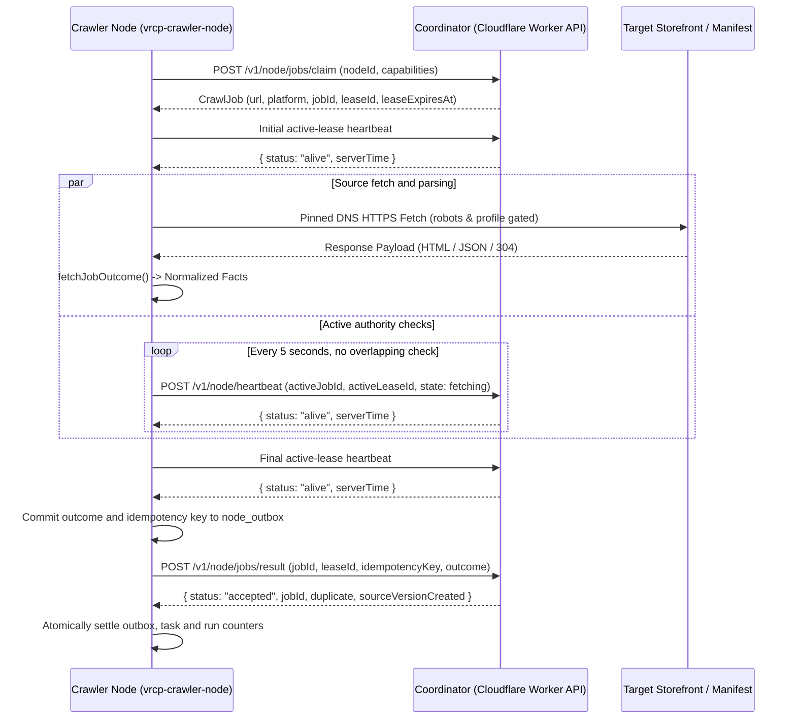

# Crawler Node & Crawler Client Specification (Candidate)

> **Document Status:** Current source reference with open recovery and GUI integration gaps
> **Target Subsystem:** Headless Crawler Node Daemon (`src-crawler`) and Desktop GUI Crawler Client (`src-crawler-client`)  
> **Source Directory:** `src-crawler/src/` (entry `main.ts`, functional subfolders) and `src-crawler-client/`

This reference describes inspected code and scoped local runtime checks. Separate Worker/fleet, platform and GUI integration remain open; local checks do not establish release readiness.

---

## 1. Overview and Terminology Disambiguation

This specification distinguishes between two operational deployment models:

### 1.1 Crawler Node (`src-crawler`)
- **Role:** Compiled binary for a headless VPS such as Linux to run (and Windows development binary `dist/dev/vrcp-crawler-node.exe`).
- **Core Behaviors:**
  - Authenticated polling of the coordinator for job leasing via `/v1/node/jobs/claim`.
  - Accepts jobs leased by the coordinator matching its capability profile.
  - Crawls assigned jobs under strict origin pacing, pinned DNS, and robots adherence.
  - Sends execution results to coordinator: success (normalized facts), rate limit (429 backoff), or failure (diagnostics).
  - **Recovery Boundary:** The daemon stages results and idempotency keys in SQLite before submission. Startup replays pending results without refetching sources.
  - **Outbox Bounds:** Default pending quota is 1,000 items. Quota exhaustion pauses claims. Default retention is 24 hours; expiry discards replay eligibility.
  - **Settled Results:** Late failure bookkeeping cannot reopen sent or terminal entries. Repeated accepted receipts preserve the first receipt and counters.
  - **Structured Logging**: Logger broadcasts operational activities ([ACTIVITY]) and discovery findings ([FINDING]) to latest.log.
  - The node ingests configuration from `.env` or process environment variables (NODE_ID, NODE_TOKEN, COORDINATOR_URL, NODE_CAPABILITIES, NODE_DB_PATH).
  - Emits local telemetry and durable submissions to `node.db` (`node_runs`, `node_tasks`, `node_outbox`).
  - **Docker Fleet Deployment**: Nodes deploy using Docker Compose (`src-crawler/docker-compose.yml`). Each node container mounts an isolated data volume (such as `node-data-1:/app/data`) to prevent SQLite database locks. The configuration requires pinned image digests (`VRCP_NODE_IMAGE`). Unverified automated updaters (such as Watchtower) and host Docker socket mounts are prohibited to protect active leases.

### 1.2 Crawler Client (`src-crawler-client`)
- **Current implementation:** Tauri with a SvelteKit static frontend. The Rust shell exposes a starter `greet` command and the opener plugin.
- **Not implemented:** Bundled node binary, child-process supervision, node setup, telemetry panels or coordinator token provisioning.
- **Owner intent:** A Windows GUI shell that bundles and controls the crawler node. Initialization alone does not deliver this integration.

### 1.3 Node log files

- Logger construction computes paths but creates no files, timers or exit hooks. The first log write starts those resources.
- An unused logger leaves existing logs unchanged when it rotates or closes. The `--version` command creates no node state.
- Active logs use `LoggerOptions.logsDir`, then `CRAWLER_LOGS_DIR`, then the runtime default. Explicit relative overrides still use the launch directory.
- Source runs default to `src-crawler/logs`, independent of the launch directory.
- Installed binaries default to `vrcp-crawler/logs` beneath Windows `LOCALAPPDATA`, macOS `~/Library/Logs`, or Linux `XDG_STATE_HOME`.
- Windows falls back to `~/AppData/Local`. Linux falls back to `~/.local/state`. Relative platform state variables use these absolute fallbacks.
- Docker sets `CRAWLER_LOGS_DIR=/app/data/logs` within its persistent volume. The executable directory is not a writable-state default.
- Session-only logging does not archive or clear an existing `latest.log`. Active latest-log rotation and shutdown retain their archive behavior.
- The 2026-10-06 crawler gate passed 141 tests and 874 assertions, type checks and a development binary build.
- Source and Windows compiled fixtures checked defaults, writes, overrides and relative state-variable rejection without launch-directory outputs.
- Docker configuration passed a static check. Linux/macOS binaries and the container did not run in this local gate.
- Concurrent writes during rotation, disk failures and synchronous exit flushing remain separate reliability risks.

---

## 2. Core Execution Lifecycle

1. **Lease Claiming (`POST /v1/node/jobs/claim`)**:
   - The node polls for a job that matches its declared capabilities. `PlatformSchema` defines ten capabilities, including storefront and registry drivers.
   - If no jobs are due, the node sleeps for the `retryAfterMs` duration sent by the coordinator.
2. **Periodic Heartbeat & Monotonic Deadline (`POST /v1/node/heartbeat`)**:
   - A timer checks active lease authority every 5 seconds. The heartbeat does not extend the lease deadline.
   - The runner enforces an independent, monotonic deadline from `leaseExpiresAt`. Fetching, parsing, and outbox staging must complete before expiry. If the lease expires before outbox staging, the runner aborts execution and skips result submission.
   - A failed authority check cancels source processing. Detection waits for the periodic check and its bounded retries. It is not instantaneous.
3. **Observation Parsing**:
   - The node parses outbound responses in memory with `src-crawler/src/adapters/observation_adapter.ts`.
   - The node never downloads or stores binary archives (`.unitypackage`, `.zip`, `.fbx`).
   - It limits description length to functional metadata summaries.
4. **Result Submission (`POST /v1/node/jobs/result`)**:
   - The node submits structured observation facts, discovered leads, or access failure diagnostics.
   - The client validates the receipt schema and requires its jobId to match the submitted job. Retries preserve the serialized request.
   - SQLite commits the outcome and idempotency key before HTTP submission. Failed receipt persistence leaves the result eligible for unchanged-key replay.
   - Startup sends pending results through `/v1/node/jobs/results`. Terminal rejection marks the entry dead; transient failures schedule bounded backoff.
   - Expiry and quota limits still apply. Restart does not grant a new source lease or bypass coordinator authority checks.

---

## 3. Outbound Transport and Network Safety Guardrails

- **Pinned DNS Resolution**: `public_metadata_fetch.ts` resolves origin IP addresses before socket creation. It rejects loopback, link-local, private, and cloud metadata addresses (anti-SSRF).
- **Origin Metadata Ceiling**: `public_metadata_fetch.ts` aborts a response above 2,000,000 bytes. This cap does not apply to coordinator JSON.
- **Coordinator Endpoint**: The client requires HTTPS, except for HTTP on loopback. It rejects embedded URL credentials and fragments.
- **Coordinator Redirects and Errors**: Calls use manual redirects and reject 3xx responses. Failed bodies are canceled without JSON parsing or body content in errors/logs.
- **Coordinator Success Bodies**: The client parses successful JSON, then applies the response schema. No streaming byte ceiling exists for these bodies.
- **Coordinator Retries**: Defaults are two retries and a 250 ms base delay, with a 2,000 ms delay cap. Options require nonnegative safe integers.
- **Idle Claim Pacing**: Empty claims use exponential backoff with jitter. The delay never falls below the coordinator wait or local minimum.
- **Idle Backoff Ceiling**: Jitter respects the local maximum. A longer coordinator wait overrides that maximum. Leasing a job resets the idle ladder.
- **Request Timeouts**: Each heartbeat attempt uses 5 seconds. Each claim/result attempt uses 30 seconds. Shutdown does not cancel these coordinator calls.
- **Access Outcomes**: The adapter reports rate limits, challenges and other failures to the coordinator. Coordinator origin pacing controls subsequent leases. No separate node circuit-breaker guarantee is established here.
- **RFC 9309 Boundary**: The coordinator checks robots snapshots at claim, heartbeat and result submission. The node sends the configured crawler User-Agent. Production robots refresh remains unfinished.

---

## 4. Local Telemetry Schema (`node.db` by default)

The node records local execution telemetry and task journals without modifying the coordinator catalog. For exact SQLite table schemas, column types, and structured logging formats, see [`DATABASE_SCHEMAS.md`](DATABASE_SCHEMAS.md).

## 5. Shutdown and recovery boundary

SIGINT, SIGTERM and the stdin commands stop/exit/shutdown request daemon cancellation. During start(), a 100 ms poll checks the configured node.stop file. The poll also runs during active fetches and reconnect waits. Final cleanup clears it.

Stop cancels source fetches and prevents execution after a pending claim or idle heartbeat returns. An in-flight result submission can still commit. The CLI waits for the daemon loop before closing SQLite and logs. Fatal one-shot errors retain failed status and exit code 1.

Task transitions and run counters share local SQLite transactions. Receipt validation checks the schema and job identity. The outbox persists payloads and idempotency keys before submission; receipt settlement shares the task/counter transaction.

The 2026-10-13 crawler gate passed 171 tests (1,441 assertions), typechecking, development compilation and credential-free version execution.

- Three child-process cases kill the daemon during a pending HTTP acknowledgment, then replay through actual loopback HTTP with published schemas.
- Cases cover unaccepted results, acceptance before a lost acknowledgment, and terminal lease rejection. Replay preserves the key and does not refetch sources.
- Test-only SQLite page limits cause real `SQLITE_FULL` during staging and receipt settlement. Both roll back and recover after capacity returns.
- Mixed-batch failure checks keep earlier sent and terminal entries settled. Existing quota, expiry and authority tests also pass.
- These checks use a schema-valid fixture coordinator, not Worker/D1. Source responses are injected; no external sources are fetched.
- Host power loss, OS permission/I/O failures, Linux/container interruption and separately running Worker/fleet ingestion remain unverified.
