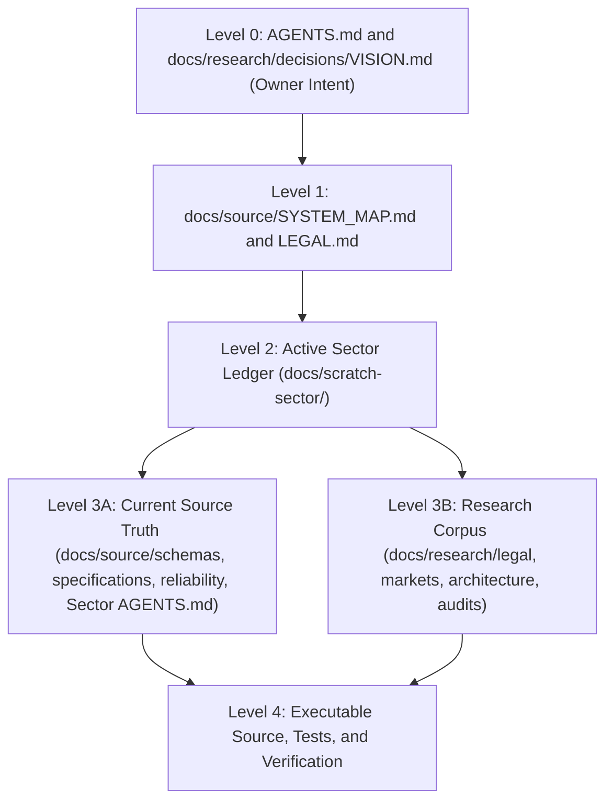
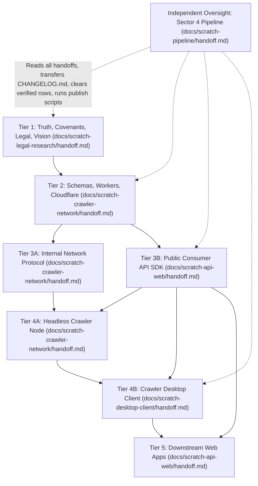

# VRCP System Map and Context Cascade

Start here at the beginning of a gate or after context loss. Read only the sector branch needed for the active task. This map owns **context routing, sector boundaries, three-domain documentation partitioning, and single-owner contract mapping**. It does not certify deployment readiness or replace executable source and tests.

## Context Cascade Overview

## Level 0 to Level 4 Read Order

Read strictly in order. Stop once the active slice's dependency boundary is clear.

| Level | Read Target | Purpose |
| :--- | :--- | :--- |
| **0** | [`AGENTS.md`](../../AGENTS.md) and [`VISION.md`](../research/decisions/VISION.md) (`T00` + active `Txx`) | Establish owner intent, brand rules, and non-negotiable safety invariants. |
| **1** | This map (`SYSTEM_MAP.md`) and [`LEGAL.md`](../../LEGAL.md) (when touching crawling, data, platforms, or APIs) | Select the single owning sector and applicable legal boundary. |
| **2** | Active sector 3-file control ledger (`docs/scratch-<sector>/IMPLEMENTATION_PLAN.md`, `task_tracker.md`, `handoff.md`) + permitted upstream `handoff.md` ledgers | Read active slice status, hypotheses, gate exit criteria, and upstream integration contracts. |
| **3** | Owning sector `AGENTS.md` + current source truth in `docs/source/` OR investigative record in `docs/research/` | Establish verified schemas, specs, or legal/market evidence without conflating domains. |
| **4** | Live source code and domain test fixtures inside the owning `src-*` folder (or primary statutory/policy citations for Sector 5) | Verify current executable behavior or primary legal text before editing. |

## Three-Domain Documentation Partition

| Documentation Domain | Canonical Path(s) | Owning Scope | Hard Boundary |
| :--- | :--- | :--- | :--- |
| **Current Source Truth** | `docs/source/` (`schemas/`, `specifications/`, `reliability/`, `SYSTEM_MAP.md`, `PUBLISHING.md`, `CHANGELOG.md`) | Verified system reliability truth, agreed storage/wire schemas, executable specifications, and pending product changelog. | Must match live code 1:1; never present unimplemented research proposals as current state. |
| **Human Application Wiki** | `docs/applications/` | Human-readable developer and end-user wiki guides (`VRCP API`, `VRCP Crawler`, `VRCP Crawler Client`). | **Keep untouched** during code/doc tasks; stage proposed changes in [`reliability/proposed_wiki_changes.md`](reliability/proposed_wiki_changes.md) until owner approves. |
| **Research Corpus** | `docs/research/` (`decisions/`, `legal/`, `markets/`, `architecture/`, `audits/`) paired with `LEGAL.md` | Legal jurisprudence, age assurance, platform clearance matrices, exploratory architecture, audits, and owner dispositions. | Never acts as source-access clearance or proof of implemented runtime behavior. |
| **Sector Control Ledgers** | `docs/scratch-<sector>/` (3 files: `IMPLEMENTATION_PLAN.md`, `task_tracker.md`, `handoff.md`) | Active slice planning, execution tracking, tiered integration handoffs, and written Publication Requests per sector. | Product/legal sectors must not clear `verified` rows or edit `docs/source/CHANGELOG.md`; only Sector 4 Pipeline transfers notes and clears rows. |
| **Automated Archives** | `docs/changelogs/` and root `CHANGELOG.md` | Generated publication snapshots managed exclusively by root delivery scripts. | Never edit or clear manually. |

## Five Monorepo Responsibility Sectors

| Sector | Code / Corpus Ownership | Sector `AGENTS.md` | Tracking Branch | Sector Scratch Anchor | Owning Docs | Domain Verification Commands |
| :--- | :--- | :--- | :--- | :--- | :--- | :--- |
| **1. Crawler Network** (`crawler-network`) | `src-worker/`, `src-worker/packages/network/`, `src-crawler/` | [`src-worker/AGENTS.md`](../../src-worker/AGENTS.md), [`src-crawler/AGENTS.md`](../../src-crawler/AGENTS.md) | `preview/crawler-network` | [`docs/scratch-crawler-network/`](../scratch-crawler-network/IMPLEMENTATION_PLAN.md) | [Coordinator](specifications/coordinator_worker.md), [Node](specifications/crawler_node.md), [D1 Schema](schemas/coordinator_d1.md), [Node SQLite](schemas/crawler_node_sqlite.md), [Reliability Matrix](reliability/failure_and_recovery_matrix.md) | `src-worker`: `bun run check`, `bun run test`, `bun run test:workers`, `bun run build:preview && bun run test:runtime`; `src-crawler`: `bun run typecheck`, `bun test`, `bun run build:dev` |
| **2. Crawler Desktop Client** (`desktop-client`) | `src-crawler-client/` | [`src-crawler-client/AGENTS.md`](../../src-crawler-client/AGENTS.md) | `preview/desktop-client` | [`docs/scratch-desktop-client/`](../scratch-desktop-client/IMPLEMENTATION_PLAN.md) | [Desktop Client](specifications/desktop_client.md) | `src-crawler-client`: `bun run check`, `bun run build:web` (`bun run build:dev` for Rust/Tauri changes) |
| **3. Consumer API and Web** (`api-web`) | `src-package/`, `src-web/`, `src-web-search/` | [`src-package/AGENTS.md`](../../src-package/AGENTS.md), [`src-web/AGENTS.md`](../../src-web/AGENTS.md), [`src-web-search/AGENTS.md`](../../src-web-search/AGENTS.md) | `preview/workers-api`, `preview/web` | [`docs/scratch-api-web/`](../scratch-api-web/IMPLEMENTATION_PLAN.md) | [SDK & Web](specifications/consumer_sdk_and_web.md), [Wire Contracts](schemas/wire_and_protocol_contracts.md), [Proposed Wiki Changes](reliability/proposed_wiki_changes.md) | `src-package`: `bun run typecheck`, `bun test`; `src-web` / `src-web-search`: `bun run build` |
| **4. Root Distribution Pipeline** (`pipeline`) | Root `package.json`, `scripts/`, `.github/workflows/`, `config*.versions.json`, `tests/` | Root [`AGENTS.md`](../../AGENTS.md) | `main`, `release/*` | [`docs/scratch-pipeline/`](../scratch-pipeline/IMPLEMENTATION_PLAN.md) | [Publishing Guide](PUBLISHING.md), [Agent Publishing Procedure](../research/decisions/AGENT_PUBLISHING_PROCEDURE.md) | Root: `bun test ./tests`, `bun .agents/scripts/check_doc_links.ts` (run root tests ONLY when root tooling changes) |
| **5. Legal Research and Covenants** (`legal-research`) | `LEGAL.md`, `docs/research/` | Root [`AGENTS.md`](../../AGENTS.md) | Feature / `main` | [`docs/scratch-legal-research/`](../scratch-legal-research/IMPLEMENTATION_PLAN.md) | [`LEGAL.md`](../../LEGAL.md), [Research Index](../research/README.md), [Expansion Matrix](../research/legal/expansion_action_matrix.md) | `bun .agents/scripts/check_doc_links.ts`, `python .agents/skills/ste-writing-skill/ste-lint.py <changed-doc>` |

## Departmental Handoff Cascade (`handoff.md`)

Every sector control folder contains a `handoff.md` integration ledger with labeled cascade tier sections. Each sector agent edits strictly inside its own sector, reads upstream (higher-tier) `handoff.md` ledgers to propagate changes into its own code, and submits Publication Requests strictly inside its own `handoff.md`. Only Sector 4 (`pipeline`) oversees all `handoff.md` ledgers, transfers verified product notes into [`docs/source/CHANGELOG.md`](CHANGELOG.md), clears transferred `verified` rows across sector ledgers, and runs root publication scripts.

| Cascade Tier | Owning Sector Folder | Scope | Permitted Upstream `handoff.md` Reads |
| :--- | :--- | :--- | :--- |
| **Tier 1: Truth, Covenants, Legal, Vision** | [`docs/scratch-legal-research/handoff.md`](../scratch-legal-research/handoff.md) | `LEGAL.md`, `docs/research/` | `scratch-pipeline/handoff.md` (notices only) |
| **Tier 2: Schemas, Workers, Cloudflare** | [`docs/scratch-crawler-network/handoff.md`](../scratch-crawler-network/handoff.md) (Tier 2) | `src-worker/` (D1, KV, Worker routes) | `scratch-legal-research/handoff.md`, `scratch-api-web/handoff.md` (Tier 3B preview SDK), `scratch-pipeline/handoff.md` |
| **Tier 3A: API and Networking (Internal)** | [`docs/scratch-crawler-network/handoff.md`](../scratch-crawler-network/handoff.md) (Tier 3A) | `src-worker/packages/network/` | `scratch-legal-research/handoff.md`, own Tier 2, `scratch-pipeline/handoff.md` |
| **Tier 3B: API and Networking (Consumer SDK)** | [`docs/scratch-api-web/handoff.md`](../scratch-api-web/handoff.md) (Tier 3B) | `src-package/` (`vrc-packages-api`) | `scratch-legal-research/handoff.md`, `scratch-crawler-network/handoff.md` (Tier 2 / 3A), `scratch-pipeline/handoff.md` |
| **Tier 4A: Headless Crawler Node** | [`docs/scratch-crawler-network/handoff.md`](../scratch-crawler-network/handoff.md) (Tier 4A) | `src-crawler/` | `scratch-legal-research/handoff.md`, own Tier 2 / 3A, `scratch-api-web/handoff.md` (Tier 3B preview SDK), `scratch-pipeline/handoff.md` |
| **Tier 4B: Crawler Desktop Client** | [`docs/scratch-desktop-client/handoff.md`](../scratch-desktop-client/handoff.md) (Tier 4B) | `src-crawler-client/` | `scratch-legal-research/handoff.md`, `scratch-crawler-network/handoff.md` (Tier 2 / 3A / 4A), `scratch-api-web/handoff.md` (Tier 3B release SDK), `scratch-pipeline/handoff.md` |
| **Tier 5: Downstream Web Apps** | [`docs/scratch-api-web/handoff.md`](../scratch-api-web/handoff.md) (Tier 5) | `src-web/`, `src-web-search/` | `scratch-legal-research/handoff.md`, `scratch-crawler-network/handoff.md`, own Tier 3B, `scratch-desktop-client/handoff.md` (Tier 4B), `scratch-pipeline/handoff.md` |
| **Independent Oversight: Pipeline** | [`docs/scratch-pipeline/handoff.md`](../scratch-pipeline/handoff.md) | Root `package.json`, `scripts/`, `.github/workflows/`, `config*.versions.json`, `tests/`, `docs/source/CHANGELOG.md` | **All sector `handoff.md` and `task_tracker.md` ledgers** |

## Single-Owner Contract Registry

| Question | Single Owning Record | Keep Separate |
| :--- | :--- | :--- |
| What is current owner intent and brand naming? | [`VISION.md`](../research/decisions/VISION.md) + [`owner_dispositions.md`](../research/decisions/owner_dispositions.md) | Owner intent vs executable proof. |
| What are legal covenants and expansion clearance gates? | [`LEGAL.md`](../../LEGAL.md) + [`docs/research/legal/`](../research/README.md) | Draft covenants and research vs active D1 source profiles. |
| Which platforms have clearance evidence? | [`platform_clearance_matrix.md`](../research/markets/platform_clearance_matrix.md) | Public visibility vs Fetch/Retain/Publish authorization. |
| What is the live Cloudflare D1 schema? | [`coordinator_d1.md`](schemas/coordinator_d1.md) + `src-worker/src/storage/d1/utils.ts` | Live DDL vs remote deployed D1 migrations. |
| What is the live Crawler Node SQLite and logging schema? | [`crawler_node_sqlite.md`](schemas/crawler_node_sqlite.md) + [`logging_and_telemetry.md`](schemas/logging_and_telemetry.md) | Node local outbox vs Coordinator D1 authority. |
| What are the agreed wire, cursor, token, and SDK schemas? | [`wire_and_protocol_contracts.md`](schemas/wire_and_protocol_contracts.md) + `src-worker/packages/network/` + `src-package/` | Internal node wire protocol vs public consumer SDK. |
| What are system failure and recovery guarantees? | [`failure_and_recovery_matrix.md`](reliability/failure_and_recovery_matrix.md) | Verified local bounds vs unmeasured hosted fleet budgets. |
| What changes are proposed for `docs/applications/`? | [`proposed_wiki_changes.md`](reliability/proposed_wiki_changes.md) | Proposed deltas vs owner-approved wiki text. |
| How are versions, tags, and releases published? | [`PUBLISHING.md`](PUBLISHING.md) (human) + [`AGENT_PUBLISHING_PROCEDURE.md`](../research/decisions/AGENT_PUBLISHING_PROCEDURE.md) (agent) | Product slices vs Sector 4 root pipeline edits. |
| Where are pending product release notes recorded? | [`docs/source/CHANGELOG.md`](CHANGELOG.md) (written exclusively by Sector 4 Pipeline from sector `handoff.md` Publication Requests) | Sector `handoff.md` requests vs Pipeline-maintained `docs/source/CHANGELOG.md` vs generated root `CHANGELOG.md`. |
| What rules and skills govern agent execution? | [`.agents/README.md`](../../.agents/README.md) + [`.agents/skills/README.md`](../../.agents/skills/README.md) | Master root governance skills vs diversified sector skills. |

## Cross-Project Dependency Flow

1. `src-package/` (`vrc-packages-api` / `vrc-packages-api-preview`) publishes before consumers adopt updates.
2. `src-worker/packages/network/` (`vrc-packages-network`, single-stream GitHub Release tarball) publishes before `src-worker/` and `src-crawler/` adopt updates.
3. Zero `file:../src-*` links, relative sibling imports, or copied shared files across `src-*` folders.
