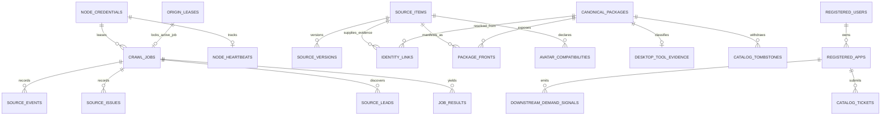

# Coordinator Cloudflare D1 Schema (Agreed Storage Contract)

> **Executable Authority:** `src-worker/src/storage/d1/utils.ts` (`D1_SCHEMA_SQL`, lines 34–118)  
> **Binding:** `VRCP_D1` (`src-worker/wrangler.toml`)  
> **Owning Sector:** Sector 1 (`crawler-network`)  
> **Inventory:** **26 tables**, **10 compatibility views**, **46 indexes**

This document is the 1:1 verified schema contract for the Cloudflare D1 coordinator database. `src-worker/test/support/local_sqlite.ts` mirrors this DDL for Bun unit fixtures only; it is not a production coordinator service.

## 1. Entity-Relationship Overview

## 2. Exact D1 Tables (26 Tables)

### 2.1 Node Workforce, Leasing, Robots, and Operator Policy (11 Tables)

| Table | Primary Key | Columns and Constraints |
| :--- | :--- | :--- |
| `node_credentials` | `node_id` | `token_hash`, `capabilities_json`, `revoked_at` |
| `node_heartbeats` | `node_id` (FK `node_credentials`) | `last_seen_at`, `state` (`CHECK IN ('idle','fetching')`), `active_job_id` |
| `crawl_jobs` | `job_id` | `platform`, `url` (`UNIQUE`), `origin`, `state` (`CHECK IN ('pending','leased','done','backoff','blocked')`), `next_fetch_at`, `claimed_by` (FK `node_credentials`), `lease_id`, `lease_expires_at`, `etag`, `last_modified`, `created_at`, `robots_deferred_until`, `source_rule_id`, `job_purpose` (`DEFAULT 'metadata'`, `CHECK IN ('discovery','metadata')`), `lease_profile_id` |
| `origin_leases` | `origin` | `active_job_id` (FK `crawl_jobs`), `lease_expires_at`, `next_allowed_at`, `min_delay_ms` |
| `origin_robots` | `origin` | `snapshot_id`, `status_code`, `body`, `fetched_at`, `expires_at`, `refresh_lease_id`, `refresh_lease_expires_at` |
| `suppressed_urls` | `url` | `reason`, `suppressed_at` |
| `source_access_profiles` | `profile_id` | `platform`, `origin`, `path_scope`, `query_scope`, `method` (`CHECK (method='GET')`), `purpose` (`CHECK IN ('discovery','metadata')`), `min_delay_ms`, `expires_at`, `review_reference`, `reason`, `retain_classes_json` (`EvidenceClass[]`), `publish_classes_json` (`EvidenceClass[]`), `created_at`, `disabled_at` |
| `lead_autoqueue_rules` | `rule_id` | `lead_kind` (for example `'vpm_listing'`), `origin`, `path_scope`, `min_delay_ms`, `expires_at`, `review_reference`, `reason`, `created_at`, `disabled_at` |
| `job_results` | `lease_id` | `job_id` (FK `crawl_jobs`), `node_id`, `idempotency_key`, `request_digest`, `response_json`, `submitted_at` |
| `operator_audit_log` | `action_id` (`INTEGER PK AUTOINCREMENT`) | `entity_type` (`CHECK IN ('node','lead','job','rule','profile')`), `entity_id`, `actor`, `action`, `reason`, `occurred_at` |
| `coordinator_meta` | `key` | `value` |

### 2.2 Observation Lake and Discovery Leads (4 Tables)

| Table | Primary Key | Columns and Constraints |
| :--- | :--- | :--- |
| `source_items` | `source_key` | `platform`, `source_url`, `latest_digest`, `latest_version_no`, `gone_at` |
| `source_versions` | `version_id` | `source_key` (FK `source_items`), `version_no`, `digest`, `payload_json`, `observed_at`, `complete` (`DEFAULT 1`, `CHECK IN (0,1)`), `contributor_node_id`, `submission_lease_id`, `source_profile_id`, `UNIQUE(source_key, version_no)` |
| `source_events` | `event_id` (`INTEGER PK AUTOINCREMENT`) | `job_id` (FK `crawl_jobs`), `source_key`, `kind` (`'changed'`, `'unchanged'`, `'restored'`, `'gone'`, `'incomplete_listing'`, or `outcome.kind`), `observed_at`, `version_id`, `contributor_node_id`, `submission_lease_id`, `source_profile_id` |
| `source_issues` | `issue_id` (`INTEGER PK AUTOINCREMENT`) | `job_id` (FK `crawl_jobs`), `source_item_key`, `version_key`, `code`, `observed_at`, `contributor_node_id`, `submission_lease_id`, `source_profile_id` |
| `source_leads` | `lead_key` (SHA-256 of JSON identity tuple) | `discovered_from_url`, `discovered_from_job_id` (FK `crawl_jobs`), `discovered_from_item_key`, `kind`, `target_url`, `claimed_package_id`, `status` (`CHECK IN ('pending_review','approved','rejected')`), `first_seen_at`, `last_seen_at`, `first_seen_node_id`, `first_seen_lease_id`, `first_seen_profile_id`, `last_seen_node_id`, `last_seen_lease_id`, `last_seen_profile_id` |

*(Count note: 5 observation/lead tables above + 11 workforce/policy tables = 16; 6 canonical tables + 4 downstream/ticket tables below = 26 total.)*

### 2.3 Canonical Catalog Graph and Delta Tombstones (6 Tables)

| Table | Primary Key | Columns and Constraints |
| :--- | :--- | :--- |
| `canonical_packages` | `canonical_id` | `umbrella` (`CHECK IN ('tools','assets','avatars')`), `category`, `lifecycle` (`CHECK IN ('active','deprecated','quarantined','delisted')`), `display_name`, `vpm_id`, `created_at`, `updated_at`, `published_at`, `timestamp_confidence`, `content_rating` (`DEFAULT 'general'`) |
| `catalog_tombstones` | `(canonical_id, recorded_at)` | `canonical_id`, `reason` (`CHECK IN ('rating_withdrawn','deleted','delisted')`), `recorded_at` |
| `identity_links` | `link_id` | `source_key` (FK `source_items`), `canonical_id` (FK `canonical_packages`), `evidence_kind` (`CHECK IN ('vpm_id','repository_match','cross_storefront_link','curator_verified','simhash_match')`), `confidence` (`CHECK (confidence >= 0.0 AND confidence <= 1.0)`), `review_state` (`CHECK IN ('provisional','accepted','rejected')`), `created_at`, `reviewed_at` |
| `package_fronts` | `front_id` | `canonical_id` (FK `canonical_packages` `ON DELETE CASCADE`), `source_key` (FK `source_items` `ON DELETE CASCADE`), `platform`, `storefront_url`, `price`, `currency`, `availability` (`DEFAULT 'available'`), `observed_at`, `UNIQUE(canonical_id, source_key)` |
| `avatar_compatibilities` | `compatibility_id` | `source_key` (FK `source_items` `ON DELETE CASCADE`), `target_avatar_base`, `scope` (`CHECK IN ('named_base','universal','uncertain')`), `confidence` (`CHECK IN ('creator_declared','keyword_inferred','unverified')`), `evidence_source`, `created_at` |
| `desktop_tool_evidence` | `canonical_id` (FK `canonical_packages` `ON DELETE CASCADE`) | `tool_subtype` (`CHECK IN ('companion_client','osc_control','tracking_bridge','streaming_accessibility','utility')`), `supported_os`, `particular_vrchat_target` (`CHECK IN (0,1)`), `evidence_url`, `publisher_claim`, `confidence`, `created_at` |

### 2.4 Downstream Principals, Demand, and Unified Tickets (4 Tables)

| Table | Primary Key | Columns and Constraints |
| :--- | :--- | :--- |
| `registered_users` | `user_id` | `user_name`, `token_hash`, `contact_email`, `created_at`, `revoked_at`, `age_verified` (`DEFAULT 0`), `is_moderator` (`DEFAULT 0`) |
| `registered_apps` | `app_id` | `app_name`, `token_hash`, `contact_email`, `permissions_json`, `created_at`, `revoked_at`, `request_count` (`DEFAULT 0`), `last_active_at`, `candidate_status` (`DEFAULT 'none'`, `CHECK IN ('none','review_pending','reviewed','trusted')`), `candidate_flags_json` (`DEFAULT '[]'`), `owner_user_id` (FK `registered_users(user_id)`) |
| `downstream_demand_signals` | `signal_id` | `app_id` (FK `registered_apps`), `signal_type` (`CHECK IN ('search_miss','refresh_demand','popularity_signal')`), `query`, `zero_hits` (`DEFAULT 0`), `requested_platform`, `target_url`, `category`, `metadata_json`, `recorded_at`, `resolved_at` |
| `catalog_tickets` | `ticket_id` | `ticket_type` (`CHECK IN ('opt_out','delegated_claim','removal_report','rating_dispute','safety_quarantine','metadata_issue')`), `app_id` (FK `registered_apps`), `target_url`, `canonical_id`, `requester_type` (`CHECK IN ('unauthenticated_creator','user','admin_operator','app')`), `requester_id`, `creator_id`, `reason`, `proof_kind` (`CHECK IN ('storefront_bio_token','dns_txt','manual_notice','delegated_signature')`), `proof_value`, `contact_email`, `challenge_token`, `expires_at`, `nonce`, `signature`, `payload_json`, `review_status` (`DEFAULT 'pending'`, `CHECK IN ('pending','accepted','rejected')`), `review_notes`, `recorded_at` |

## 3. Compatibility Read Views (10 Views)

Consolidated under `G18` so audit, ownership, robots refresh, and ticket tables share unified storage without breaking read queries:

| View Name | Underlying Table and Filter |
| :--- | :--- |
| `node_credential_actions` | `operator_audit_log WHERE entity_type = 'node'` |
| `operator_actions` | `operator_audit_log WHERE entity_type = 'lead'` |
| `job_seed_actions` | `operator_audit_log WHERE entity_type = 'job'` (`cast(action_id as text)`) |
| `operator_rule_actions` | `operator_audit_log WHERE entity_type = 'rule'` |
| `source_access_profile_actions` | `operator_audit_log WHERE entity_type = 'profile'` |
| `origin_robots_refresh_leases` | `origin_robots WHERE refresh_lease_id IS NOT NULL` |
| `user_app_ownership` | `registered_apps WHERE owner_user_id IS NOT NULL` |
| `creator_opt_outs` | `catalog_tickets WHERE ticket_type = 'opt_out'` |
| `delegated_creator_claims` | `catalog_tickets WHERE ticket_type = 'delegated_claim'` |
| `catalog_reports` | `catalog_tickets WHERE ticket_type IN ('removal_report','rating_dispute','safety_quarantine','metadata_issue')` |

## 4. Exact Index Inventory (46 Indexes)

| Table | Indexes |
| :--- | :--- |
| `operator_audit_log` | `idx_operator_audit_log_entity(entity_type, entity_id, occurred_at)`, `idx_operator_audit_log_occurred(occurred_at DESC, action_id DESC)` |
| `crawl_jobs` | `idx_crawl_jobs_ready(state, next_fetch_at, platform)`, `idx_crawl_jobs_origin_due(origin, next_fetch_at, state)`, `idx_crawl_jobs_lease_profile(lease_profile_id)`, `idx_crawl_jobs_source_rule(source_rule_id)`, `idx_crawl_jobs_claimed_state(claimed_by, state)` |
| `origin_robots` | `idx_origin_robots_refresh(origin, refresh_lease_expires_at)` |
| `source_items` | `idx_source_items_url(source_url)` |
| `source_versions` | `idx_source_versions_complete(source_key, complete, version_no DESC)`, `idx_source_versions_contributor(contributor_node_id, observed_at DESC, version_id DESC)` |
| `source_events` | `idx_source_events_contributor(contributor_node_id, event_id DESC)` |
| `source_issues` | `idx_source_issues_contributor(contributor_node_id, issue_id DESC)` |
| `source_leads` | `idx_source_leads_status(status, kind)`, `idx_source_leads_page(status, first_seen_at, lead_key)`, `idx_source_leads_first_node(first_seen_node_id, first_seen_at DESC, lead_key DESC)`, `idx_source_leads_last_node(last_seen_node_id, last_seen_at DESC, lead_key DESC)`, `idx_source_leads_target(target_url)`, `idx_source_leads_discovered_url(discovered_from_url)` |
| `lead_autoqueue_rules` | `idx_lead_autoqueue_rules_scope(lead_kind, origin, disabled_at, expires_at)`, `idx_lead_autoqueue_rules_page(created_at DESC, rule_id DESC)` |
| `source_access_profiles` | `idx_source_access_profiles_scope(platform, origin, purpose, disabled_at, expires_at)`, `idx_source_access_profiles_page(created_at DESC, profile_id DESC)` |
| `canonical_packages` | `idx_canonical_packages_updated(updated_at ASC, canonical_id ASC)`, `idx_canonical_packages_created(created_at DESC, canonical_id DESC)`, `idx_canonical_packages_rating_updated(content_rating, updated_at DESC, canonical_id ASC)`, `idx_canonical_packages_category_rating(category, content_rating)` |
| `catalog_tombstones` | `idx_catalog_tombstones_cursor(recorded_at ASC, canonical_id ASC)` |
| `identity_links` | `idx_identity_links_source(source_key)`, `idx_identity_links_canonical(canonical_id)` |
| `package_fronts` | `idx_package_fronts_canonical(canonical_id)`, `idx_package_fronts_source(source_key)`, `idx_package_fronts_canonical_source(canonical_id, source_key)` (`UNIQUE`), `idx_package_fronts_storefront(storefront_url)` |
| `avatar_compatibilities` | `idx_avatar_compat_source_key(source_key)`, `idx_avatar_compat_target_base(target_avatar_base)` |
| `registered_users` | `idx_registered_users_token(token_hash)` |
| `registered_apps` | `idx_registered_apps_token_hash(token_hash)`, `idx_registered_apps_candidate(candidate_status, request_count)`, `idx_registered_apps_owner(owner_user_id)`, `idx_registered_apps_page(created_at DESC, app_id DESC)` |
| `downstream_demand_signals` | `idx_downstream_demand_platform(requested_platform, resolved_at)` |
| `catalog_tickets` | `idx_catalog_tickets_nonce(app_id, nonce) WHERE nonce IS NOT NULL` (`UNIQUE`), `idx_catalog_tickets_review(ticket_type, review_status, recorded_at, ticket_id)`, `idx_catalog_tickets_canonical(canonical_id)`, `idx_catalog_tickets_target_url(target_url)` |
