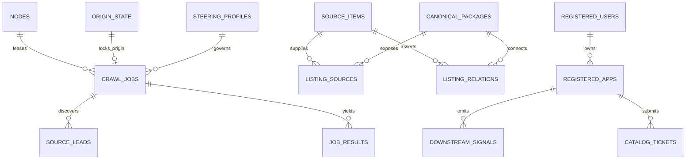

# Coordinator Cloudflare D1 Schema

> **Live Contract Status (`[P18]` / `[P19]`):** Version 0 live contract verified 1:1 against `src-worker/src/storage/d1/schema/` and local `wrangler dev` D1 (`v0-17`).  
> **Executable Authority:** `src-worker/src/storage/d1/schema/` (aggregated via `src-worker/src/storage/d1/utils.ts` `D1_SCHEMA_SQL`)  
> **Binding:** `VRCP_D1` (`src-worker/wrangler.toml`)  
> **Owning Sector:** Sector 1 (`crawler-network`)  
> **Inventory:** **17 tables**, **0 compatibility views**, targeted D1 Free Tier indexes

This document defines the 1:1 Version 0 schema contract for the Cloudflare D1 coordinator database. Each subsection matches one module inside `src-worker/src/storage/d1/schema/`. Legacy compatibility views and multi-version scrape history tables are retired to fit Cloudflare Free Tier write and query budgets.

## 1. Entity-Relationship Overview

## 2. Exact D1 Tables (17 Tables, 0 Views)

### 2.1 Node Workforce, Leasing, and Robots Plane (4 Tables)

Defined in `src-worker/src/storage/d1/schema/workforce_and_leasing.ts`. Pacing and heartbeat queries on `origin_state` must select explicit columns and omit `robots_body` to avoid oversized row reads.

| Table | Primary Key | Columns and Constraints |
| :--- | :--- | :--- |
| `nodes` | `node_id` | `token_hash`, `capabilities_json`, `revoked_at`, `last_seen_at`, `state` (`CHECK IN ('idle','fetching')`), `active_job_id` |
| `origin_state` | `origin` | `active_job_id` (FK `crawl_jobs`), `lease_expires_at`, `next_allowed_at`, `min_delay_ms`, `robots_snapshot_id`, `robots_status_code`, `robots_body`, `robots_fetched_at`, `robots_expires_at`, `refresh_lease_id`, `refresh_lease_expires_at` |
| `crawl_jobs` | `job_id` | `platform`, `url` (`UNIQUE`), `origin`, `state` (`CHECK IN ('pending','leased','done','backoff','blocked')`), `priority_lane` (`DEFAULT 3`, `CHECK IN (1,2,3,4)`), `recrawl_interval_ms`, `pagination_depth` (`DEFAULT 0`), `next_fetch_at`, `claimed_by` (FK `nodes`), `lease_id`, `lease_expires_at`, `etag`, `last_modified`, `created_at`, `robots_deferred_until`, `steering_profile_id`, `job_purpose` (`DEFAULT 'metadata'`, `CHECK IN ('discovery','metadata')`) |
| `job_results` | `lease_id` | `job_id` (FK `crawl_jobs`), `node_id`, `idempotency_key`, `request_digest`, `response_json`, `submitted_at` (TTL-pruned) |

### 2.2 Operator Governance Plane (3 Tables)

Defined in `src-worker/src/storage/d1/schema/operator_governance.ts`. Unifies source-access profiles and auto-promotion into `steering_profiles`, adds host/domain suppression to `suppressed_targets`, and drops all 10 legacy compatibility views.

| Table | Primary Key | Columns and Constraints |
| :--- | :--- | :--- |
| `operator_audit_log` | `action_id` (`INTEGER PK AUTOINCREMENT`) | `entity_type` (`CHECK IN ('node','lead','job','profile','suppressed_target','app','system')`), `entity_id`, `actor`, `action`, `reason`, `occurred_at` |
| `suppressed_targets` | `target` | `scope` (`CHECK IN ('url','origin','domain')`), `reason`, `suppressed_at` |
| `steering_profiles` | `profile_id` | `platform`, `host_match_mode` (`CHECK IN ('exact','wildcard_subdomain','any_vpm_https')`), `host_pattern`, `path_scope`, `query_mode` (`CHECK IN ('none','exact','pagination')`), `query_scope`, `method` (`CHECK (method='GET')`), `purpose` (`CHECK IN ('discovery','metadata')`), `auto_promote` (`INTEGER DEFAULT 0`, `CHECK IN (0,1)`), `recrawl_interval_ms`, `min_delay_ms`, `max_pagination_depth`, `expires_at`, `review_reference`, `reason`, `retain_classes_json` (`EvidenceClass[]`), `publish_classes_json` (`EvidenceClass[]`), `created_at`, `disabled_at` |

### 2.3 Observation Lake and Discovery Leads (2 Tables)

Defined in `src-worker/src/storage/d1/schema/observation_lake.ts`. Retains strictly latest observation snapshots, active issue flags, and grouped candidate leads per data-minimization and D1 write budgets.

| Table | Primary Key | Columns and Constraints |
| :--- | :--- | :--- |
| `source_items` | `source_key` | `platform`, `source_url`, `latest_digest`, `payload_json`, `observed_at`, `complete` (`DEFAULT 1`, `CHECK IN (0,1)`), `issues_json`, `contributor_node_id`, `submission_lease_id`, `steering_profile_id`, `gone_at` |
| `source_leads` | `lead_key` (SHA-256 of JSON identity tuple) | `discovered_from_url`, `discovered_from_job_id` (FK `crawl_jobs`), `discovered_from_item_key`, `kind`, `target_url`, `target_host`, `claimed_package_id`, `status` (`CHECK IN ('pending_review','approved','rejected')`), `first_seen_at`, `last_seen_at`, `first_seen_node_id`, `first_seen_lease_id`, `first_seen_profile_id`, `last_seen_node_id`, `last_seen_lease_id`, `last_seen_profile_id` |

### 2.4 Canonical Catalog Graph (4 Tables)

Defined in `src-worker/src/storage/d1/schema/catalog_graph.ts`. Stores atomic listings, merged identity/storefront sources, extensible relations, and inline delta tombstones (metadata scrubbed when withdrawn or deleted).

| Table | Primary Key | Columns and Constraints |
| :--- | :--- | :--- |
| `canonical_packages` | `canonical_id` | `umbrella` (`CHECK IN ('tools','assets','avatars')`), `category`, `lifecycle` (`CHECK IN ('active','deprecated','quarantined','delisted','deleted')`), `tombstone_reason` (`CHECK IN ('rating_withdrawn','deleted','delisted')`), `display_name`, `owner_key`, `owner_name`, `verification_status` (`DEFAULT 'unverified'`, `CHECK IN ('unverified','verified')`), `verified_by_app_id`, `vpm_id`, `vpm_latest_version`, `vpm_repo_url`, `summary`, `tags_json`, `quality_flags_json`, `attributes_json`, `created_at`, `updated_at`, `published_at`, `timestamp_confidence`, `content_rating` (`DEFAULT 'general'`) |
| `listing_sources` | `source_link_id` | `canonical_id` (FK `canonical_packages` `ON DELETE CASCADE`), `source_key` (FK `source_items` `ON DELETE CASCADE`), `platform`, `storefront_url`, `evidence_kind` (`CHECK IN ('vpm_id','repository_match','cross_storefront_link','curator_verified','simhash_match')`), `confidence` (`CHECK (confidence >= 0.0 AND confidence <= 1.0)`), `review_state` (`CHECK IN ('provisional','accepted','rejected')`), `price`, `currency`, `availability` (`DEFAULT 'available'`), `observed_at`, `reviewed_at`, `UNIQUE(canonical_id, source_key)` |
| `listing_relations` | `relation_id` | `source_key` (FK `source_items` `ON DELETE CASCADE`), `source_canonical_id` (FK `canonical_packages` `ON DELETE CASCADE`), `target_canonical_id`, `target_avatar_base`, `relation_type` (`CHECK IN ('compatible_with_avatar','depends_on','fork_of','related_product','same_owner')`), `scope` (`CHECK IN ('named_base','universal','uncertain','exact')`), `confidence`, `evidence_source`, `feedback_up_count` (`DEFAULT 0`), `feedback_down_count` (`DEFAULT 0`), `created_at`, `updated_at` |
| `coordinator_meta` | `key` | `value` |

### 2.5 Downstream Principals, Signals, and Tickets (4 Tables)

Defined in `src-worker/src/storage/d1/schema/downstream_and_tickets.ts`. Unifies demand telemetry with downstream relationship feedback in `downstream_signals`.

| Table | Primary Key | Columns and Constraints |
| :--- | :--- | :--- |
| `registered_users` | `user_id` | `user_name`, `token_hash`, `contact_email`, `created_at`, `revoked_at`, `age_verified` (`DEFAULT 0`), `is_moderator` (`DEFAULT 0`) |
| `registered_apps` | `app_id` | `app_name`, `token_hash`, `contact_email`, `permissions_json`, `created_at`, `revoked_at`, `request_count` (`DEFAULT 0`), `last_active_at`, `candidate_status` (`DEFAULT 'none'`, `CHECK IN ('none','review_pending','reviewed','trusted')`), `candidate_flags_json` (`DEFAULT '[]'`), `owner_user_id` (FK `registered_users(user_id)`) |
| `downstream_signals` | `signal_id` | `app_id` (FK `registered_apps`), `signal_type` (`CHECK IN ('search_miss','refresh_demand','popularity_signal','relationship_feedback')`), `query`, `zero_hits` (`DEFAULT 0`), `requested_platform`, `target_url`, `target_canonical_id`, `related_canonical_id`, `category`, `metadata_json`, `recorded_at`, `resolved_at` |
| `catalog_tickets` | `ticket_id` | `ticket_type` (`CHECK IN ('opt_out','delegated_claim','removal_report','rating_dispute','safety_quarantine','metadata_issue')`), `app_id` (FK `registered_apps`), `target_url`, `canonical_id`, `requester_type` (`CHECK IN ('unauthenticated_creator','user','admin_operator','app')`), `requester_id`, `creator_id`, `reason`, `proof_kind` (`CHECK IN ('storefront_bio_token','dns_txt','manual_notice','delegated_signature')`), `proof_value`, `contact_email`, `challenge_token`, `expires_at`, `nonce`, `signature`, `payload_json`, `review_status` (`DEFAULT 'pending'`, `CHECK IN ('pending','accepted','rejected')`), `review_notes`, `recorded_at` |

## 3. Exact Index Inventory

`D1_SCHEMA_SQL` binds only indexes required by priority claim selection, grouped lead review, owner lookups, delta streaming, and Free Tier scan avoidance:

| Table | Required Indexes |
| :--- | :--- |
| `nodes` | `idx_nodes_active(revoked_at, state, last_seen_at)` |
| `origin_state` | `idx_origin_state_refresh(origin, refresh_lease_expires_at)` |
| `crawl_jobs` | `idx_crawl_jobs_priority(state, priority_lane, next_fetch_at, platform)`, `idx_crawl_jobs_origin_due(origin, next_fetch_at, state)`, `idx_crawl_jobs_profile(steering_profile_id)`, `idx_crawl_jobs_claimed_state(claimed_by, state)` |
| `job_results` | `idx_job_results_submitted(submitted_at)` |
| `operator_audit_log` | `idx_operator_audit_log_entity(entity_type, entity_id, occurred_at)`, `idx_operator_audit_log_occurred(occurred_at DESC, action_id DESC)` |
| `suppressed_targets` | `idx_suppressed_targets_scope(scope, target)` |
| `steering_profiles` | `idx_steering_profiles_scope(platform, host_match_mode, purpose, disabled_at, expires_at)`, `idx_steering_profiles_page(created_at DESC, profile_id DESC)` |
| `source_items` | `idx_source_items_url(source_url)`, `idx_source_items_contributor(contributor_node_id, observed_at DESC)` |
| `source_leads` | `idx_source_leads_host(status, target_host, first_seen_at)`, `idx_source_leads_status(status, kind)`, `idx_source_leads_page(status, first_seen_at, lead_key)`, `idx_source_leads_target(target_url)` |
| `canonical_packages` | `idx_canonical_packages_owner(owner_key, updated_at DESC)`, `idx_canonical_packages_delta(updated_at ASC, canonical_id ASC)`, `idx_canonical_packages_created(created_at DESC, canonical_id DESC)`, `idx_canonical_packages_rating_updated(content_rating, updated_at DESC, canonical_id ASC)`, `idx_canonical_packages_category_rating(category, content_rating)` |
| `listing_sources` | `idx_listing_sources_canonical(canonical_id, review_state)`, `idx_listing_sources_source(source_key)`, `idx_listing_sources_storefront(storefront_url)` |
| `listing_relations` | `idx_listing_relations_source_canonical(source_canonical_id, relation_type)`, `idx_listing_relations_target(target_canonical_id, target_avatar_base)` |
| `registered_users` | `idx_registered_users_token(token_hash)` |
| `registered_apps` | `idx_registered_apps_token_hash(token_hash)`, `idx_registered_apps_candidate(candidate_status, request_count)`, `idx_registered_apps_owner(owner_user_id)`, `idx_registered_apps_page(created_at DESC, app_id DESC)` |
| `downstream_signals` | `idx_downstream_signals_platform(requested_platform, resolved_at)`, `idx_downstream_signals_relation(signal_type, target_canonical_id)` |
| `catalog_tickets` | `idx_catalog_tickets_nonce(app_id, nonce) WHERE nonce IS NOT NULL` (`UNIQUE`), `idx_catalog_tickets_review(ticket_type, review_status, recorded_at, ticket_id)`, `idx_catalog_tickets_canonical(canonical_id)`, `idx_catalog_tickets_target_url(target_url)` |
