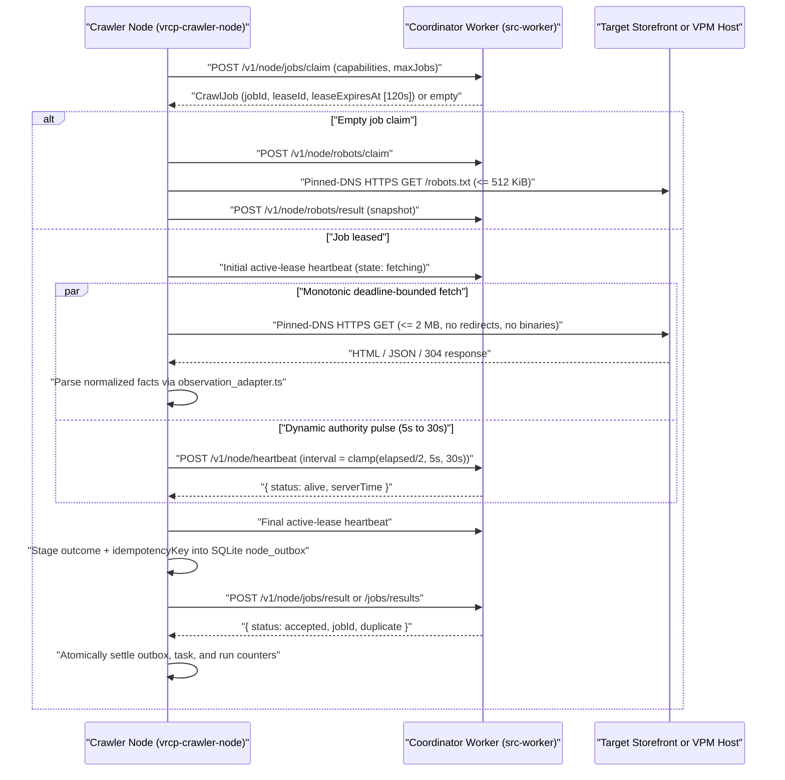

# Headless Crawler Node Specification (`src-crawler/`)

> **Executable Entry Point:** `src-crawler/src/main.ts` (Bun-compiled binary `vrcp-crawler-node`)  
> **Owning Sector:** Sector 1 (`crawler-network`)  
> **Related Schemas:** [`crawler_node_sqlite.md`](../schemas/crawler_node_sqlite.md), [`logging_and_telemetry.md`](../schemas/logging_and_telemetry.md), [`wire_and_protocol_contracts.md`](../schemas/wire_and_protocol_contracts.md)

The Crawler Node is a headless, continuously running daemon designed for Linux VPS / Docker fleets and Windows local development. It fetches public metadata strictly under unexpired Coordinator leases and has no embedded coordinator binary or interactive CLI setup commands (`R16-C19`).

## 1. Execution Lifecycle and Dynamic Heartbeat Sequence

## 2. Verified Runtime Bounds (`daemon.ts`, `lease_runner.ts`, `node_client.ts`)

| Subsystem | Live Executable Constant / Rule |
| :--- | :--- |
| **Fixed lease deadline** | Coordinator issues `120_000 ms` (120s) leases; runner enforces an independent monotonic deadline adjusted by `clockOffsetMs` from `serverTime` and aborts fetching/staging on expiry (`R13-C9-LEASE-DEADLINE`). |
| **Active lease heartbeat** | Scales dynamically between **`5_000 ms` and `30_000 ms`**: origin EMA (`0.7 * prev + 0.3 * durationMs`) seeds initial interval `clamp(round(avg / 2), 5s, 30s)`; in-flight timer reschedules via `min(30s, max(5s, round(elapsed / 2)))`. |
| **Idle heartbeat** | `30_000 ms` (30s) inside `daemon.step()`. |
| **Idle backoff ladder** | `minIdleDelayMs = 5_000`, `maxIdleDelayMs = 60_000`, `idleBackoffMultiplier = 1.5`, `jitterRatio = 0.2`, clamped to `[base, ceiling]`. Resets immediately when jobs are leased. |
| **Delegated robots preflight** | Wired in `daemon.ts` when `claim.status === "empty"`: calls `claimRobotsRefresh()` -> `retrieveRobotsSnapshot()` -> `submitRobotsResult()`. |
| **Coordinator HTTP transport** | `maxRetries = 2`, `retryBaseDelayMs = 250` (cap `2_000 ms`), claim/result timeout `30_000 ms`, heartbeat timeout `5_000 ms`, **`MAX_COORDINATOR_RESPONSE_BYTES = 2 MiB`** (checked via `Content-Length` and streaming reader), manual redirect rejection (3xx rejected). |
| **Public metadata fetch transport** | `public_metadata_fetch.ts`: `MAX_METADATA_BYTES = 2_000_000`, pinned DNS + `isPrivateOrReservedIp` SSRF guard, `accept-encoding: identity`, HTTPS port 443 `GET` only, zero redirects, binary URL/MIME rejection. |
| **Durable SQLite outbox** | `maxPendingOutboxQuota = 1_000`, `outboxTtlMs = 24h`, prune every `1h`, batch flush up to `50` in chunks of `10` (`MAX_BATCH_RESULTS`). |

## 3. Configuration and Docker Fleet Deployment

### Environment Variables (`runtime_config.ts`, `main.ts`, `logger.ts`)
- **Required**: `NODE_TOKEN` (`vrcp_<64-hex><4-hex>`).
- **Optional**: `NODE_ID`, `COORDINATOR_URL` (default `http://127.0.0.1:8787`), `NODE_CAPABILITIES` (default all 10 platforms), `NODE_DB_PATH` (default `<cwd>/node.db`), `NODE_CONFIG_PATH` (default `<cwd>/node.config.json`, max 64 KiB), `CRAWLER_LOGS_DIR`, `DEBUG` / `LOG_LEVEL=debug`, `GITHUB_TOKEN` / `GH_TOKEN`.

### Docker Compose Fleet Invariants (`src-crawler/docker-compose.yml`)
- Pin container images strictly by immutable digest (`VRCP_NODE_IMAGE`).
- Mount an isolated persistent data volume per node (`node-data-1:/app/data`) to prevent SQLite write locks; set `CRAWLER_LOGS_DIR=/app/data/logs`.
- Automated host-socket updaters (Watchtower) and host Docker socket mounts are permanently prohibited (`FLEET-S3`).
