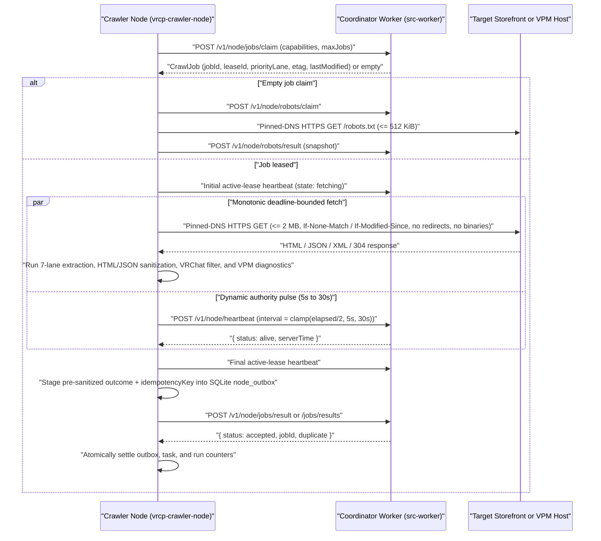

# Headless Crawler Node Specification (`src-crawler/`)

> **Target Blueprint Status (`[P18]` / `PN-009`, updated `[P19]` / `PN-010`):** Owner-approved Version 0 target contract (2026-11-24). Supersedes pre-rewrite live implementation until Stage 5-6 code slices verify 1:1 parity.  
> **Executable Entry Point:** `src-crawler/src/main.ts` (Bun-compiled binary `vrcp-crawler-node`)  
> **Owning Sector:** Sector 1 (`crawler-network`)  
> **Related Schemas:** [`crawler_node_sqlite.md`](../schemas/crawler_node_sqlite.md), [`logging_and_telemetry.md`](../schemas/logging_and_telemetry.md), [`wire_and_protocol_contracts.md`](../schemas/wire_and_protocol_contracts.md)

The Crawler Node is a headless daemon for Linux VPS or Docker fleets and Windows local development. It fetches public metadata strictly under unexpired Coordinator leases across 9 atomic platforms (with `"curated"` purged). It has no embedded coordinator binary or interactive CLI setup commands.

## 1. Execution Lifecycle and Dynamic Heartbeat Sequence

## 2. Verified Runtime Bounds and Seven-Lane Discovery Pipeline

| Subsystem | Blueprint / Live Constraint |
| :--- | :--- |
| **Fixed lease deadline** | Coordinator issues `120_000 ms` (120s) leases. Runner enforces a monotonic deadline adjusted by `clockOffsetMs` from `serverTime` and aborts fetching on expiry. |
| **Active & idle heartbeats** | Active heartbeats scale dynamically between `5_000 ms` and `30_000 ms` from origin EMA duration. Idle heartbeats run every `30_000 ms`. |
| **Idle backoff ladder** | `minIdleDelayMs = 5_000`, `maxIdleDelayMs = 60_000`, `idleBackoffMultiplier = 1.5`, `jitterRatio = 0.2`. Resets when Coordinator leases a job. |
| **Seven preview discovery lanes** | (1) `vpm` lead feeds (`vcc://vpm/addRepo?url=...`, JSON/text lists, VPM `index.json`). (2) `booth` browse pagination (`/ja/items/{id}`). (3) `gumroad` VRChat discover and storefronts. (4) `jinxxy` sitemap and browse under RFC 9309, polite pacing, and instant kill-switch (pre-prod Sector 5 outreach stays mandatory). (5) `itch` tag browse (`/tools/tag-vrchat`, `tag-udon`, `tag-vrchat-avatar`, `/search` hard-blocked). (6) `shopify` product sitemaps and HTML metadata. (7) `github` public REST API (`/repos/{owner}/{repo}` including `topics`). |
| **Node-offloaded pipeline order** | (1) Resolve relative links with `job.url`, decode numeric and named entities, and strip raw HTML in `cleanDescription`. (2) Extract avatar compatibilities BEFORE stripping decorative brackets from `displayName`. (3) Select the highest SemVer VPM version (`compareVpmVersions`), omit `.zip` binaries from `outboundLinks`, and compute deterministic `qualityFlags` (`skeleton`, `fork_suspected`, `missing_release`, `incomplete_metadata`, `missing_zip_sha256`). (4) Extract storefront `price`, `currency`, `availability`, `storefrontUrl`, `platformTags`, `desktopToolEvidence`, and `vrchatRelevance`. (5) Cap and paginate multi-page discovery via `nextPageLead` (`<= maxPaginationDepth`) instead of failing >100-link pages. |
| **HTTP transport & code hygiene** | Pinned DNS + `isPrivateOrReservedIp` SSRF guard, HTTPS 443 `GET` only, zero redirects, binary block, and `2_000_000` byte cap. Set platform-matched `Accept` headers (`text/html` for Shopify metadata vs `application/xml` for sitemaps). Move `.env` token loading from `observation_adapter.ts` to `runtime_config.ts` and remove unused `@trybyte/robotstxt-parser` from `src-crawler/package.json`. |
| **Durable SQLite outbox** | `maxPendingOutboxQuota = 1_000`, `outboxTtlMs = 24h`, prune every `1h`, batch flush up to `50` in chunks of `10` (`MAX_BATCH_RESULTS`). |

## 3. Configuration and Docker Fleet Deployment

### Environment Variables and CWD Containment (`runtime_config.ts`, `main.ts`, `logger.ts`)

- **Strict CWD containment (`NODE-CWD-CONTAINMENT`)**: All node outputs (`node.db`, `-wal`/`-shm`, `logs/latest.log`, `logs/archive/`, `node.stop`, `node.config.json`, `.env`) stay strictly inside the node working directory (`process.cwd()`) for source runs and compiled binaries.
- **Required**: `NODE_TOKEN` (`vrcp_<64-hex><4-hex>`). Capabilities decode strictly from the Coordinator-issued token suffix (`9` atomic platforms, `0x01ff`) with zero manual registration picking.
- **Optional**: `NODE_ID`, `COORDINATOR_URL` (default `http://127.0.0.1:8787`), `NODE_DB_PATH` (default `<cwd>/node.db`), `NODE_CONFIG_PATH` (default `<cwd>/node.config.json`, max 64 KiB), `CRAWLER_LOGS_DIR` (default `<cwd>/logs` via `path.resolve(process.cwd(), "logs")`), `DEBUG` or `LOG_LEVEL=debug`, `GITHUB_TOKEN` or `GH_TOKEN`.

### Docker Compose Fleet Invariants (`src-crawler/docker-compose.yml`)

- Pin container images strictly by immutable digest (`VRCP_NODE_IMAGE`).
- Mount an isolated persistent data volume per node (`node-data-1:/app/data`) to prevent SQLite write locks. Set `CRAWLER_LOGS_DIR=/app/data/logs`.
- Automated host-socket updaters (Watchtower) and host Docker socket mounts remain permanently forbidden.
